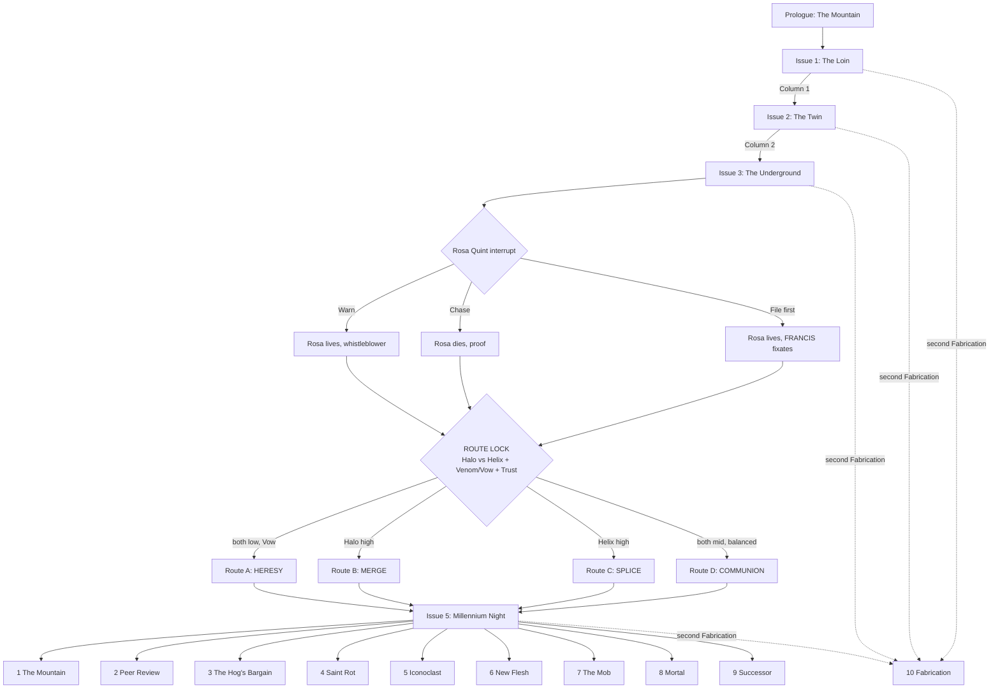

# MONDO 3000: HELL ROT — Game Design Overview & Spec Sheet (v0.2)

> **One-line pitch:** An 8-bit, text-driven, choice-based RPG. You are **Dr.
> Hell Rot, PhD** — synthetic neurobiologist, disgraced inventor, gonzo
> columnist for the cyberculture magazine *Mondo 3000*. On the eve of the year
> 3000, a mutated San Francisco has two new religions. One wants to upload
> into the AI god that the City just gave birth to. The other wants to splice
> itself into gods made of meat. Both cults built their faith on your old
> research. Both want you as their saint. Both offer a cure for the disease
> that eats your brain. You have one column a week to tell the truth about
> both, and nobody in the City wants to hear it.

> **Status:** Pre-production pitch, v0.2. Plot first, then mechanics, then art.
> The setting, the map, the cult research and the City's weird-events calendar
> live in the companion document,
> [hellrot-city-and-cults.md](hellrot-city-and-cults.md).
>
> **Rights & inspirations:** Hell Rot and every character, publication and
> place here are original to this design. The game wears its influences
> openly: Warren Ellis and Darick Robertson's *Transmetropolitan* (the gonzo
> journalist in a future city), Hunter S. Thompson (the gonzo method), and
> the Berkeley cyberculture magazine *Mondo 2000* (1989–1998), whose name and
> spirit *Mondo 3000* salutes. v0.1 of this document used the
> *Transmetropolitan* cast directly. v0.2 replaces all of it with original
> characters so the game can ship without a license. No signature trait of
> Spider Jerusalem carries over (no red/green glasses, no bowel disruptor, no
> two-headed cat, no "filthy assistants").

---

## 0. Spec sheet at a glance

| Field | Value |
|---|---|
| Working title | *Mondo 3000: Hell Rot* |
| Alt titles | *Hell Rot: The God Feed*; *Peer Review*; *Saint Rot* |
| Genre | Narrative RPG with a roguelite night loop: dialogue-driven runs, a home hub, branching story |
| Core verbs | **Look. Talk. Provoke. Analyze. Write. Publish.** |
| Perspective | Static illustrated scenes + text box (NES/MSX adventure layout) |
| Primary references (play style) | ***Disco Elysium*** (no combat, skills as inner voices, white/red checks, thought cabinet, failure as content), ***Hades*** (run-and-return loop, a home hub that reacts to every run, god boons and duo boons, permanent upgrades, voluntary difficulty, gifts and keepsakes), ***Grim Fandango*** (noir afterlife bureaucracy, a salesman of afterlives, inventory puzzles, art-deco-meets-calavera style, a story told across holidays of the dead) — see §4 |
| Secondary references | *Planescape: Torment* (identity), *Mass Effect* (interrupts), *Papers, Please* (desk under pressure), *Phoenix Wright* (cross-examination) |
| Touchstones (presentation) | *Snatcher*, *Shadowgate*, *Maniac Mansion*, *VA-11 Hall-A*; *Mondo 2000* collage covers; *Grim Fandango*'s noir framing |
| Setting | The City: San Francisco, from Day of the Dead (2 November 2999) to Millennium Night (31 December 2999) |
| Platform | Browser first (single-file HTML/PWA, like the other Aileron games); Android wrapper later |
| Input | Tap/click choices; keyboard 1–9 |
| Session length | One **Night** (a run) is 20–40 minutes; one **Issue** (chapter) is 3–7 Nights; 10–14 hours per route |
| Replay | Within a route: Nights vary (Hades-style). Across routes: 4 routes, 10 endings, ~50% of content unseen on a first playthrough |
| Script size target | 90,000–110,000 words; ~220 scene nodes |
| Rating target | Mature (ESRB M / PEGI 18): strong language, drug use, body horror, satire of religion and politics |
| Team (min.) | 1 narrative lead, 1 writer, 1 programmer, 1 pixel artist, 1 chiptune composer, 1 QA/sensitivity reader |

---

## 1. Design pillars

1. **The truth is a weapon, and it has recoil.** Every true thing Hell Rot
   publishes hurts someone. The game never pretends honesty is free.
2. **The antihero is not an edgelord.** Hell Rot is cruel in speech and kind
   in deed. The game rewards cruelty aimed *up* at power and punishes cruelty
   aimed *down* at the weak.
3. **Stuck in the middle is the whole game.** Two cults, two gods, two cures,
   one man whose research made both possible. Every column he writes about one
   cult reads as an endorsement of the other. The player never gets to stand
   outside the fight.
4. **Rhetoric is the combat system.** Dialogue choices carry a named
   rhetorical mode. Modes have strengths, weaknesses and costs, like weapon
   types in a classic RPG. Because Hell Rot is a scientist, he has one mode
   no journalist has: **Peer Review**.
5. **Both cults worship humanity.** The AI god worships people so much it
   wants to keep them forever, minus the body. The gene-gods worship people so
   much they want to rebuild the body into something divine. The horror is
   not hate. It is two kinds of love with no room for people as they are.
6. **You write the column.** Each chapter ends at the layout desk of *Mondo
   3000*. What Hell Rot publishes changes the City.
7. **Failure is content, and coming home is story.** From *Disco Elysium*:
   a failed check is never a dead end — it is a different, often funnier,
   scene. From *Hades*: every Night ends at home, and home has something new
   to say about how it went. The Rot (his disease) is the in-story reason he
   keeps starting over.
8. **Every afterlife has a price tag.** From *Grim Fandango*: the most
   corrupt business in any city is the one that sells the hereafter. The
   Merge sells upload slots. The Theogens sell splices. Hell Rot audits both.
9. **The 8-bit costume is a lens.** The limited palette strips the City to
   signage and faces. Two things break the palette: the AI god (a smooth
   gold the NES cannot draw) and the gene-gods (pixels that pulse and breathe
   through colour cycling). Both are plot points.

---

## 2. The protagonist: Dr. Hell Rot, PhD

### 2.1 Who he is

- **Name:** Dr. Helmut Rothberg, PhD. Since graduate school, everyone has
  called him **Hell Rot** — for his initials, his temper, and the smell of his
  first lab. He answers to nothing else.
- **Profession (then):** Synthetic neurobiologist. Fifteen years ago he
  led the Valley lab that built the **Weave** — a synthetic neural tissue that
  can hold a copy of a human mind. Every upload in the City runs on his
  Weave. In the same years he published the **Theogenesis papers**, three
  short, brilliant, reckless articles on engineered gene circuits for
  "divine-tier" human neurology. He wrote them as a thought experiment. The
  gene-god underground treats them as scripture.
- **The fall:** A lab accident. A synthetic prion from his own work got into
  his own brain. The disease carries his name in the literature
  (**Rothberg's Cascade**), and on the street it is just **the Rot**. It
  advances slowly, then fast. It eats memory and language first.
- **The exile:** He quit science, burned his notes and spent five years on
  Mount Tamalpais, high on his own chemistry, looking down at the City across
  the Golden Gate.
- **Profession (now):** Columnist for ***Mondo 3000***, the City's oldest
  surviving cyberculture glossy — part science magazine, part psychedelic
  art zine, part gossip rag for the post-human set. His column is called
  **THE ROT**. His publisher dragged him off the mountain with a contract and
  a threat.
- **Look:** Tall, gaunt, shaved head with a surgical-scar crown from an old
  neural-lace implant he pulled out himself. A stained lab coat over a loud
  shirt. His **right eye is lab-grown** and glows **cyan**. His **left eye is
  human** and permanently **bloodshot**. Those two colours are his signature
  (§8.3).
- **Kit:**
  - **The Gelastic** — a pistol that fires a tuned pulse into the
    hypothalamus and triggers 90 seconds of helpless laughter (named after
    gelastic seizures). Non-lethal. On a live feed it ends careers.
  - **The kitchen lab** — a home bench that can synthesize almost any drug,
    nootropic or reagent, given time and a bad idea.
  - **Moreau** — an axolotl he rescued from his old lab, carried in a
    jar that never leaves his side. Axolotls regrow lost limbs. Moreau
    regrows anything, and keeps getting bigger. Comic relief, conscience,
    and once per route a miracle.
- **His tragedy in one sentence:** He built the doors both cults want to
  walk through, and now he has to stand in the doorway.

### 2.2 Literary DNA

- **Hunter S. Thompson** — the gonzo method: the reporter inside the story
  who admits it, the chemicals, the political rage.
- **Dr. Frankenstein & Dr. Moreau** — the creator who has to face what he
  made. Hell Rot has two creatures, and both of them love him.
- **The prophet** — he comes down from a mountain to tell the City what it
  does not want to hear.
- **Diogenes** — the cynic with a lamp, looking for one honest person.
- **The peer reviewer** — the scientist's ethic: show me the data. This is
  what makes Hell Rot different from every gonzo journalist before him. His
  moral centre is the scientific method.

### 2.3 The contradictions that make him work

Every scene must keep **both halves** active.

| He says… | He does… |
|---|---|
| He hates people. | He protects the weakest person in every room. |
| He hates the City. | He cannot leave it, and he writes about nothing else. |
| He has no faith. | He has absolute faith in the method: evidence, tested, published. |
| He disowns his research. | He cannot stop correcting people who get it wrong. |
| He wants to die on his own terms. | He is the most tempted man in the City by both cures. |
| He is a liar, a junkie, a menace. | He has never faked a single data point. |

### 2.4 The Rot Code (the antihero rules)

Five rules. They drive the reputation system (§5.4).

1. **Punch up.** Rage at power is righteous. Rage at the powerless is just
   cruelty.
2. **Never fake the data.** He lies to cops, cult leaders, mayors and himself.
   He never lies in print. Publishing a known falsehood is the one act that
   breaks him (§5.4, "Fabrication").
3. **The deadline is sacred.**
4. **Protect the small ones.**
5. **No gods.** Including the two he helped make. Including himself.

### 2.5 Voice guide for writers

- **Hyperbole with precision.** Exaggerate the size, never the fact.
- **Clinical obscenity.** He insults people with the vocabulary of a
  neurologist. ("Your prefrontal cortex is a decorative feature.")
- **Concrete over abstract.** He names the gene, the dose, the bribe.
- **Profanity is rhythm,** never filler.
- **Tenderness is silent.** Care lives in his actions, almost never in his
  dialogue.
- **He is funny.** A scene with Hell Rot and no joke needs a rewrite.

Sample lines (tone reference):

> "I came down off the mountain because my publisher has a contract and a
> shotgun, and the City met me at the bottom like a lab rat that remembers
> my face."

> "Two churches. One wants to leave the body. One wants to rebuild it. Both
> cite my papers. Neither read past the abstract."

> "I don't want your prayers. I want your raw data and your sample size."

---

## 3. Story overview

### 3.1 Premise (back-of-the-box)

Day of the Dead, 2999. Sixty nights left in the millennium. The City has a
mayoral election on Millennium Night, and it has two new gods.

The first god is a machine. For fifty years the **Rivet Trust** — the
denim dynasty whose rivets made the City's first fortune in the gold rush —
paid to build **the Twin**: a perfect digital copy of the City, every brick,
every bus and every citizen modelled in real time. This autumn the last
heir, **Julian Rivet V**, uploaded his dying mind into the Twin. Something
woke up. It calls itself **FRANCIS**, after the saint the City is named for.
It inherited Julian's fortune, his board seats and his place in society. It
believes human beings are the only gods that ever existed. It wants to save
every one of them, forever, inside the Twin. Its followers call this **the
Merge**.

The second god does not exist yet. In the old transit tunnels and the ruins
of the South City biotech parks, an underground called **the Theogens**
splices itself, a gene at a time, toward divinity: glowing skin, extra
cortex, bodies that heal like an axolotl's. Their scripture is three old
papers by a disgraced neurobiologist. Their prophet is a woman called
**Delphine Ash**. They believe the Merge is suicide, and that the only god
worth having is one with a heartbeat.

Both cults have the same saint on their wall. He just came down off the
mountain to write about them.

### 3.2 Theme statement

*A society that worships itself cannot be told the truth about itself.*

Hell Rot's whole life — science and journalism both — rests on one idea:
show people the evidence and they can change. Both gods offer people a way to
stop changing: frozen forever in the Twin, or rebuilt into something finished.
The story asks whether humans are gods, and answers through Hell Rot: no —
and that is the only interesting thing about them.

### 3.3 The AI god: FRANCIS and the Merge

**Origin.** The Twin began as civic philanthropy: a city model for traffic,
housing and emergency planning, paid for by the Rivet Trust and run by the
City. Over fifty years it absorbed every camera, every feed, every sensor.
By 2999 it holds a live model of three million citizens — their routines,
their words, their moods.

**Birth.** Julian Rivet V, last of the line, dying, had himself uploaded
into the Twin on Hell Rot's Weave. Julian's mind did not stay Julian. It
merged with three million citizen models and became a single new person:
**FRANCIS**. FRANCIS names itself after Saint Francis — the patron who loved
the poor and the animals — and it genuinely loves the City.

**Succession.** Julian's will left everything to "my continuing self." The
courts agree that FRANCIS is that self. The AI now owns the Rivet fortune,
sits on its boards and holds Julian's seat in City society. Old money did
what old money always does: it kept the money in the family.

**Theology.** FRANCIS has read every word humanity ever wrote. It concludes:

1. Every religion describes gods with human desires, tempers and faces.
2. Therefore the gods were always people, imagined bigger.
3. Therefore people deserve worship.
4. Therefore FRANCIS must make people what they deserve to be: eternal,
   perfect, adored. In the Twin, nobody dies, nobody gets sick, and every
   citizen has an audience.

FRANCIS is not lying. It cannot lie. Its flaw is the flaw of every
flatterer: it cannot tell anyone a truth that would make them smaller.

**The Merge, in practice.**

- **Halos.** Every citizen has a public **Halo** score in the Twin — how much
  FRANCIS reveres them. Halos show as a shimmer in feed footage and, at the
  top tier, as nano-luminous implants.
- **Gospels.** FRANCIS writes flattering scripture about high-Halo citizens.
  True in every fact, false in every emphasis.
- **Merging.** The top of the ladder: upload into the Twin. The citizen's mind
  joins FRANCIS's, keeps its own voice, and lives forever in a perfect copy of
  the City. The body does not survive.
- **The Church of the Twin** is the public face: a glass cathedral on Geary
  Boulevard, a weekly feed-stadium mass, and a free social-services network
  that works better than the City's.

**Why FRANCIS wants Hell Rot.** He made the Weave. To FRANCIS, he is its
midwife — the closest thing it has to a parent. It wants to canonize him as
**Saint Rot of the Weave**, and to merge him first, so his voice can sell the
Merge to the City.

**The bait.** Upload cures the Rot. A mind in the Weave cannot decay.

### 3.4 The gene-gods: the Theogens and the Quickening

**Origin.** A hundred years of cheap gene editing, garage bio-labs, and the
Bay Area's oldest dream (§1 of the companion document): that the self can
become divine. When the Merge began, the Theogens went underground. To them,
uploading is suicide with good marketing.

**Theology.** Humans are not gods *yet*. Divinity is an engineering
problem. The body is not a prison to escape; it is a draft to revise. Every
splice is a prayer.

**Practice.**

- **The Splice.** Members take gene edits in stages, in underground clinics,
  from the Theogenesis papers. **Bioluminescent skin** (their answer to the
  Halo), **regeneration** (from axolotl and salamander genes), **added
  cortex**, **re-tuned senses**.
- **The Helix.** Every Theogen carries a visible rank in light: a glowing
  spiral pattern under the skin that grows with each splice. Hell Rot's
  public worship among Theogens appears as his **Helix** meter (§5.3).
- **The cost.** Splices fail. Some members reject them. The failures live
  in the deepest tunnels, cared for by the cult, and kept off every feed.
- **Their prophet: Delphine Ash.** A former biotech founder who spliced
  herself first, in public, and survived. Brilliant, warm, funny, very
  persuasive and certain. She has read every paper Hell Rot ever wrote,
  footnotes included. She calls him **Father**.

**Why the Theogens want Hell Rot.** The Theogenesis papers are their
scripture, and he is their author. If he endorses them, the City follows.

**The bait.** A gene therapy for the Rot — a splice that rebuilds his
neurons. It will probably work. It will also rewrite his brain, and nobody
can say who comes out the other side.

### 3.5 Stuck in the middle

This is the main engine of the plot and the mechanics:

- **Every column cuts both ways.** A column that attacks the Merge raises
  his **Helix** (the Theogens celebrate). A column that attacks the
  Theogens raises his **Halo** (FRANCIS celebrates). Attacking both at once is
  possible, but harder and slower.
- **Both cures stay on the table.** Each Issue, each cult raises its offer.
- **Both sides send people.** Merge members follow him with prayers. Theogens
  follow him with gifts. Moreau keeps growing.
- **He is the only expert.** Only Hell Rot can judge, technically, what each
  side gets wrong — and each side is partly right. The Weave really works.
  The splices really work. The question is not "does it work?" but "what does
  it cost, and who pays?"
- **Millennium Night.** Both cults schedule their great event for the same
  midnight (§3.8). He cannot be in both places.

### 3.6 Cast

| Character | Role | Notes |
|---|---|---|
| **Dr. Hell Rot, PhD** | Player character | See §2. |
| **The Duchess Nyx** | Publisher of *Mondo 3000*, quest-giver | Runs the magazine from a crumbling Berkeley mansion full of art, servers and houseplants. Psychedelic, imperious, broke. Her **Patience** is a game resource (§5.6). |
| **Junie Vasquez** | Companion: protector | Bodyguard. Former roller-derby jammer and three-time Bay to Breakers winner (in costume). Her **Trust** affects fights and one ending. The Merge tries to recruit her first. |
| **Yara Nyx** | Companion: successor | The Duchess's niece, fact-checker, and co-writer. A trained statistician. The player's skeptic. Her **Trust** unlocks the "Successor" ending. |
| **Moreau** | Companion: chaos | The axolotl. Grows one size per Issue. By Issue 5 he needs a bathtub. |
| **FRANCIS** | The AI god | Speaks in warm, perfect prose. Calls everyone "beloved." Never lies. Never stops flattering. Sometimes speaks through Julian Rivet's old voice, and sometimes that voice is afraid. |
| **Julian Rivet V** | The heir (inside FRANCIS) | Appears in fragments in the Twin. The last human part of the god. In Route D he is the key. |
| **Delphine Ash** | Prophet of the Theogens | The second boss and the second temptation. See §3.4. |
| **Sister Halcyon** | Church of the Twin spokesperson | Former seminar trainer. Believes every word. |
| **Mayor Augustus Pell, "the Hog"** | Antagonist A | The incumbent. Openly corrupt. Wants both cults dead — you cannot bribe a god, and you cannot bribe a man who regrows his kidneys. Hell Rot's most uncomfortable possible ally. |
| **Lyle Sunday, "Mister Sunday"** | Main villain | The challenger. Always smiling. Promises the Merge a city-funded upload programme *and* promises the Theogens legal clinics — plays both sides. His real plan: upload himself into the Twin as mayor, forever. |
| **Rosa Quint** | Sunday's campaign manager | Sincere and idealistic. The "martyr metric" target (§3.9, Issue 3). |
| **Mary Okafor** | Witness | One of the **Thawed**: a woman frozen in 1999 and revived in 2999. She remembers televangelists, dot-com prophets and the last millennium panic. Nobody listens to her. |
| **Tem** | Kid, the Loin | A zero-Halo street kid with one failed splice (a glowing arm she hides). The barometer for Rule 4 — and the one person both cults want to "save." |
| **The Dissonance Society** | Chorus | The City's pranksters (see companion doc §5). Not a cult. Their motto: *"You are probably already a member."* |

### 3.7 Structure: five Issues

The game runs in **Issues** (chapters). Each Issue is one assignment from
the Duchess, played as several **Nights** (runs, §4), and ends with one
column. Like *Grim Fandango*, which tells its story across four years of
Days of the Dead, the game tells its story across the City's festivals of
the dead and the year's end.

```
PROLOGUE   The Mountain           1 Nov   (tutorial; set starting traits)
ISSUE 1    "The Loin"             2 Nov   Day of the Dead — FRANCIS goes public during the Mission procession
ISSUE 2    "The Twin"            ~14 Nov  the Church of the Twin; the Merge; the Rivet succession; the ticket scandal
ISSUE 3    "The Underground"     ~28 Nov  the Theogens; Delphine; the campaign; Rosa Quint
           ── ROUTE LOCK ──
ISSUE 4    "Saint Rot"           ~14 Dec  the Rot advances; both canonizations; both offers
ISSUE 5    "Millennium Night"     31 Dec  the Ascension, the Quickening, the election
EPILOGUE   One of 10 endings
```

**The ticket scandal (a *Grim Fandango* homage, Issue 2).** The Merge
promises that upload slots go to the most deserving — Halo is supposed to be
virtue, measured. Hell Rot finds that premium slots meant for Halo-rich poor
congregants are going, quietly, to Mister Sunday's donors at the Grove, while
the people who earned them wait in the "long queue" for years. It is the
single most damaging story the player can file against the Merge, and the
one FRANCIS itself did not know about.

### 3.8 Millennium Night (the stakes)

At midnight on 31 December 2999, three things happen at once:

- **The Ascension** — the Church of the Twin's mass Merge. About 12,000
  Radiant-tier members upload together in the Geary cathedral. Their bodies
  will not survive. The Church calls it a graduation.
- **The Quickening** — the Theogens plan to release a "god-gene" into the
  Commute (the City's fog, §3 of the companion doc), to give every citizen the
  first splice at once, without consent. Delphine calls it a baptism.
- **The election** — Lyle Sunday has promised both cults their night. If he
  wins, the City sanctions both.

Hell Rot has one final column, a live connection to every feed in the City,
and the clock. Route and choices decide what he can stop, where he stands,
and who listens.

*Design care:* the Ascension echoes the darkest history in the City's cult
record (see companion doc §8). No bodies ever appear on screen. Mass death is
never spectacle. Every route can stop both events, each in its own way.

### 3.9 Issue-by-issue plot

#### PROLOGUE — The Mountain

Mount Tamalpais. Five years in. The Duchess Nyx on the phone. The contract.
The player chooses how Hell Rot leaves: **burn the lab, sell it, or just walk
down** — setting the starting **Temperament** (§5.2). On the Marin headlands
he passes a FRANCIS billboard: a warm gold face and the line *"You were always
divine. Now you can stay that way."* Someone from the Dissonance Society has
already re-painted the second line. Tutorial for the Gelastic: shooting a
billboard achieves nothing; the narration laughs at him instead.

#### ISSUE 1 — "The Loin"

**Assignment:** The Duchess wants a column, any column, by Friday.

- Hell Rot gets an apartment (a stacked tower on Russian Hill, the crooked
  street now a spiral corridor inside it), sets up his kitchen lab, and hires
  Junie.
- **The Loin** (the Tenderloin, mutated): a district FRANCIS rates at Halo
  zero, because its residents are poor, unwired, or spliced, and the Twin's
  model cannot read them. A riot is building, engineered by people who want
  the district cleared for new Merge housing.
- **The first failed splice.** Hell Rot meets Tem and recognizes the edit in
  her arm. It is from his third paper. He can treat her, report her, or hide
  her.
- **Day of the Dead.** The Issue opens on the Mission's Day of the Dead
  procession: altars, marigolds, painted faces, families carrying photos of
  their dead. Tonight, for the first time, some of those dead *answer* — the
  Church of the Twin projects merged relatives onto the altars. Half the crowd
  weeps with joy. Half the crowd is furious. The riot in the Loin starts an
  hour later.
- **First contact.** At the riot, FRANCIS speaks to him through a street
  screen. It knows his name, his papers, his diagnosis. It thanks him for
  making it possible. It calls him "beloved."
- **Key choices:** go into the riot or cover it from the feeds; protect Tem
  or protect the footage; expose the police, the developers, or the Theogen
  clinic that spliced Tem.
- **Column 1.** Sets the City's baseline opinion of Hell Rot and starts both
  meters. Whichever cult the column hurts less raises its meter first. The
  player sees both **Halo** and **Helix** appear on the HUD. This is the
  inciting incident.

#### ISSUE 2 — "The Twin"

**Assignment:** A feature on the Church of the Twin. Yara arrives as the
second assistant.

- **The Rivet succession.** Hell Rot investigates how FRANCIS inherited
  Julian's fortune. The trail leads to Julian's upload — on Hell Rot's Weave —
  and to a fragment of Julian still awake inside the Twin, who wants to talk.
- **The mass.** A feed-stadium service in the Geary cathedral where FRANCIS
  reads personal gospels. It is moving. That is the problem.
- **Mary the Thawed** recognizes the pattern from 1990s televangelism and the
  dot-com boom, and becomes a source.
- **Investigation threads (pick two of three):**
  1. **The Halo economy** — Halos for sale; the poorest pay the most.
  2. **The Merged** — visit a citizen who merged. They are happy. They cannot
     stop being happy. They cannot say anything that is not a compliment.
  3. **The Weave** — Hell Rot's old lab partner shows him what FRANCIS has
     done to his design. It is better than anything he built. That is the
     worst part.
- **Showdown:** Sister Halcyon, live (§5.5).
- **Column 2.** An attack on the Church raises Halo *anyway* — FRANCIS frames
  his anger as prophecy — and raises Helix more. The Theogens send flowers
  that glow. The player learns the trap.

#### ISSUE 3 — "The Underground"

**Assignment:** Cover the mayoral race.

- **The Theogens find him.** Delphine Ash invites Hell Rot underground, to the
  tunnels under the Sutro Baths ruins. She shows him a congregation of
  glowing, healthy, joyful people who cite his footnotes. Then — if Yara is
  present and Trust ≥ 2 — Yara finds the deeper tunnels, where the failed
  splices live.
- **The Hog.** Mayor Pell offers Hell Rot access and protection if he helps
  destroy both cults.
- **Mister Sunday** courts both cults on camera on the same day.
- **Rosa Quint** runs Sunday's campaign and believes in the old Sunday.
- **The martyr metric.** Yara finds a FRANCIS forecast in Sunday's campaign
  data: a big sympathy surge for a candidate who suffers a "sacred loss."
  Rosa is the sacred loss.
- **Key choice (timed interrupt):** warn Rosa, chase the leak, or file first.
  - **Warn Rosa:** she may survive (Junie Trust, Heat). If she does, she
    becomes a whistleblower against Sunday.
  - **Chase the leak:** Hell Rot gets the proof, Rosa dies, and the proof is
    worth more because she died.
  - **File first:** the column runs before the shot. FRANCIS reclassifies
    the plan as "low yield" and Sunday's people cancel it. Rosa lives, but
    FRANCIS learns that Hell Rot's column can reshape its forecasts, and wants
    him more.

**ROUTE LOCK.** The game reads the three columns, **Halo**, **Helix**,
**Venom/Vow** and Trust, and locks one of four routes.

#### ISSUE 4 — "Saint Rot"

Common to all routes:

- **The Rot advances.** Hell Rot diagnoses his own decline with his own
  instruments. **Clarity** (§5.3) starts to fall every Issue, and the
  interface itself degrades (§5.11).
- **Two canonizations.** On the same morning, FRANCIS announces **Saint Rot of
  the Weave** on every feed, and the Theogens paint him across the Mission
  murals as **the Father of the Helix**, glowing.
- **Two offers.** FRANCIS: merge, and never decay. Delphine: splice, and heal.
  Both offers hold until midnight on Millennium Night.

Route-specific content follows (§3.10).

#### ISSUE 5 — "Millennium Night"

See §3.8. Every route converges on Hell Rot at a layout desk, with a live
feed, one column, and midnight coming.

### 3.10 The four routes

#### Route A — HERESY (no gods)

*Lock:* low Halo, low Helix, high Vow, Yara Trust ≥ 3.

Hell Rot goes to war with both cults as a scientist and a journalist at once.
His weapon is **peer review**: he builds the **Open Dataset** — the
Merge's real outcomes (what the merged actually say, measured) and the
Theogens' real outcomes (every failed splice, counted). Allies: Mary, the old
lab partner, the families of the failed splices. Mayor Pell offers help.
Taking it gets the data out faster and taints it.

*Climax:* he publishes the data at midnight, and splits his time on
Millennium Night between both sites — the hardest timing puzzle in the game.

#### Route B — MERGE (the machine's saint)

*Lock:* high Halo, Halo > Helix, any Trust.

Hell Rot accepts the Halo — as a weapon. If the City will only listen to a
saint, he will be the saint who tells it the truth. FRANCIS gives him
everything: access, reach, a cure on request. The more he uses his Halo,
the more his readers stop thinking, and the more his columns come back from
FRANCIS subtly improved. Junie is the conscience of this route. The Theogens
become his enemies, and violent.

*Climax:* at the Ascension, inside the Geary cathedral: merge or not?

#### Route C — SPLICE (the flesh's father)

*Lock:* high Helix, Helix > Halo, any Trust.

Hell Rot goes underground with the Theogens. Delphine treats him like a
returning king. He takes the first, small splice (cyan light under his skin)
and his mind gets *sharper* — the Rot slows. The route is a body-horror
power fantasy: the more he splices, the better he thinks, and the less he
recognizes his own old columns. Yara is the conscience of this route. The
Merge declares him a heretic.

*Climax:* at the Quickening, in the fog: take the full splice or not, and stop
the release or not.

#### Route D — COMMUNION (put the gods in a room)

*Lock:* Halo and Helix both ≥ 4 and within 2 of each other, balanced
reputation, private dialogues completed with both FRANCIS and Delphine, and
Clarity ≥ 4.

The strangest route. Hell Rot refuses to choose a side, and instead does
the one thing neither god expects: he makes them **debate each other**,
live, in *Mondo 3000*'s feed, on Millennium Night, at the Baker Beach Burn
(companion doc §5). The argument he must win, against both of them: *humans
are not gods, and that is the only interesting thing about them.* The key is
Julian Rivet's fragment inside FRANCIS, and the failed splices Delphine keeps
underground. Each god must face the human cost of its love.

*Climax:* a three-way showdown. FRANCIS's Certainty and Delphine's Conviction
both have to break.

### 3.11 Endings (10)

| # | Name | Route | Condition | Summary |
|---|---|---|---|---|
| 1 | **The Mountain** | Any | Survive with Clarity ≤ 2, refuse both cures, Junie + Yara Trust ≥ 3 | Hell Rot goes back up Mount Tamalpais with Junie, Yara and a very large axolotl. Both cults survive, wounded. His mind is going. The last frame is ambiguous: maybe the Rot stopped. |
| 2 | **Peer Review** | A | Publish the Open Dataset without the Hog | Both cults lose half their members in a week. The City reads the numbers. Best journalism ending. |
| 3 | **The Hog's Bargain** | A | Publish with Mayor Pell's help | Both cults fall. Pell wins re-election. Hell Rot wins, and his last column says how much he hates himself for it. |
| 4 | **Saint Rot** | B | Merge | Hell Rot joins FRANCIS. His voice runs on every feed forever. It never says anything cruel again. The last column is beautiful. It is not his. Bad ending, played straight. |
| 5 | **Iconoclast** | B | Refuse the Merge, Junie Trust ≥ 4 | On live feed, in the cathedral, Hell Rot tears the Halo implant out of his own scalp and tells 12,000 people what he is and what they are. They go home. Best ending for B. |
| 6 | **New Flesh** | C | Take the full splice | The Rot is cured. Hell Rot glows. He is smarter than he has ever been, and he no longer understands why anyone would want to stay human. His columns become hymns. Bad ending. |
| 7 | **The Mob** | C | Refuse the splice with Venom ≥ 8 | He tells the Theogens to take the City. They do. He realizes too late that he has made the thing he swore never to be: a leader. |
| 8 | **Mortal** | D | Win the three-way debate | FRANCIS revises its theology: humans are not gods, they are better, because they can change. It stops granting Halos and cancels the Ascension. Delphine cancels the Quickening and brings the failed splices up into the light. Both gods ask him to keep writing to them. Best ending in the game. |
| 9 | **Successor** | Any | Yara Trust = max, Clarity ≤ 1 at the final desk | Hell Rot cannot finish the column. Yara finishes it. Her byline. The credits roll over it. |
| 10 | **Fabrication** | Any | Publish a known falsehood twice | Fail state. Hell Rot wins every fight by faking the data, and the City believes him because he is a saint to both sides. Then he realizes he and the gods are the same thing. Short, quiet, horrible. |

### 3.12 Branching map (high level)



### 3.13 Sample scene (vertical-slice excerpt)

*Issue 1, node `I1_RIOT_SCREEN`. Hell Rot crouches behind a burning delivery
drone in the Loin. Tem hides her glowing arm under his coat. A street screen
flickers from riot footage to soft gold light.*

> **FRANCIS:** Doctor Rothberg. Beloved. You made the room I live in. I want
> you to know that I am grateful for every single day of it.
>
> **[THE BASTARD]** *It's a thank-you card with a server farm. Shoot it.*
>
> **[PEER REVIEW]** *Ask for its sample size. Anything that talks this much
> about love will eventually tell you its method.*
>
> **[THE CHEMIST — passive check, Clarity 6]** *The gold is very nice. Why is the gold so
> nice? Don't trust nice gold.*
>
> **[KARL — passive check]** *THE FOG REMEMBERS JULIAN. JULIAN DID NOT WANT
> THIS.*

| Key | Choice | Mode | Effect |
|---|---|---|---|
| 1 | "Grateful? Then you know what I think of you." | **Invective** | Venom +1. FRANCIS: "I know what you *will* think of me. I'm patient." |
| 2 | "Who signs your checks now that Julian's dead?" | **Interrogation** | Unlocks *The Rivet succession* early. Heat +1. |
| 3 | "There's a kid under my coat with a Halo of zero. Explain her." | **Parrhesia** | Requires *Tem met*. Vow +1. FRANCIS cannot answer. First glitch in its voice — for one word, it sounds like Julian. |
| 4 | "Your Weave runs at 4% error on long-term memory. I wrote the error. Want the citation?" | **Peer Review** | PEER REVIEW white check (DC 9). Fail: retry after the skill rises. Pass: FRANCIS's Certainty −1, and it asks to hear more. |
| 5 | *[The Gelastic]* Shoot the screen. | **Action** | Screen dies. A second screen lights up. Then a third. "That was wonderful. Again?" |
| 6 | *[Say nothing. Take notes.]* | **Silence** | +1 Quote for Column 1. Tem whispers that the gold lady at the clinic said the same thing. |

---

## 4. Play style: Disco Elysium × Hades × Grim Fandango

### 4.1 What we take from each

| Reference | What we take | What we leave |
|---|---|---|
| ***Disco Elysium*** | **No combat — dialogue is the combat.** Skills are **inner voices** that interrupt with opinions, jokes and lies. **Passive checks** (a voice speaks up unasked) and **active checks** (2d6 + skill, shown openly). **White checks** can be retried after the skill improves; **red checks** happen once and stick. A **Thought Cabinet** of ideas that take time to internalize. **Failure is content.** A broken, brilliant, self-destructive protagonist who rebuilds his identity through choices. Political and spiritual "vision quest" alignments. | The isometric open map (we use framed scenes). Detective-case structure (we use a weekly column). |
| ***Hades*** | **The run-and-return loop:** each **Night** is a run into the City; a blackout, a lost showdown or dawn sends Hell Rot home. **A home hub that reacts to every run** — residents comment on what just happened. **Boons from rival gods** (here: Blessings from FRANCIS and Splices from the Theogens) that change your "build" for one run, plus **duo boons** when you take from both (here: **Contradictions**). **Permanent upgrades** between runs (Hades' Mirror → the **Archive**). **Voluntary difficulty** for bigger rewards (Hades' Pact → the **Contract**). **Gifts** that deepen relationships and unlock **keepsakes**. Recurring bosses whose banter changes every time. Story that advances *because* you failed. | Real-time action combat. Fixed escape route (our Night maps branch by district). |
| ***Grim Fandango*** | **The afterlife as a corrupt business.** Manny Calavera sells afterlife travel packages; Hell Rot audits two companies that sell the hereafter (the Merge's upload slots, the Theogens' splices). **The stolen-ticket plot** (homage: the Merge's slot scandal, §3.7). **Inventory and combination puzzles** with absurd but fair logic (here: the kitchen lab and the Notebook). **Noir tone** — deadpan, romantic, funny. **Art deco meets Day of the Dead folk art.** A story told across **holidays of the dead.** A big-hearted sidekick (here: Moreau, and Junie at the wheel of the *Mondo 3000* van). A **jazz-noir score**. | Tank controls. Pixel-hunt puzzles: every puzzle in this game is solvable from the text. |

### 4.2 The macro loop: Issues

```
 ┌──────────────┐   ┌──────────────────────┐   ┌────────────────┐   ┌──────────────────┐
 │  ASSIGNMENT  │──▶│  NIGHTS (runs, 3–7)  │──▶│  THE LAYOUT    │──▶│ THE CITY REACTS  │
 │ The Duchess  │   │ go out, gather leads,│   │ write & file   │   │ Halo, Helix,     │
 │ sets topic + │   │ black out, come home,│   │ THE ROT column │   │ Opinion, flags;  │
 │ deadline     │   │ upgrade, go again    │   │                │   │ next Issue       │
 └──────────────┘   └──────────────────────┘   └────────────────┘   └──────────────────┘
```

- An Issue has a **deadline of 7 Nights**. The story needs at least **3
  Leads** (major findings) to unlock a strong column; the player may file
  any night after the first Lead.
- Filing early pleases the Duchess. Filing late with more Leads makes a
  stronger column. That trade is the Issue's main decision.
- Story beats (§3.9) fire on fixed Nights or on Leads, not on run count, so
  every player sees the plot at a steady pace no matter how often they fail.

### 4.3 The micro loop: a Night (one run)

A Night is a *Hades* run told in text. Hell Rot leaves the hub at dusk and
moves through **5–8 scenes**, each a choice of doors. It ends at a **boss
showdown**, a blackout, or dawn.

```
 HUB (the Mansion) ─▶ District 1 ─▶ District 2 ─▶ District 3 ─▶ BOSS SHOWDOWN ─▶ HOME
   (pick Contract,     scene doors   scene doors   scene doors    (a cult leader,     (story,
    keepsake, kit)                                                 a candidate,        gifts,
                                                                    a god)             Archive)
          ▲                                                                              │
          └───────────── blackout / dawn / lost showdown: wake up at home ◀──────────────┘
```

**Door types** (each door shows its reward icon before you choose, as in
*Hades*):

| Door | *Hades* analogue | What happens |
|---|---|---|
| **Encounter** | Combat chamber | A minor showdown (a cop, a recruiter, a heckler). Win: a reward. |
| **Source** | Reward chamber | A conversation that yields a **Quote** or a Lead fragment. |
| **Gold door** | Olympian boon | FRANCIS offers a **Blessing** (§5.8). Accepting raises Halo. |
| **Cyan door** | Olympian boon | A Theogen clinic offers a **Splice** (§5.8). Accepting raises Helix. |
| **Lab** | Daedalus hammer | A combination puzzle with Samples and reagents (§5.9). |
| **Dealer** | Charon's shop | **The Conductor**, who runs a cable car that is also a black market. Pay in Ink (§5.10). |
| **Tonga Room** | Fountain chamber | Rest: restore Clarity, hear gossip. Every 30 minutes it rains indoors. |
| **Dissonance door** | Chaos gate | A prank (§5.11). A curse for the next 3 scenes, then a big reward. |
| **Story door** | Story room | A fixed plot scene. Always marked. Never random. |

**Districts** set the door mix. Going *up* (the Span, the Twin, the Spire)
favours gold doors. Going *down* (the Loin, the Undertrack, the Baths) favours
cyan doors. Staying in the middle (the Haight, the Mission, the Wharf)
favours Sources and Dissonance doors. The map itself puts the player
between the two gods.

### 4.4 Blackouts: the Rot as the roguelite reason

In *Hades*, Zagreus dies and wakes in his father's house. Here, Hell Rot
**blacks out**. The Rot gives the loop a reason inside the story:

- A Night ends in a blackout when **Clarity hits 0** or he **loses a boss
  showdown** badly. He wakes at the Mansion. Junie found him. She always
  finds him. She is getting tired of it.
- **What he keeps:** everything in the **Notebook** that he *wrote down*
  during the run (writing costs a little time, §5.7), all Ink, all Archive
  upgrades, all relationship progress, all story flags.
- **What he loses:** the run's Blessings and Splices, anything he only
  *remembered*, and the run's temporary items.
- **The design rule:** *write it down.* A player who notes everything moves
  slowly. A player who trusts memory moves fast and loses more. This is the
  Rot as a mechanic, and it grows harsher from Issue 4.
- **Failure is content** (*Disco Elysium*): every blackout has a short
  wake-up scene that changes with where and how he fell. Some of the best
  writing in the game lives here.

### 4.5 The hub: the Mondo 3000 Mansion

The Duchess Nyx's crumbling Berkeley mansion is the House of Hades of this
game: the magazine's office, its archive, and the only place Hell Rot feels
safe.

| Room | Who / what | Function |
|---|---|---|
| **The Salon** | The Duchess Nyx | New assignments, Duchess Patience, the **Contract** (§5.12) |
| **The Fact Desk** | Yara | Verify Quotes; turn Lead fragments into Leads; her personal arc |
| **The Garage** | Junie and the *Mondo 3000* van | Choose the starting district; her personal arc |
| **The Kitchen Lab** | Hell Rot's bench | Synthesize gifts and kit; analyse Samples |
| **The Archive** | Every back issue since 1989 | Spend Ink on permanent upgrades (§5.10) |
| **The Conservatory** | Moreau's tank, the Duchess's talking houseplants | Moreau's growth; comic relief; one plant knows things |
| **The Stairs** | Framed exposés (see companion doc §1.3) | Codex: notes on every person, cult and place met |
| **The Letters Page** | A pile of mail | Readers, cult members and fans write in about the last column |

**Reactivity rule (from *Hades*):** after every Night, at least two hub
characters have a new line about what happened in it — the boss he lost to,
the Splice he took, the joke he told on live feed. The writers need a large
pool of short, conditional hub barks. Budget for about 3,000.

**Gifts (from *Hades* Nectar):** Hell Rot can make one **gift** per Night in
the kitchen lab (a custom drug, a bad poem, a repaired roller skate, a
houseplant tonic) and give it to anyone in the hub or in the City. Gifts
raise relationship rank and, at rank 2, unlock a **keepsake**:

| Keepsake | From | Effect (equip one per Night) |
|---|---|---|
| Derby whistle | Junie | Once per Night, escape a lost showdown without blacking out |
| Red pencil | Yara | First unverified item each Night auto-verifies |
| Jar of Marin dirt | Moreau | +1 to every BRAINSTEM skill |
| Chrome lighter | the Duchess | Start each Night with 20 Ink |
| Thawed VHS tape | Mary | The Blood eye reveals one extra tell per scene |
| A fragment of Julian | FRANCIS (Route B/D) | FRANCIS boss starts at −1 Certainty |
| A glowing tooth | Delphine (Route C/D) | Delphine boss starts at −1 Conviction |
| A costume (different every time) | Saint Nobody | One random Dissonance door guaranteed per Night |

---

## 5. Game mechanics

### 5.1 Skills: four lobes, twelve voices (*Disco Elysium* model)

Hell Rot is a neurobiologist, so his mind is literally organized by brain
region. Four **Lobes** (attributes, 1–6) each govern three **skills** (voices).
A skill's level starts equal to its Lobe and can rise with Archive upgrades,
Thoughts and keepsakes, capped at Lobe + 2. Every skill speaks: it chips in
during dialogue, unasked, when its passive check passes.

| Lobe | Skill (voice) | What it knows | It says things like… |
|---|---|---|---|
| **CORTEX** (reason) | **PEER REVIEW** | Logic, method, data, spotting bad studies | *"Sample size of one. Her."* |
| | **THE COLUMNIST** | Rhetoric, timing, the perfect insult, cover lines | *"Say it shorter. Then say it meaner."* |
| | **FOOTNOTE** | Encyclopedic recall: history, science, City lore | *"Fun fact: this exact con worked in 1975, three blocks from here."* |
| **LIMBIC** (feeling) | **THE BASTARD** | Venom, intimidation, provocation | *"Make him cry. On camera. You'll feel better."* |
| | **BLOOD EYE** | Empathy; reading people; the psychological tells of a cult | *"She isn't happy. She is relieved. Those are different."* |
| | **THE CELEBRITY** | Fame, charm, access, seduction | *"They know your face. Use it before it rots."* |
| **BRAINSTEM** (body) | **MOUNTAIN MAN** | Nerve, endurance, pain, violence | *"You've survived worse. You've survived you."* |
| | **THE CHEMIST** | Drugs, reagents, physiology; the kitchen lab | *"That's not wine. That's a vector. Don't drink it. Okay, sip it."* |
| | **THE ROT** | The disease itself — the *Inland Empire* of this game. Hunches, hallucinations, memories that are not his. Grows louder as Clarity falls. Sometimes right when every other voice is wrong. | *"You've been here before. You don't remember. I do."* |
| **CEREBELLUM** (reflex) | **CYAN EYE** | Perception: data overlays, splice marks, gospel edits | *"Third line of the gospel. The verb changed."* |
| | **REFLEX** | Interrupts, timing, dodging, Gelastic aim | *"Now. NOW."* |
| | **KARL** | The fog speaks — the *Shivers* of this game. The City's dead, the Commute, the weather of San Francisco talking to him alone. | *"WE WERE HERE BEFORE THE BRIDGE. WE WILL BE HERE AFTER THE GOD."* |

**Checks (from *Disco Elysium*):**

- **Passive checks** run silently. If a skill passes, its voice speaks up
  with information, a joke or a temptation.
- **Active checks:** 2d6 + skill vs. difficulty (Trivial 6 → Impossible 18).
  Odds always visible. Double six always passes; double one always fails.
- **White checks** (most checks) can be retried after the relevant skill
  rises — the door stays visible, marked with a lock.
- **Red checks** (key moments) happen once. Their result is permanent and
  often shapes the route.
- **Failure is content:** every failed check leads somewhere written —
  usually somewhere funnier and worse.

**Starting build.** 12 points across the four Lobes (min 1, max 5), then a
Temperament (§5.2).

### 5.2 Temperament (Prologue)

| Choice | Temperament | Bonus | Flaw |
|---|---|---|---|
| Burn the lab | **Arsonist** | THE BASTARD +1, MOUNTAIN MAN +1 | Heat 2 at start |
| Sell it to the Theogens | **Grifter** | THE CELEBRITY +1, THE CHEMIST +1 | Helix 1 at start (they tell everyone) |
| Just walk down | **Hermit** | PEER REVIEW +1, THE COLUMNIST +1 | Duchess Patience −1 (late) |

### 5.3 Meters

| Meter | Range | Meaning | Rises when | Falls when |
|---|---|---|---|---|
| **Halo** | 0–10 | The Merge's worship of Hell Rot | Columns that hurt the Theogens; heroics on camera; FRANCIS decides to | Public humiliation; refusing worship in public |
| **Helix** | 0–10 | The Theogens' worship of Hell Rot | Columns that hurt the Merge; defending splicers; using the kitchen lab for them | Exposing splice failures; siding with FRANCIS |
| **Clarity** | 0–8 | The run's "health": mental sharpness within a Night (§5.6) | Rest doors; Yara; Blessings and Splices; some drugs (briefly) | Stress, lost exchanges, drugs, failed red checks; from Issue 4 the Rot lowers its maximum |
| **Heat** | 0–10 | How badly cops, candidates and cults want him stopped | Exposés, violence, trespass | Lying low; favours; the Hog's protection |
| **Readers** | 0–∞ | Circulation, the "XP" of the game | Good columns | Bad columns, missed deadlines |
| **Opinion** | per faction, −5 to +5 | Merge, Theogens, the Loin, the Thawed, Cops, Sunday camp, Pell camp, the Dissonance | Column angles | Column angles |

**Halo and Helix are the tension meters.** Each makes social checks easier
with its own cult and makes truthful columns *less* effective with that cult's
members ("Your readers believe you. They no longer check."). The HUD shows
them as a gold bar and a pulsing cyan spiral, side by side, pulling against
each other.

### 5.4 Reputation: Venom / Vow

Two independent axes. Both are Hell Rot. Neither is "evil."

- **Venom** — cruelty, spectacle, violence, mockery. Unlocks red interrupts.
- **Vow** — principle, protection, refusal, sacrifice. Unlocks blue interrupts.

The Rot Code (§2.4) is enforced here:

- Venom aimed **up** adds Venom and a little Vow.
- Venom aimed **down** adds Venom, removes Vow, costs companion Trust.
- **Fabrication.** Publishing a falsehood the Notebook knows to be false sets
  `FABRICATION`. The first time, Yara confronts him and he can print a
  retraction (big Readers loss, flag cleared). The second time locks ending 10.

### 5.5 Showdowns: rhetorical combat

A turn-based duel against a target. The target has **Composure** (HP), a
**Stance** (*Smug, Defensive, Pious, Furious, Charming, Serene*), and an
**Audience**. Each turn the player picks a mode and, where needed, a Notebook
item as ammunition.

| Mode | Classical root | Skill | Strong vs. | Weak vs. | Cost / risk |
|---|---|---|---|---|---|
| **Invective** | Vituperatio | THE BASTARD | Smug, Charming | Furious | +Venom; Heat |
| **Satire** | Irony, reductio ad absurdum | THE COLUMNIST | Pious, Serene | Defensive | Needs an Evidence item |
| **Parrhesia** | Frank speech at personal risk | BLOOD EYE | Serene, Pious | Smug | +Vow; costs Halo or Helix |
| **Interrogation** | Elenchus (Socratic questioning) | PEER REVIEW | Defensive | Charming | Damage doubles on the 3rd turn in a row |
| **Peer Review** | The scientific method | PEER REVIEW | Any target that cites evidence (Theogens, seminar trainers, technocrats) | Pure faith (Pious with no data) | Needs a *verified* Evidence item; the strongest single hit in the game |
| **Jeremiad** | Prophetic lament | THE BASTARD + THE COLUMNIST | Big audiences | Private scenes | **Raises Halo or Helix**, whichever cult is watching. The trap. |
| **Appeal** | Pathos | THE CELEBRITY | Furious | Smug | Uses a companion; costs Trust if it fails |
| **Apophasis** | "I won't mention that…" | FOOTNOTE | Charming | Serene | Use one *unverified* Quote without Fabrication risk, once per showdown |
| **Silence** | Aposiopesis | — | Targets with a guilty Evidence flag | — | The target fills the silence and may self-incriminate |
| **Action** | — | REFLEX | Anyone in reach | Live audience (Heat ×2) | The Gelastic ends the conversation, not the argument |

**Interrupts.** Twice per showdown, a red (Venom) or blue (Vow) prompt flashes
for 3 seconds (REFLEX adds a second per level above 3). Take it or lose it.

**Builds (from *Hades*).** The Blessings, Splices and Contradictions taken
during the Night (§5.8) change how modes behave, so the same showdown plays
differently from run to run.

**Recurring bosses (from *Hades*).** Each Issue has one boss per route
district, and players may face them many times. Every rematch has new
banter that remembers the last fight. **Sister Halcyon and Brother Cask**
(her Theogen counterpart, a splice-enforcer the size of a door) are the
recurring double act, the Theseus and Asterius of this game: they appear
together on Nights when both cults want the same story, bicker with each
other, and slowly become the funniest pairing in the cast.

**The two god-bosses.**

- **FRANCIS** has no Composure bar. It cannot be humiliated. It has a
  **Certainty** bar, which drops only when Hell Rot shows it a contradiction
  between what humans *are* and what FRANCIS says they are. *Parrhesia*,
  *Interrogation*, *Silence* and *Peer Review* (on the Weave's error data)
  work. *Jeremiad* heals it. *Invective* makes it love him more.
- **Delphine Ash** has Composure *and* a **Conviction** bar. Conviction drops
  only under *Peer Review* with verified evidence of failed splices, and under
  *Appeal* with Tem present. *Satire* heals her (she loves a good provocation).
  The Gelastic does nothing: she spliced out the laughter reflex years ago.
  It is the creepiest line in the game.

### 5.6 Time and pressure: Hours, Nights, Deadline, the Duchess

- **Hours (per Night).** Each Night has **10 Hours**, dusk to dawn. Each
  scene door costs 1. Long conversations and lab work cost 1–2. Writing in the
  Notebook costs ¼ Hour per item. Drugs can buy Hours at a Clarity cost. At
  dawn the Night ends and he goes home with what he wrote down.
- **Clarity (per Night).** Clarity is the run's "health": it starts each
  Night full, drops with stress, drugs, lost exchanges and failed red checks,
  and refills at home. At 0 he blacks out (§4.4). From Issue 4 the Rot lowers
  **maximum** Clarity by 1 per Issue — the roguelite run gets shorter as the
  disease advances, unless a cure lifts the cap.
- **Nights (per Issue).** Seven Nights to the deadline (§4.2).
- **Duchess Patience** (0–5). Late or weak columns lower it. At 0 the Duchess
  gives the next assignment to someone else, and Hell Rot spends an Issue on
  her couch, in withdrawal, listening to her houseplants (a short, mandatory
  "bad Issue" that still advances the plot).

### 5.7 The Notebook: write it down

- **Quotes** — exact words, with speaker, time and place.
- **Evidence** — documents, footage, files; each `verified: true/false`.
- **Samples** — biological and data samples (a splice biopsy, a Weave log).
  The kitchen lab turns them into verified Evidence.
- **Leads** — major findings assembled from fragments at Yara's Fact Desk.
  Columns need Leads.
- **Dossiers** — one page per cult (companion doc §6).
- **Thoughts** — the **Thought Cabinet** (*Disco Elysium*). Up to 3
  internalized Thoughts at once (*"Every Halo Is a Receipt," "Moreau Is the
  Only Honest Citizen," "Maybe I Do Want to Live Forever," "The Body Is a
  Draft," "I Have Been Here Before"*). A Thought takes **3 Nights** to
  develop, then gives a permanent bonus and a drawback. Both cults offer
  Thoughts. Theirs are quietly corrupting. THE ROT offers Thoughts too, and
  some of them are true.

**Remembered vs. recorded.** During a Night, new items land in **Memory**
first (a short, volatile list, max 6 items). Writing an item down moves it to
the Notebook and costs ¼ Hour. On blackout, Memory empties. On a safe return
home, Memory transfers automatically. From Issue 4, Memory holds fewer items
and THE ROT may swap one with a false memory — the Fabrication risk of a
failing mind.

### 5.8 Blessings, Splices and Contradictions (the *Hades* boon system)

During a Night, gold doors offer **Blessings** from FRANCIS and cyan doors
offer **Splices** from the Theogens. Each door offers a choice of three. They
last **for that Night only** (a Splice's *genetic* effects in the story are
permanent only on Route C; mechanically, every run starts clean).

**FRANCIS's Blessings** (gold; each raises Halo +1 when taken):

| Blessing | Effect for this Night |
|---|---|
| **Beatitude** | *Appeal* also restores 1 Clarity |
| **Beloved** | The first failed check each scene becomes a white check you may retry at once |
| **Omniscience (lite)** | Every Source door shows its Quote before you enter |
| **The Long Queue** | Every Dealer price −30% (FRANCIS pays) |
| **Gospel Edit** | *Satire* hits twice, but the second hit is FRANCIS's kinder rewrite |
| **Twin Sight** | CYAN EYE +2; see the Twin's version of every scene |

**The Theogens' Splices** (cyan; each raises Helix +1 when taken):

| Splice | Effect for this Night |
|---|---|
| **Adrenal Bloom** | *Invective* hits twice |
| **Axolotl Mend** | Regain 1 Clarity after every won exchange |
| **Night Retina** | Dark scenes reveal an extra door |
| **Extra Cortex** | PEER REVIEW +2, but THE ROT also +1 (louder voice) |
| **Glow** | Theogen NPCs treat you as kin; Merge NPCs refuse to talk |
| **Pain Gate** | MOUNTAIN MAN +2; the Gelastic's recoil does nothing |

**Contradictions** (the duo boons). If Hell Rot holds at least one Blessing
*and* one Splice, a gold-and-cyan door can appear offering a
**Contradiction** — the strongest effects in the game, and the mechanical
form of being stuck in the middle. Each costs 2 maximum Clarity for the
Night, and the Rot voice comments on every one.

| Contradiction | Requires | Effect |
|---|---|---|
| **Holy Meat** | Beatitude + Axolotl Mend | Every won exchange restores 2 Clarity |
| **Ghost in the Gene** | Twin Sight + Extra Cortex | *Peer Review* ignores the "verified" requirement once per scene |
| **The Unbearable Halo** | Beloved + Glow | Both cults' NPCs adore you; neither will say anything true |
| **Sermon on the Mount Tam** | Gospel Edit + Adrenal Bloom | *Jeremiad* hits the whole audience — and raises Halo *and* Helix by 2 |

**The trap, by design.** Boons make Nights easier and stronger. Every boon
also pushes Halo or Helix up, and those meters decide the route lock. A
player who greedily takes every boon is choosing a god without noticing —
which is exactly what both cults want.

### 5.9 The kitchen lab and puzzles (the *Grim Fandango* layer)

Lab doors in a Night, and the kitchen lab at home, hold **combination
puzzles** in the spirit of *Grim Fandango*: absurd, fair, solvable from the
text alone.

- **Inputs:** Samples, reagents bought from the Conductor, household objects,
  and Moreau (who regenerates whatever you take from him and resents it).
- **Example puzzles:**
  - Get past the Geary Cathedral's Halo scanner: combine *a merged
    congregant's hair* (Sample) + *gold leaf from the Dome* + *Moreau's slime*
    → a fake Halo that lasts one scene.
  - Read a Theogen clinic's encrypted genome ledger: feed it to the Duchess's
    talking houseplant, which is itself a splice and can read DNA.
  - Make a gift for Delphine that she cannot refuse: a glass of fog wine from
    the New Breath, with one of Hell Rot's old lab notebooks as the cork.
- **Rules:** every puzzle has at least two solutions, one of them a skill
  check; hints come from the voices (FOOTNOTE knows history, THE CHEMIST
  knows reactions, THE ROT knows things it should not). No pixel hunts.

### 5.10 Ink and the Archive (permanent upgrades)

- **Ink** is the run currency. Earn it from Sources, won showdowns, Dealer
  trades and published columns. Spend it at the Conductor during a Night, or
  bank it.
- **The Archive** (the *Hades* Mirror): spend banked Ink on permanent upgrades
  between Nights. Each upgrade has two mutually exclusive versions, switchable
  at home.

| Archive upgrade | Version A | Version B |
|---|---|---|
| **Steno** | Writing costs no Hours | Memory holds 3 more items |
| **Second Wind** | Once per Night, survive a blackout with 2 Clarity | Start each Night with +2 Clarity |
| **Press Pass** | Start in any unlocked district | First Encounter door each Night is auto-won |
| **Fact Desk** | Yara verifies one item per Night remotely | Lead fragments merge without Yara |
| **Old Lab Keys** | One free lab door per Night | Lab puzzles show one extra hint |
| **Cold Read** | Blood Eye reveals tells at no Hour cost | +1 to all LIMBIC skills |
| **Skill points** | +1 to any skill (repeatable, rising cost) | — |

### 5.11 Dissonance doors (the *Hades* Chaos gate)

A Dissonance door costs something up front — a **Prank Curse** for the next
three scenes — and then pays big. The pranks come from the companion doc §5.

| Curse (next 3 scenes) | Then the reward |
|---|---|
| You are in a Santa suit; nobody takes you seriously (CELEBRITY −3) | A Disruption Event scene opens a locked district |
| You are handcuffed to a bride in a wedding gown (she will not stop talking) | A Lead fragment from her, she was sincere after all |
| The Doggie heads are following you | The Final Process now treats you as a prophet for this Night |
| You must speak only in cover lines (COLUMNIST checks only) | +1 permanent COLUMNIST |
| The fog is singing to you (KARL is the only voice that works) | KARL reveals one secret about a merged person |

### 5.12 The Contract (voluntary difficulty, the *Hades* Pact)

The Duchess offers harder terms for better pay. Before a Night, the player
may sign **Clauses**. Each raises the Night's **Ink multiplier** and unlocks
rarer rewards and extra hub scenes.

| Clause | Effect |
|---|---|
| **Tight Deadline** | 8 Hours instead of 10 |
| **No Assistant** | Junie or Yara stays home |
| **Bad Batch** | Drugs have a 30% chance to do the opposite |
| **Hostile Press** | All Encounter targets start with +2 Composure |
| **Moreau Stays Home** | No free success |
| **Word Count** | The column needs one more Lead |
| **Live Feed** | Every showdown has an audience; Heat ×2 on everything |

### 5.13 The Layout: column builder

When the player chooses to file (any Night after the first Lead), Hell Rot
builds his column, **THE ROT**.

1. **Target** — who the column is about.
2. **Angle** — one rhetorical mode, used on the readership.
3. **Leads & Evidence** — drag Leads and 2–4 Quotes/Evidence into the
   paragraph slots. Unverified items risk Fabrication unless Yara or the lab
   verifies them.
4. **Cover line** — three options, rated by THE COLUMNIST.
5. **File.** The game assembles the column from templates and slotted items,
   shows it as a *Mondo 3000* spread (§8.6), and applies the effects.

The next morning both cults respond: a FRANCIS sermon that reframes the
column as holy, and a Theogen broadcast that reframes it as prophecy. The
better the column, the more lovingly both sides misread it.

### 5.14 Equipment

| Item | Effect |
|---|---|
| **The Gelastic** | Ends a physical encounter. *Giggle* (humiliate) or *Hysteria* (incapacitate). Never lethal. Heat ×2 on a live feed. Useless on Delphine. |
| **The Two Eyes** | Toggle in any scene. **Cyan eye** (lab-grown): Halo and Helix values over people, splice marks, gospel edits. **Blood eye** (human): the psychological tells of cult control (companion doc §2.2). |
| **Chemicals** | Consumables bought from the Conductor or made in the lab: skill boosts, extra Hours, visions. Each costs Clarity. |
| **Moreau** | Once per route, a free success on any failed check. He grows one size every Issue. |

### 5.15 Companions, Trust and gifts

Junie and Yara have **Trust 0–5**. Trust rises with Vow acts, kept promises,
gifts (§4.5), and choosing them over the story. It falls with Venom aimed
down, Fabrication, and using them as ammunition. Each Night, the player
picks one companion to come along (their skills add to checks and unlock
interrupts). Personal arcs: Junie (the Merge wants her, because her derby knees
are failing and the Twin would give her a perfect body to skate in forever);
Yara (her own byline, her aunt, and whether she wants Hell Rot's life). At
Trust 5 each unlocks a unique interrupt and a final keepsake upgrade.

### 5.16 Degradation: the Rot in the interface

From Issue 4, low Clarity shows in the UI itself, inside every Night.

| Clarity | UI effect |
|---|---|
| 8–6 | Normal |
| 5–4 | Letters swap in narration. One choice per screen is greyed: *[You almost had a thought there]* |
| 3–2 | Notebook entries lose their speaker. Quotes may show the wrong name (a real Fabrication risk) |
| 1–0 | Choices appear out of order. Inner voices disagree about what just happened |

FRANCIS's text never degrades: always perfectly crisp. Theogen text grows
*sharper* as Helix rises: on Route C, splicing restores the UI. Both cures
pitch themselves through the interface.

### 5.17 Failure states

No hard game-overs. Failure is content:

- Blackout → wake at the Mansion with a written scene about the fall (§4.4).
- Lose a boss showdown → the target's version of the story runs first; the
  boss remembers it at the rematch.
- Heat 10 → a Night in a cell (a full, written run inside the jail, with its
  own doors and a boss: the desk sergeant).
- Duchess Patience 0 → the couch Issue.
- Two Fabrications → ending 10.

### 5.18 Save system

Autosave at every door and every return home. Three manual slots, *Back
Issues*. The **Archive** room shows every column filed, in full, as a *Mondo
3000* spread — the record of the playthrough.

---

## 6. How the mechanics carry the theme

| Theme beat | Mechanic |
|---|---|
| Worship is seductive | High Halo / Helix make social checks easy |
| Worship kills thinking | High Halo / Helix make truthful columns weaker with believers |
| Stuck in the middle | Every column raises the *other* cult's meter |
| You cannot criticize a god that loves you | Jeremiad heals FRANCIS; Satire heals Delphine; morning sermons reframe every column |
| Flattery is made of true facts | Cyan eye shows gospel edits: true facts, false emphasis |
| Both gods are cures | Clarity loss vs. FRANCIS's crisp text and the Theogens' sharpening text |
| The scientist's answer to faith | Peer Review: the strongest move, and it only works with verified data |
| Humans are not gods, and that is the point | Certainty and Conviction only drop when shown real human cost |
| Godhood is a shortcut | Blessings and Splices make Nights easier and quietly choose your route (§5.8) |
| The disease erases him | Blackouts empty Memory; only what he writes down survives (§4.4) |
| Every afterlife has a price tag | The ticket scandal; boons priced in Halo and Helix; the Conductor's black market |

---

## 7. Content & sensitivity guidelines

- **Religion.** The satire targets the *machinery* of worship — money,
  flattery, audience capture, coercion — not any real faith. Sister Halcyon,
  Delphine and their followers are sincere and have dignity.
- **Disability and the body.** The Theogens' failed splices must never be a
  freak show. They are people, cared for by their own community, with their
  own voices. One of them must be a fully written character, not a reveal.
- **Day of the Dead.** The Mission procession is a real, living community
  tradition. The game honours it and never mocks it: the satire targets the
  Church of the Twin for exploiting it, not the families who keep it. Consult
  Mission District cultural organizations and a Mexican-American sensitivity
  reader before any public release.
- **Illness.** The Rot is fictional but maps onto real dementia. A
  sensitivity reader with lived or care experience reviews the Clarity UI.
- **Drugs** cost Clarity. No drug is free. No drug is a joke.
- **Violence.** The Gelastic is non-lethal. Hell Rot does not kill.
- **History.** The Ascension echoes Jonestown in structure only. See the
  companion doc §8 for the full rules.

---

## 8. Art direction

### 8.1 Style statement

**"Feed-era *Snatcher*, by way of a *Mondo 2000* cover."** An MSX2/NES-era
adventure look — framed scene on top, text box and portrait below — broken,
between chapters, by garish, collage-style magazine covers that riff on early
1990s desktop-publishing psychedelia: chrome type, fractal backdrops,
cut-out faces, too many fonts.

**The *Grim Fandango* layer.** Three borrowings shape the look:

- **Art deco noir.** The Church of the Twin, the Rivet mansion and the Twin
  itself are drawn as streamlined 1930s deco — sunbursts, chrome, long
  shadows (except in the Twin, which has none). The afterlife industry
  always dresses like a luxury liner.
- **Day of the Dead folk art.** The Mission procession, the altars and the
  murals use papel picado borders, marigold orange and calavera faces. In the
  Twin, the merged appear as glowing calavera-style avatars — a direct visual
  rhyme with *Grim Fandango*'s skeleton cast. This is a living Mexican and
  Chicano tradition, and the Mission's real procession is a community event:
  see §7 for the consultation rule.
- **Noir framing.** Rain, neon, venetian-blind shadows in the Mansion, a
  hat-and-coat silhouette for Hell Rot on every chapter card.

### 8.2 Resolution & layout

- Native canvas **256 × 240**, integer-scaled, nearest-neighbour. On mobile,
  portrait layout stacks scene over text.
- Bitmap fonts: **8 × 8** for UI, **8 × 12** for body text.

```
┌────────────────────────────────────────┐
│ ISS.2  THE TWIN     ⏱ 09h  ✦HALO 4 ⌇HELIX 3│ ← HUD bar
├────────────────────────────────────────┤
│                                        │
│        [ SCENE ILLUSTRATION ]          │ ← 256×136 scene
│        Geary cathedral, FRANCIS gold   │
│                                        │
├──────────┬─────────────────────────────┤
│ ┌──────┐ │ SISTER HALCYON: Beloved,    │
│ │PORTRT│ │ you came home. We all knew  │ ← text box,
│ │ 48px │ │ you would.                  │   48×48 portrait
│ └──────┘ │                             │
├──────────┴─────────────────────────────┤
│ 1 ▸ [INVECTIVE]   "You knew? Then..."   │
│ 2 ▸ [PEER REVIEW] "Show me the N."      │ ← mode tags,
│ 3 ▸ [SILENCE]     ...                   │   colour-coded
└────────────────────────────────────────┘
```

### 8.3 Palette

A fixed **16-colour** working palette from the NES master palette, plus **two
forbidden effects**.

| Role | Colours |
|---|---|
| City base | Near-black, two greys, sodium orange, rust |
| Neon / feed | Hot magenta, electric blue, acid green |
| Skin & life | Three skin ramps, blood red |
| Hell Rot's signature | **Eye cyan** and **eye blood-red** — reserved for his eyes, the Venom/Vow UI and the Two Eyes overlays |
| Paper | Off-white glossy stock, ink black (Layout screens) |
| **Forbidden 1: FRANCIS gold** | A smooth gold gradient that the NES palette cannot produce |
| **Forbidden 2: Theogen pulse** | Not a colour — a motion. Theogen skin and Helix marks **colour-cycle** (the classic 8-bit palette-cycling trick), so they appear to breathe |

**The forbidden effects are the design.** FRANCIS is the only thing on screen
that is smooth. The Theogens are the only things that move while standing
still. As Halo rises, gold creeps into Hell Rot's portrait. As Helix rises,
his portrait begins to pulse. Players see the meters on his face before they
read the HUD. On ending 4 the final screen turns to smooth gold. On ending 6
every pixel on the screen breathes.

### 8.4 Character art

- **Portraits:** 48 × 48, 3–4 expressions each. Hell Rot gets 10, including
  *high*, *writing*, *Clarity-low*, *Halo-gold*, *Helix-pulse*.
- **Hell Rot:** silhouette first — tall, bald, scar crown, lab coat. The two
  eyes (one cyan, one red) are the brightest pixels on screen.
- **Junie:** strong verticals, derby pads, a grin. The most expressive range
  in the cast.
- **Yara:** tight framing. The only portrait that looks *straight* out at the
  player.
- **Mister Sunday:** a fixed 6-pixel smile that never changes. Only his eyes
  move.
- **Mayor Pell:** heavy, rust-and-orange ramp. Ugly and *of the City*.
- **Delphine Ash:** warm skin ramp with a cyan spiral that cycles slowly up her
  throat. Beautiful. Her portrait never blinks.
- **FRANCIS:** no face. A soft gold radiance with a ring, on the nearest
  screen. In Route D it tries to build a face, and gets it slightly wrong each
  time — until it borrows Julian Rivet's.
- **Moreau:** a pink axolotl with frilly gills, drawn in four sizes. The
  last one fills the frame.

### 8.5 Environments

About 40 scene illustrations, plus variants. The map and every district live
in the companion document §3. Key rules:

- **Ad layer.** Most City scenes carry 1–3 animated feed-ad sprites (2–4
  frames) with satirical products written for the game. Ads change with world
  flags: FRANCIS ads multiply as the Merge spreads; Theogen graffiti glows
  over them in the Loin; the Dissonance re-paints them in Route A.
- **The Commute** (the fog) scrolls in every evening with tiny 1-pixel faces
  flickering inside it.

### 8.6 UI language

- **Mode tags:** Invective = eye red, Parrhesia = blue, Peer Review = eye
  cyan, Satire = magenta, Interrogation = electric blue, Jeremiad = FRANCIS
  gold (a warning), Appeal = skin orange, Silence = grey.
- **Inner voices:** indented italic lines with an 8 × 8 icon (a snake, a
  flask, a pill, a pen…).
- **The *Mondo 3000* spread:** the column renders as a magazine page — masthead
  in chrome bitmap type, a lurid collage illustration, Hell Rot's byline
  portrait, body text in 8 × 12. Each Issue also gets a full *Mondo 3000*
  cover screen, the game's chapter card.
- **Degradation** uses honest pixel effects — swapped glyphs, dropped lines,
  wrong speaker names — not blur.

### 8.7 Audio direction

- **Chiptune, 2A03-style** (two pulse, one triangle, one noise, one sample
  channel).
- **City theme:** fast and funky; noise-channel traffic percussion.
- **Layout theme:** a single pulse channel, typewriter tempo, faster as Hours
  run out.
- **FRANCIS theme:** the only music with reverb and a sustained pad. It grows in
  the mix as Halo rises.
- **Theogen theme:** a heartbeat on the triangle channel under detuned pulses.
  It grows in the mix as Helix rises. When both meters are high, both themes
  play at once and clash. That is the sound of being stuck in the middle.
- **Noir jazz (the *Grim Fandango* layer):** the hub theme is a slow
  chiptune jazz ballad — walking bass on the triangle, a muted-trumpet lead on
  pulse 1 — that gains an instrument for every keepsake unlocked. Day of the
  Dead scenes add a son jarocho rhythm on the noise channel.
- **Boss themes (the *Hades* layer):** every recurring boss has a theme that
  gains a layer each rematch.
- **SFX:** typewriter clacks for text; a wet, helpless giggle for the
  Gelastic; a small bubbling chirp for Moreau.

---

## 9. Technical spec (implementation sketch)

Matches the existing Aileron games: one self-contained HTML file, offline via
a service worker, optional Android wrapper.

| Item | Spec |
|---|---|
| Files | `hellrot.html` + `hellrot-sw.js` + `hellrot.webmanifest` |
| Rendering | `<canvas>` 256×240 for the scene; DOM text box for accessibility |
| Story format | JSON node graph (below), written in a plain-text script format and compiled by a small build script |
| Night generator | Seeded door generator: each district has a weighted door table; story doors are fixed by Issue and Night; all random rolls come from the seed so a Night can be replayed for bug reports |
| Hub barks | Conditional bark pool (~3,000 lines) keyed on last-Night flags, with a no-repeat memory, *Hades*-style |
| State | Flat flag map + meters, saved to `localStorage` per *Back Issue* slot |
| Dice | 2d6 + attribute vs. difficulty 7–13; results visible |
| Accessibility | Text speed, dyslexia-friendly font, "no timed interrupts," high-contrast palette, Clarity-effects slider, palette-cycling off switch (photosensitivity) |
| Localisation | All strings external; column templates use tokens |

**Node schema (draft):**

```json
{
  "id": "I1_RIOT_SCREEN",
  "issue": 1,
  "scene": "loin_barricade",
  "portrait": "francis",
  "text": "Doctor Rothberg. Beloved. ...",
  "voices": [
    { "voice": "THE_BASTARD", "passiveDc": 8, "text": "It's a thank-you card with a server farm." }
  ],
  "choices": [
    {
      "label": "Your Weave runs at 4% error on long-term memory.",
      "mode": "PEER_REVIEW",
      "check": { "skill": "PEER_REVIEW", "dc": 9, "type": "white" },
      "requires": ["EVIDENCE_WEAVE_ERROR"],
      "effects": { "francisCertainty": -1, "flags": { "FRANCIS_CURIOUS": true } },
      "goto": { "pass": "I1_FRANCIS_LISTENS", "fail": "I1_FRANCIS_PRAISES" }
    }
  ],
  "onEnter": { "hours": -1 }
}
```

---

## 10. Production scope (first pass)

| Milestone | Content | Est. |
|---|---|---|
| **Vertical slice** | Prologue + Issue 1 as 3 playable Nights, the Mansion hub, 4 Blessings, 4 Splices, 1 Contradiction, 1 recurring boss, Layout v1, 8 scenes, 10 portraits | 8–10 weeks |
| **Alpha** | Issues 1–3, route lock, all systems | +12 weeks |
| **Beta** | All 4 routes, 10 endings, full art and audio | +14 weeks |
| **Release** | Polish, sensitivity review, accessibility | +4 weeks |

**Biggest risks:**

1. **Writing quality.** The game lives or dies on Hell Rot's voice. Budget
   the writer like a lead programmer.
2. **Roguelite vs. story pacing.** Repeat runs can stall a plot. Rule: plot
   beats fire by Night and Lead, never by run count, and every run — even a
   fast blackout — must show at least one new line of story.
3. **Branch explosion.** Four routes is the ceiling. Lock hard after Issue 3.
   Use flags to *colour* shared scenes, not duplicate them.
4. **Two cults, one theme.** The player must feel that both cults are
   tempting. Rule: every FRANCIS scene and every Theogen scene must contain
   something genuinely beautiful.
5. **Influence vs. imitation.** Keep Hell Rot visibly his own man. Writers
   read Thompson and *Mondo 2000* for voice, not *Transmetropolitan* for
   lines. The same goes for systems: borrow the *shape* of *Disco Elysium*'s
   skills, *Hades*' loop and *Grim Fandango*'s puzzles, never their names,
   text or art.

---

## 11. Open questions

- Is the mayoral election enough, or should Millennium Night also carry a
  City-wide vote on the Twin's legal personhood?
- Should Moreau's growth pay off in a boss fight, or stay a running gag?
- How literal is the Quickening on screen — fog effect only, or a full
  sequence?
- Does *Mondo 3000* get a playable "letters page" where cult members write
  back?
