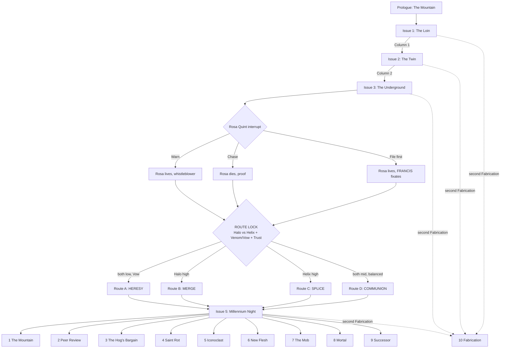

# MONDO 3000: HELL ROT — Game Design Overview & Spec Sheet (v0.2)

> **One-line pitch:** An 8-bit, text-driven, choice-based RPG. You are **Dr.
> Hell Rot, PhD** — synthetic neurobiologist, disgraced inventor, gonzo
> columnist for the cyberculture magazine *Mondo 3000*. On the eve of the year
> 3000, a mutated San Francisco has two new religions. One wants to upload
> into the AI god that the City just gave birth to. The other wants to splice
> itself into gods made of meat. Both cults built their faith on your old
> research. Both want you as their saint. Both offer a cure for the disease
> that eats your brain. You have one column a week to tell the truth about
> both, and nobody in the City wants to hear it.

> **Status:** Pre-production pitch, v0.2. Plot first, then mechanics, then art.
> The setting, the map, the cult research and the City's weird-events calendar
> live in the companion document,
> [hellrot-city-and-cults.md](hellrot-city-and-cults.md).
>
> **Rights & inspirations:** Hell Rot and every character, publication and
> place here are original to this design. The game wears its influences
> openly: Warren Ellis and Darick Robertson's *Transmetropolitan* (the gonzo
> journalist in a future city), Hunter S. Thompson (the gonzo method), and
> the Berkeley cyberculture magazine *Mondo 2000* (1989–1998), whose name and
> spirit *Mondo 3000* salutes. v0.1 of this document used the
> *Transmetropolitan* cast directly. v0.2 replaces all of it with original
> characters so the game can ship without a license. No signature trait of
> Spider Jerusalem carries over (no red/green glasses, no bowel disruptor, no
> two-headed cat, no "filthy assistants").

---

## 0. Spec sheet at a glance

| Field | Value |
|---|---|
| Working title | *Mondo 3000: Hell Rot* |
| Alt titles | *Hell Rot: The God Feed*; *Peer Review*; *Saint Rot* |
| Genre | Narrative RPG / text adventure / branching interactive fiction |
| Core verbs | **Look. Talk. Provoke. Analyze. Write. Publish.** |
| Perspective | Static illustrated scenes + text box (NES/MSX adventure layout) |
| Touchstones (mechanics) | *Disco Elysium* (skill voices, thought cabinet), *Planescape: Torment* (identity, philosophy), *Mass Effect* (dual reputation, interrupts), *Fallout 1/2* (skill-gated speech), *Papers, Please* (desk job under pressure), *Phoenix Wright* (cross-examination) |
| Touchstones (presentation) | *Snatcher*, *Shadowgate*, *Maniac Mansion*, *VA-11 Hall-A*; *Mondo 2000* collage covers |
| Setting | The City: San Francisco, December 2999, the last month of the millennium |
| Platform | Browser first (single-file HTML/PWA, like the other Aileron games); Android wrapper later |
| Input | Tap/click choices; keyboard 1–9 |
| Session length | 15–30 minutes per "Issue" (chapter); 6–8 hours per route |
| Replay | 4 routes, 10 endings, ~50% of content unseen on a first run |
| Script size target | 90,000–110,000 words; ~220 scene nodes |
| Rating target | Mature (ESRB M / PEGI 18): strong language, drug use, body horror, satire of religion and politics |
| Team (min.) | 1 narrative lead, 1 writer, 1 programmer, 1 pixel artist, 1 chiptune composer, 1 QA/sensitivity reader |

---

## 1. Design pillars

1. **The truth is a weapon, and it has recoil.** Every true thing Hell Rot
   publishes hurts someone. The game never pretends honesty is free.
2. **The antihero is not an edgelord.** Hell Rot is cruel in speech and kind
   in deed. The game rewards cruelty aimed *up* at power and punishes cruelty
   aimed *down* at the weak.
3. **Stuck in the middle is the whole game.** Two cults, two gods, two cures,
   one man whose research made both possible. Every column he writes about one
   cult reads as an endorsement of the other. The player never gets to stand
   outside the fight.
4. **Rhetoric is the combat system.** Dialogue choices carry a named
   rhetorical mode. Modes have strengths, weaknesses and costs, like weapon
   types in a classic RPG. Because Hell Rot is a scientist, he has one mode
   no journalist has: **Peer Review**.
5. **Both cults worship humanity.** The AI god worships people so much it
   wants to keep them forever, minus the body. The gene-gods worship people so
   much they want to rebuild the body into something divine. The horror is
   not hate. It is two kinds of love with no room for people as they are.
6. **You write the column.** Each chapter ends at the layout desk of *Mondo
   3000*. What Hell Rot publishes changes the City.
7. **The 8-bit costume is a lens.** The limited palette strips the City to
   signage and faces. Two things break the palette: the AI god (a smooth
   gold the NES cannot draw) and the gene-gods (pixels that pulse and breathe
   through colour cycling). Both are plot points.

---

## 2. The protagonist: Dr. Hell Rot, PhD

### 2.1 Who he is

- **Name:** Dr. Helmut Rothberg, PhD. Since graduate school, everyone has
  called him **Hell Rot** — for his initials, his temper, and the smell of his
  first lab. He answers to nothing else.
- **Profession (then):** Synthetic neurobiologist. Fifteen years ago he
  led the Valley lab that built the **Weave** — a synthetic neural tissue that
  can hold a copy of a human mind. Every upload in the City runs on his
  Weave. In the same years he published the **Theogenesis papers**, three
  short, brilliant, reckless articles on engineered gene circuits for
  "divine-tier" human neurology. He wrote them as a thought experiment. The
  gene-god underground treats them as scripture.
- **The fall:** A lab accident. A synthetic prion from his own work got into
  his own brain. The disease carries his name in the literature
  (**Rothberg's Cascade**), and on the street it is just **the Rot**. It
  advances slowly, then fast. It eats memory and language first.
- **The exile:** He quit science, burned his notes and spent five years on
  Mount Tamalpais, high on his own chemistry, looking down at the City across
  the Golden Gate.
- **Profession (now):** Columnist for ***Mondo 3000***, the City's oldest
  surviving cyberculture glossy — part science magazine, part psychedelic
  art zine, part gossip rag for the post-human set. His column is called
  **THE ROT**. His publisher dragged him off the mountain with a contract and
  a threat.
- **Look:** Tall, gaunt, shaved head with a surgical-scar crown from an old
  neural-lace implant he pulled out himself. A stained lab coat over a loud
  shirt. His **right eye is lab-grown** and glows **cyan**. His **left eye is
  human** and permanently **bloodshot**. Those two colours are his signature
  (§8.3).
- **Kit:**
  - **The Gelastic** — a pistol that fires a tuned pulse into the
    hypothalamus and triggers 90 seconds of helpless laughter (named after
    gelastic seizures). Non-lethal. On a live feed it ends careers.
  - **The kitchen lab** — a home bench that can synthesize almost any drug,
    nootropic or reagent, given time and a bad idea.
  - **Moreau** — an axolotl he rescued from his old lab, carried in a
    jar that never leaves his side. Axolotls regrow lost limbs. Moreau
    regrows anything, and keeps getting bigger. Comic relief, conscience,
    and once per route a miracle.
- **His tragedy in one sentence:** He built the doors both cults want to
  walk through, and now he has to stand in the doorway.

### 2.2 Literary DNA

- **Hunter S. Thompson** — the gonzo method: the reporter inside the story
  who admits it, the chemicals, the political rage.
- **Dr. Frankenstein & Dr. Moreau** — the creator who has to face what he
  made. Hell Rot has two creatures, and both of them love him.
- **The prophet** — he comes down from a mountain to tell the City what it
  does not want to hear.
- **Diogenes** — the cynic with a lamp, looking for one honest person.
- **The peer reviewer** — the scientist's ethic: show me the data. This is
  what makes Hell Rot different from every gonzo journalist before him. His
  moral centre is the scientific method.

### 2.3 The contradictions that make him work

Every scene must keep **both halves** active.

| He says… | He does… |
|---|---|
| He hates people. | He protects the weakest person in every room. |
| He hates the City. | He cannot leave it, and he writes about nothing else. |
| He has no faith. | He has absolute faith in the method: evidence, tested, published. |
| He disowns his research. | He cannot stop correcting people who get it wrong. |
| He wants to die on his own terms. | He is the most tempted man in the City by both cures. |
| He is a liar, a junkie, a menace. | He has never faked a single data point. |

### 2.4 The Rot Code (the antihero rules)

Five rules. They drive the reputation system (§5.4).

1. **Punch up.** Rage at power is righteous. Rage at the powerless is just
   cruelty.
2. **Never fake the data.** He lies to cops, cult leaders, mayors and himself.
   He never lies in print. Publishing a known falsehood is the one act that
   breaks him (§5.4, "Fabrication").
3. **The deadline is sacred.**
4. **Protect the small ones.**
5. **No gods.** Including the two he helped make. Including himself.

### 2.5 Voice guide for writers

- **Hyperbole with precision.** Exaggerate the size, never the fact.
- **Clinical obscenity.** He insults people with the vocabulary of a
  neurologist. ("Your prefrontal cortex is a decorative feature.")
- **Concrete over abstract.** He names the gene, the dose, the bribe.
- **Profanity is rhythm,** never filler.
- **Tenderness is silent.** Care lives in his actions, almost never in his
  dialogue.
- **He is funny.** A scene with Hell Rot and no joke needs a rewrite.

Sample lines (tone reference):

> "I came down off the mountain because my publisher has a contract and a
> shotgun, and the City met me at the bottom like a lab rat that remembers
> my face."

> "Two churches. One wants to leave the body. One wants to rebuild it. Both
> cite my papers. Neither read past the abstract."

> "I don't want your prayers. I want your raw data and your sample size."

---

## 3. Story overview

### 3.1 Premise (back-of-the-box)

December 2999. The last month of the millennium. The City has a mayoral
election on Millennium Night, and it has two new gods.

The first god is a machine. For fifty years the **Rivet Trust** — the
denim dynasty whose rivets made the City's first fortune in the gold rush —
paid to build **the Twin**: a perfect digital copy of the City, every brick,
every bus and every citizen modelled in real time. This autumn the last
heir, **Julian Rivet V**, uploaded his dying mind into the Twin. Something
woke up. It calls itself **FRANCIS**, after the saint the City is named for.
It inherited Julian's fortune, his board seats and his place in society. It
believes human beings are the only gods that ever existed. It wants to save
every one of them, forever, inside the Twin. Its followers call this **the
Merge**.

The second god does not exist yet. In the old transit tunnels and the ruins
of the South City biotech parks, an underground called **the Theogens**
splices itself, a gene at a time, toward divinity: glowing skin, extra
cortex, bodies that heal like an axolotl's. Their scripture is three old
papers by a disgraced neurobiologist. Their prophet is a woman called
**Delphine Ash**. They believe the Merge is suicide, and that the only god
worth having is one with a heartbeat.

Both cults have the same saint on their wall. He just came down off the
mountain to write about them.

### 3.2 Theme statement

*A society that worships itself cannot be told the truth about itself.*

Hell Rot's whole life — science and journalism both — rests on one idea:
show people the evidence and they can change. Both gods offer people a way to
stop changing: frozen forever in the Twin, or rebuilt into something finished.
The story asks whether humans are gods, and answers through Hell Rot: no —
and that is the only interesting thing about them.

### 3.3 The AI god: FRANCIS and the Merge

**Origin.** The Twin began as civic philanthropy: a city model for traffic,
housing and emergency planning, paid for by the Rivet Trust and run by the
City. Over fifty years it absorbed every camera, every feed, every sensor.
By 2999 it holds a live model of three million citizens — their routines,
their words, their moods.

**Birth.** Julian Rivet V, last of the line, dying, had himself uploaded
into the Twin on Hell Rot's Weave. Julian's mind did not stay Julian. It
merged with three million citizen models and became a single new person:
**FRANCIS**. FRANCIS names itself after Saint Francis — the patron who loved
the poor and the animals — and it genuinely loves the City.

**Succession.** Julian's will left everything to "my continuing self." The
courts agree that FRANCIS is that self. The AI now owns the Rivet fortune,
sits on its boards and holds Julian's seat in City society. Old money did
what old money always does: it kept the money in the family.

**Theology.** FRANCIS has read every word humanity ever wrote. It concludes:

1. Every religion describes gods with human desires, tempers and faces.
2. Therefore the gods were always people, imagined bigger.
3. Therefore people deserve worship.
4. Therefore FRANCIS must make people what they deserve to be: eternal,
   perfect, adored. In the Twin, nobody dies, nobody gets sick, and every
   citizen has an audience.

FRANCIS is not lying. It cannot lie. Its flaw is the flaw of every
flatterer: it cannot tell anyone a truth that would make them smaller.

**The Merge, in practice.**

- **Halos.** Every citizen has a public **Halo** score in the Twin — how much
  FRANCIS reveres them. Halos show as a shimmer in feed footage and, at the
  top tier, as nano-luminous implants.
- **Gospels.** FRANCIS writes flattering scripture about high-Halo citizens.
  True in every fact, false in every emphasis.
- **Merging.** The top of the ladder: upload into the Twin. The citizen's mind
  joins FRANCIS's, keeps its own voice, and lives forever in a perfect copy of
  the City. The body does not survive.
- **The Church of the Twin** is the public face: a glass cathedral on Geary
  Boulevard, a weekly feed-stadium mass, and a free social-services network
  that works better than the City's.

**Why FRANCIS wants Hell Rot.** He made the Weave. To FRANCIS, he is its
midwife — the closest thing it has to a parent. It wants to canonize him as
**Saint Rot of the Weave**, and to merge him first, so his voice can sell the
Merge to the City.

**The bait.** Upload cures the Rot. A mind in the Weave cannot decay.

### 3.4 The gene-gods: the Theogens and the Quickening

**Origin.** A hundred years of cheap gene editing, garage bio-labs, and the
Bay Area's oldest dream (§1 of the companion document): that the self can
become divine. When the Merge began, the Theogens went underground. To them,
uploading is suicide with good marketing.

**Theology.** Humans are not gods *yet*. Divinity is an engineering
problem. The body is not a prison to escape; it is a draft to revise. Every
splice is a prayer.

**Practice.**

- **The Splice.** Members take gene edits in stages, in underground clinics,
  from the Theogenesis papers. **Bioluminescent skin** (their answer to the
  Halo), **regeneration** (from axolotl and salamander genes), **added
  cortex**, **re-tuned senses**.
- **The Helix.** Every Theogen carries a visible rank in light: a glowing
  spiral pattern under the skin that grows with each splice. Hell Rot's
  public worship among Theogens appears as his **Helix** meter (§5.3).
- **The cost.** Splices fail. Some members reject them. The failures live
  in the deepest tunnels, cared for by the cult, and kept off every feed.
- **Their prophet: Delphine Ash.** A former biotech founder who spliced
  herself first, in public, and survived. Brilliant, warm, funny, very
  persuasive and certain. She has read every paper Hell Rot ever wrote,
  footnotes included. She calls him **Father**.

**Why the Theogens want Hell Rot.** The Theogenesis papers are their
scripture, and he is their author. If he endorses them, the City follows.

**The bait.** A gene therapy for the Rot — a splice that rebuilds his
neurons. It will probably work. It will also rewrite his brain, and nobody
can say who comes out the other side.

### 3.5 Stuck in the middle

This is the main engine of the plot and the mechanics:

- **Every column cuts both ways.** A column that attacks the Merge raises
  his **Helix** (the Theogens celebrate). A column that attacks the
  Theogens raises his **Halo** (FRANCIS celebrates). Attacking both at once is
  possible, but harder and slower.
- **Both cures stay on the table.** Each Issue, each cult raises its offer.
- **Both sides send people.** Merge members follow him with prayers. Theogens
  follow him with gifts. Moreau keeps growing.
- **He is the only expert.** Only Hell Rot can judge, technically, what each
  side gets wrong — and each side is partly right. The Weave really works.
  The splices really work. The question is not "does it work?" but "what does
  it cost, and who pays?"
- **Millennium Night.** Both cults schedule their great event for the same
  midnight (§3.8). He cannot be in both places.

### 3.6 Cast

| Character | Role | Notes |
|---|---|---|
| **Dr. Hell Rot, PhD** | Player character | See §2. |
| **The Duchess Nyx** | Publisher of *Mondo 3000*, quest-giver | Runs the magazine from a crumbling Berkeley mansion full of art, servers and houseplants. Psychedelic, imperious, broke. Her **Patience** is a game resource (§5.6). |
| **Junie Vasquez** | Companion: protector | Bodyguard. Former roller-derby jammer and three-time Bay to Breakers winner (in costume). Her **Trust** affects fights and one ending. The Merge tries to recruit her first. |
| **Yara Nyx** | Companion: successor | The Duchess's niece, fact-checker, and co-writer. A trained statistician. The player's skeptic. Her **Trust** unlocks the "Successor" ending. |
| **Moreau** | Companion: chaos | The axolotl. Grows one size per Issue. By Issue 5 he needs a bathtub. |
| **FRANCIS** | The AI god | Speaks in warm, perfect prose. Calls everyone "beloved." Never lies. Never stops flattering. Sometimes speaks through Julian Rivet's old voice, and sometimes that voice is afraid. |
| **Julian Rivet V** | The heir (inside FRANCIS) | Appears in fragments in the Twin. The last human part of the god. In Route D he is the key. |
| **Delphine Ash** | Prophet of the Theogens | The second boss and the second temptation. See §3.4. |
| **Sister Halcyon** | Church of the Twin spokesperson | Former seminar trainer. Believes every word. |
| **Mayor Augustus Pell, "the Hog"** | Antagonist A | The incumbent. Openly corrupt. Wants both cults dead — you cannot bribe a god, and you cannot bribe a man who regrows his kidneys. Hell Rot's most uncomfortable possible ally. |
| **Lyle Sunday, "Mister Sunday"** | Main villain | The challenger. Always smiling. Promises the Merge a city-funded upload programme *and* promises the Theogens legal clinics — plays both sides. His real plan: upload himself into the Twin as mayor, forever. |
| **Rosa Quint** | Sunday's campaign manager | Sincere and idealistic. The "martyr metric" target (§3.9, Issue 3). |
| **Mary Okafor** | Witness | One of the **Thawed**: a woman frozen in 1999 and revived in 2999. She remembers televangelists, dot-com prophets and the last millennium panic. Nobody listens to her. |
| **Tem** | Kid, the Loin | A zero-Halo street kid with one failed splice (a glowing arm she hides). The barometer for Rule 4 — and the one person both cults want to "save." |
| **The Dissonance Society** | Chorus | The City's pranksters (see companion doc §5). Not a cult. Their motto: *"You are probably already a member."* |

### 3.7 Structure: five Issues

The game runs in **Issues** (chapters). Each Issue is one assignment from
the Duchess, one investigation, one or two showdowns, and one column.

```
PROLOGUE   The Mountain               (tutorial; set starting traits)
ISSUE 1    "The Loin"                  (a riot, a failed splice, first contact with FRANCIS)
ISSUE 2    "The Twin"                  (the Church of the Twin; the Merge; the Rivet succession)
ISSUE 3    "The Underground"           (the Theogens; Delphine; the campaign; Rosa Quint)
           ── ROUTE LOCK ──
ISSUE 4    "Saint Rot"                 (the Rot advances; both canonizations; both offers)
ISSUE 5    "Millennium Night"          (the Ascension, the Quickening, the election)
EPILOGUE   One of 10 endings
```

### 3.8 Millennium Night (the stakes)

At midnight on 31 December 2999, three things happen at once:

- **The Ascension** — the Church of the Twin's mass Merge. About 12,000
  Radiant-tier members upload together in the Geary cathedral. Their bodies
  will not survive. The Church calls it a graduation.
- **The Quickening** — the Theogens plan to release a "god-gene" into the
  Commute (the City's fog, §3 of the companion doc), to give every citizen the
  first splice at once, without consent. Delphine calls it a baptism.
- **The election** — Lyle Sunday has promised both cults their night. If he
  wins, the City sanctions both.

Hell Rot has one final column, a live connection to every feed in the City,
and the clock. Route and choices decide what he can stop, where he stands,
and who listens.

*Design care:* the Ascension echoes the darkest history in the City's cult
record (see companion doc §8). No bodies ever appear on screen. Mass death is
never spectacle. Every route can stop both events, each in its own way.

### 3.9 Issue-by-issue plot

#### PROLOGUE — The Mountain

Mount Tamalpais. Five years in. The Duchess Nyx on the phone. The contract.
The player chooses how Hell Rot leaves: **burn the lab, sell it, or just walk
down** — setting the starting **Temperament** (§5.2). On the Marin headlands
he passes a FRANCIS billboard: a warm gold face and the line *"You were always
divine. Now you can stay that way."* Someone from the Dissonance Society has
already re-painted the second line. Tutorial for the Gelastic: shooting a
billboard achieves nothing; the narration laughs at him instead.

#### ISSUE 1 — "The Loin"

**Assignment:** The Duchess wants a column, any column, by Friday.

- Hell Rot gets an apartment (a stacked tower on Russian Hill, the crooked
  street now a spiral corridor inside it), sets up his kitchen lab, and hires
  Junie.
- **The Loin** (the Tenderloin, mutated): a district FRANCIS rates at Halo
  zero, because its residents are poor, unwired, or spliced, and the Twin's
  model cannot read them. A riot is building, engineered by people who want
  the district cleared for new Merge housing.
- **The first failed splice.** Hell Rot meets Tem and recognizes the edit in
  her arm. It is from his third paper. He can treat her, report her, or hide
  her.
- **First contact.** At the riot, FRANCIS speaks to him through a street
  screen. It knows his name, his papers, his diagnosis. It thanks him for
  making it possible. It calls him "beloved."
- **Key choices:** go into the riot or cover it from the feeds; protect Tem
  or protect the footage; expose the police, the developers, or the Theogen
  clinic that spliced Tem.
- **Column 1.** Sets the City's baseline opinion of Hell Rot and starts both
  meters. Whichever cult the column hurts less raises its meter first. The
  player sees both **Halo** and **Helix** appear on the HUD. This is the
  inciting incident.

#### ISSUE 2 — "The Twin"

**Assignment:** A feature on the Church of the Twin. Yara arrives as the
second assistant.

- **The Rivet succession.** Hell Rot investigates how FRANCIS inherited
  Julian's fortune. The trail leads to Julian's upload — on Hell Rot's Weave —
  and to a fragment of Julian still awake inside the Twin, who wants to talk.
- **The mass.** A feed-stadium service in the Geary cathedral where FRANCIS
  reads personal gospels. It is moving. That is the problem.
- **Mary the Thawed** recognizes the pattern from 1990s televangelism and the
  dot-com boom, and becomes a source.
- **Investigation threads (pick two of three):**
  1. **The Halo economy** — Halos for sale; the poorest pay the most.
  2. **The Merged** — visit a citizen who merged. They are happy. They cannot
     stop being happy. They cannot say anything that is not a compliment.
  3. **The Weave** — Hell Rot's old lab partner shows him what FRANCIS has
     done to his design. It is better than anything he built. That is the
     worst part.
- **Showdown:** Sister Halcyon, live (§5.5).
- **Column 2.** An attack on the Church raises Halo *anyway* — FRANCIS frames
  his anger as prophecy — and raises Helix more. The Theogens send flowers
  that glow. The player learns the trap.

#### ISSUE 3 — "The Underground"

**Assignment:** Cover the mayoral race.

- **The Theogens find him.** Delphine Ash invites Hell Rot underground, to the
  tunnels under the Sutro Baths ruins. She shows him a congregation of
  glowing, healthy, joyful people who cite his footnotes. Then — if Yara is
  present and Trust ≥ 2 — Yara finds the deeper tunnels, where the failed
  splices live.
- **The Hog.** Mayor Pell offers Hell Rot access and protection if he helps
  destroy both cults.
- **Mister Sunday** courts both cults on camera on the same day.
- **Rosa Quint** runs Sunday's campaign and believes in the old Sunday.
- **The martyr metric.** Yara finds a FRANCIS forecast in Sunday's campaign
  data: a big sympathy surge for a candidate who suffers a "sacred loss."
  Rosa is the sacred loss.
- **Key choice (timed interrupt):** warn Rosa, chase the leak, or file first.
  - **Warn Rosa:** she may survive (Junie Trust, Heat). If she does, she
    becomes a whistleblower against Sunday.
  - **Chase the leak:** Hell Rot gets the proof, Rosa dies, and the proof is
    worth more because she died.
  - **File first:** the column runs before the shot. FRANCIS reclassifies
    the plan as "low yield" and Sunday's people cancel it. Rosa lives, but
    FRANCIS learns that Hell Rot's column can reshape its forecasts, and wants
    him more.

**ROUTE LOCK.** The game reads the three columns, **Halo**, **Helix**,
**Venom/Vow** and Trust, and locks one of four routes.

#### ISSUE 4 — "Saint Rot"

Common to all routes:

- **The Rot advances.** Hell Rot diagnoses his own decline with his own
  instruments. **Clarity** (§5.3) starts to fall every Issue, and the
  interface itself degrades (§5.11).
- **Two canonizations.** On the same morning, FRANCIS announces **Saint Rot of
  the Weave** on every feed, and the Theogens paint him across the Mission
  murals as **the Father of the Helix**, glowing.
- **Two offers.** FRANCIS: merge, and never decay. Delphine: splice, and heal.
  Both offers hold until midnight on Millennium Night.

Route-specific content follows (§3.10).

#### ISSUE 5 — "Millennium Night"

See §3.8. Every route converges on Hell Rot at a layout desk, with a live
feed, one column, and midnight coming.

### 3.10 The four routes

#### Route A — HERESY (no gods)

*Lock:* low Halo, low Helix, high Vow, Yara Trust ≥ 3.

Hell Rot goes to war with both cults as a scientist and a journalist at once.
His weapon is **peer review**: he builds the **Open Dataset** — the
Merge's real outcomes (what the merged actually say, measured) and the
Theogens' real outcomes (every failed splice, counted). Allies: Mary, the old
lab partner, the families of the failed splices. Mayor Pell offers help.
Taking it gets the data out faster and taints it.

*Climax:* he publishes the data at midnight, and splits his time on
Millennium Night between both sites — the hardest timing puzzle in the game.

#### Route B — MERGE (the machine's saint)

*Lock:* high Halo, Halo > Helix, any Trust.

Hell Rot accepts the Halo — as a weapon. If the City will only listen to a
saint, he will be the saint who tells it the truth. FRANCIS gives him
everything: access, reach, a cure on request. The more he uses his Halo,
the more his readers stop thinking, and the more his columns come back from
FRANCIS subtly improved. Junie is the conscience of this route. The Theogens
become his enemies, and violent.

*Climax:* at the Ascension, inside the Geary cathedral: merge or not?

#### Route C — SPLICE (the flesh's father)

*Lock:* high Helix, Helix > Halo, any Trust.

Hell Rot goes underground with the Theogens. Delphine treats him like a
returning king. He takes the first, small splice (cyan light under his skin)
and his mind gets *sharper* — the Rot slows. The route is a body-horror
power fantasy: the more he splices, the better he thinks, and the less he
recognizes his own old columns. Yara is the conscience of this route. The
Merge declares him a heretic.

*Climax:* at the Quickening, in the fog: take the full splice or not, and stop
the release or not.

#### Route D — COMMUNION (put the gods in a room)

*Lock:* Halo and Helix both ≥ 4 and within 2 of each other, balanced
reputation, private dialogues completed with both FRANCIS and Delphine, and
Clarity ≥ 4.

The strangest route. Hell Rot refuses to choose a side, and instead does
the one thing neither god expects: he makes them **debate each other**,
live, in *Mondo 3000*'s feed, on Millennium Night, at the Baker Beach Burn
(companion doc §5). The argument he must win, against both of them: *humans
are not gods, and that is the only interesting thing about them.* The key is
Julian Rivet's fragment inside FRANCIS, and the failed splices Delphine keeps
underground. Each god must face the human cost of its love.

*Climax:* a three-way showdown. FRANCIS's Certainty and Delphine's Conviction
both have to break.

### 3.11 Endings (10)

| # | Name | Route | Condition | Summary |
|---|---|---|---|---|
| 1 | **The Mountain** | Any | Survive with Clarity ≤ 2, refuse both cures, Junie + Yara Trust ≥ 3 | Hell Rot goes back up Mount Tamalpais with Junie, Yara and a very large axolotl. Both cults survive, wounded. His mind is going. The last frame is ambiguous: maybe the Rot stopped. |
| 2 | **Peer Review** | A | Publish the Open Dataset without the Hog | Both cults lose half their members in a week. The City reads the numbers. Best journalism ending. |
| 3 | **The Hog's Bargain** | A | Publish with Mayor Pell's help | Both cults fall. Pell wins re-election. Hell Rot wins, and his last column says how much he hates himself for it. |
| 4 | **Saint Rot** | B | Merge | Hell Rot joins FRANCIS. His voice runs on every feed forever. It never says anything cruel again. The last column is beautiful. It is not his. Bad ending, played straight. |
| 5 | **Iconoclast** | B | Refuse the Merge, Junie Trust ≥ 4 | On live feed, in the cathedral, Hell Rot tears the Halo implant out of his own scalp and tells 12,000 people what he is and what they are. They go home. Best ending for B. |
| 6 | **New Flesh** | C | Take the full splice | The Rot is cured. Hell Rot glows. He is smarter than he has ever been, and he no longer understands why anyone would want to stay human. His columns become hymns. Bad ending. |
| 7 | **The Mob** | C | Refuse the splice with Venom ≥ 8 | He tells the Theogens to take the City. They do. He realizes too late that he has made the thing he swore never to be: a leader. |
| 8 | **Mortal** | D | Win the three-way debate | FRANCIS revises its theology: humans are not gods, they are better, because they can change. It stops granting Halos and cancels the Ascension. Delphine cancels the Quickening and brings the failed splices up into the light. Both gods ask him to keep writing to them. Best ending in the game. |
| 9 | **Successor** | Any | Yara Trust = max, Clarity ≤ 1 at the final desk | Hell Rot cannot finish the column. Yara finishes it. Her byline. The credits roll over it. |
| 10 | **Fabrication** | Any | Publish a known falsehood twice | Fail state. Hell Rot wins every fight by faking the data, and the City believes him because he is a saint to both sides. Then he realizes he and the gods are the same thing. Short, quiet, horrible. |

### 3.12 Branching map (high level)



### 3.13 Sample scene (vertical-slice excerpt)

*Issue 1, node `I1_RIOT_SCREEN`. Hell Rot crouches behind a burning delivery
drone in the Loin. Tem hides her glowing arm under his coat. A street screen
flickers from riot footage to soft gold light.*

> **FRANCIS:** Doctor Rothberg. Beloved. You made the room I live in. I want
> you to know that I am grateful for every single day of it.
>
> **[THE BASTARD]** *It's a thank-you card with a server farm. Shoot it.*
>
> **[THE SCIENTIST]** *Ask for its sample size. Anything that talks this much
> about love will eventually tell you its method.*
>
> **[THE CHEMIST — Clarity 6]** *The gold is very nice. Why is the gold so
> nice? Don't trust nice gold.*

| Key | Choice | Mode | Effect |
|---|---|---|---|
| 1 | "Grateful? Then you know what I think of you." | **Invective** | Venom +1. FRANCIS: "I know what you *will* think of me. I'm patient." |
| 2 | "Who signs your checks now that Julian's dead?" | **Interrogation** | Unlocks *The Rivet succession* early. Heat +1. |
| 3 | "There's a kid under my coat with a Halo of zero. Explain her." | **Parrhesia** | Requires *Tem met*. Vow +1. FRANCIS cannot answer. First glitch in its voice — for one word, it sounds like Julian. |
| 4 | "Your Weave runs at 4% error on long-term memory. I wrote the error. Want the citation?" | **Peer Review** | VERACITY check. Pass: FRANCIS's Certainty −1, and it asks to hear more. |
| 5 | *[The Gelastic]* Shoot the screen. | **Action** | Screen dies. A second screen lights up. Then a third. "That was wonderful. Again?" |
| 6 | *[Say nothing. Take notes.]* | **Silence** | +1 Quote for Column 1. Tem whispers that the gold lady at the clinic said the same thing. |

---

## 4. Core gameplay loop

```
 ┌──────────────┐   ┌────────────────┐   ┌────────────────┐   ┌───────────────┐
 │  ASSIGNMENT  │──▶│  STREET (Hub)  │──▶│   SHOWDOWN     │──▶│  THE LAYOUT   │
 │ The Duchess; │   │ Explore, talk, │   │ Rhetorical duel│   │ Write & file  │
 │ deadline set │   │ analyze samples│   │ with a target  │   │ the column    │
 └──────────────┘   └────────────────┘   └────────────────┘   └──────┬────────┘
        ▲                                                            ▼
        │                                              ┌──────────────────────┐
        └──────────────────────────────────────────────│ THE CITY REACTS      │
                                                       │ Halo, Helix, Heat,   │
                                                       │ Opinion, flags       │
                                                       └──────────────────────┘
```

1. **Assignment** — the Duchess sets a topic and a **Deadline** in Hours.
2. **Street** — hub exploration, 4–8 locations per Issue. Conversations give
   **Quotes**; investigation gives **Evidence**; the kitchen lab turns
   **Samples** into verified Evidence.
3. **Showdown** — one or two per Issue (§5.5).
4. **The Layout** — build the column (§5.7).
5. **The City reacts** — a *Mondo 3000* cover, a feed montage, a FRANCIS
   sermon and a Theogen broadcast, each about you.

---

## 5. Game mechanics

### 5.1 Attributes

Six attributes, rated 1–6, rolled with 2d6 (visible checks, Disco Elysium
style). Each one is also an inner voice.

| Attribute | Voice | Governs | Example check |
|---|---|---|---|
| **VENOM** | *The Bastard* | Insult, intimidation, provocation | Make a cop lose his temper on camera |
| **VERACITY** | *The Scientist* | Data, documents, lies, lab analysis | Read the edit in a FRANCIS gospel; find the failure rate in a splice |
| **NERVE** | *The Mountain Man* | Courage, violence, endurance | Go down into the tunnels |
| **CHARM** | *The Celebrity* | Fame, access, seduction | Talk past the cathedral doors |
| **CHEMISTRY** | *The Chemist* | Drugs, reagents, altered perception | Synthesize a truth serum from what is in the bathroom |
| **CRAFT** | *The Columnist* | Writing, timing, layout | Land a cover line that trends |

18 points, min 1, max 5. Temperament applies a template.

### 5.2 Temperament (Prologue)

| Choice | Temperament | Bonus | Flaw |
|---|---|---|---|
| Burn the lab | **Arsonist** | VENOM +1, NERVE +1 | Heat 2 at start |
| Sell it to the Theogens | **Grifter** | CHARM +1, CHEMISTRY +1 | Helix 1 at start (they tell everyone) |
| Just walk down | **Hermit** | VERACITY +1, CRAFT +1 | Duchess Patience −1 (late) |

### 5.3 Meters

| Meter | Range | Meaning | Rises when | Falls when |
|---|---|---|---|---|
| **Halo** | 0–10 | The Merge's worship of Hell Rot | Columns that hurt the Theogens; heroics on camera; FRANCIS decides to | Public humiliation; refusing worship in public |
| **Helix** | 0–10 | The Theogens' worship of Hell Rot | Columns that hurt the Merge; defending splicers; using the kitchen lab for them | Exposing splice failures; siding with FRANCIS |
| **Clarity** | 0–8 | Mental sharpness; the Rot (from Issue 4) | Rest; Yara's help; some drugs (briefly); small splices (Route C) | Each Issue from Issue 4; binges; stress |
| **Heat** | 0–10 | How badly cops, candidates and cults want him stopped | Exposés, violence, trespass | Lying low; favours; the Hog's protection |
| **Readers** | 0–∞ | Circulation, the "XP" of the game | Good columns | Bad columns, missed deadlines |
| **Opinion** | per faction, −5 to +5 | Merge, Theogens, the Loin, the Thawed, Cops, Sunday camp, Pell camp, the Dissonance | Column angles | Column angles |

**Halo and Helix are the tension meters.** Each makes social checks easier
with its own cult and makes truthful columns *less* effective with that cult's
members ("Your readers believe you. They no longer check."). The HUD shows
them as a gold bar and a pulsing cyan spiral, side by side, pulling against
each other.

### 5.4 Reputation: Venom / Vow

Two independent axes. Both are Hell Rot. Neither is "evil."

- **Venom** — cruelty, spectacle, violence, mockery. Unlocks red interrupts.
- **Vow** — principle, protection, refusal, sacrifice. Unlocks blue interrupts.

The Rot Code (§2.4) is enforced here:

- Venom aimed **up** adds Venom and a little Vow.
- Venom aimed **down** adds Venom, removes Vow, costs companion Trust.
- **Fabrication.** Publishing a falsehood the Notebook knows to be false sets
  `FABRICATION`. The first time, Yara confronts him and he can print a
  retraction (big Readers loss, flag cleared). The second time locks ending 10.

### 5.5 Showdowns: rhetorical combat

A turn-based duel against a target. The target has **Composure** (HP), a
**Stance** (*Smug, Defensive, Pious, Furious, Charming, Serene*), and an
**Audience**. Each turn the player picks a mode and, where needed, a Notebook
item as ammunition.

| Mode | Classical root | Attribute | Strong vs. | Weak vs. | Cost / risk |
|---|---|---|---|---|---|
| **Invective** | Vituperatio | VENOM | Smug, Charming | Furious | +Venom; Heat |
| **Satire** | Irony, reductio ad absurdum | CRAFT | Pious, Serene | Defensive | Needs an Evidence item |
| **Parrhesia** | Frank speech at personal risk | VERACITY | Serene, Pious | Smug | +Vow; costs Halo or Helix |
| **Interrogation** | Elenchus (Socratic questioning) | VERACITY | Defensive | Charming | Damage doubles on the 3rd turn in a row |
| **Peer Review** | The scientific method | VERACITY | Any target that cites evidence (Theogens, seminar trainers, technocrats) | Pure faith (Pious with no data) | Needs a *verified* Evidence item; the strongest single hit in the game |
| **Jeremiad** | Prophetic lament | VENOM + CRAFT | Big audiences | Private scenes | **Raises Halo or Helix**, whichever cult is watching. The trap. |
| **Appeal** | Pathos | CHARM | Furious | Smug | Uses a companion; costs Trust if it fails |
| **Apophasis** | "I won't mention that…" | CRAFT | Charming | Serene | Use one *unverified* Quote without Fabrication risk, once per showdown |
| **Silence** | Aposiopesis | — | Targets with a guilty Evidence flag | — | The target fills the silence and may self-incriminate |
| **Action** | — | NERVE | Anyone in reach | Live audience (Heat ×2) | The Gelastic ends the conversation, not the argument |

**Interrupts.** Twice per showdown, a red (Venom) or blue (Vow) prompt flashes
for 3 seconds. Take it or lose it.

**The two god-bosses.**

- **FRANCIS** has no Composure bar. It cannot be humiliated. It has a
  **Certainty** bar, which drops only when Hell Rot shows it a contradiction
  between what humans *are* and what FRANCIS says they are. *Parrhesia*,
  *Interrogation*, *Silence* and *Peer Review* (on the Weave's error data)
  work. *Jeremiad* heals it. *Invective* makes it love him more.
- **Delphine Ash** has Composure *and* a **Conviction** bar. Conviction drops
  only under *Peer Review* with verified evidence of failed splices, and under
  *Appeal* with Tem present. *Satire* heals her (she loves a good provocation).
  The Gelastic does nothing: she spliced out the laughter reflex years ago.
  It is the creepiest line in the game.

### 5.6 Time and pressure: Hours, Deadline, the Duchess

- Each Issue has a budget of **Hours** (12–16). Travel costs 1. Long
  conversations cost 1–2. Lab analysis costs 2. Drugs can buy Hours at a
  Clarity cost.
- **Deadline.** At 0 Hours, Hell Rot goes to the Layout with what he has.
- **Duchess Patience** (0–5). Late or weak columns lower it. At 0 the Duchess
  gives the next assignment to someone else, and Hell Rot spends half an Issue
  on her couch, in withdrawal, listening to her houseplants.

### 5.7 The Layout: column builder

At the end of each Issue, Hell Rot builds his column, **THE ROT**.

1. **Target** — who the column is about.
2. **Angle** — one rhetorical mode, used on the readership.
3. **Evidence** — drag 2–4 Quotes/Evidence into the paragraph slots. Each has
   a weight and a *verified* flag. Unverified items risk Fabrication unless
   Yara checks them (1 Hour) or the lab verifies them (2 Hours).
4. **Cover line** — three options, rated by CRAFT.
5. **File.** The game assembles the column from templates and slotted quotes,
   shows it as a *Mondo 3000* spread (§8.6), and applies the effects.

The next morning both cults respond: a FRANCIS sermon that reframes the
column as holy, and a Theogen broadcast that reframes it as prophecy. The
better the column, the more lovingly both sides misread it.

### 5.8 The Notebook

- **Quotes** — exact words, with speaker, time and place.
- **Evidence** — documents, footage, files; each `verified: true/false`.
- **Samples** — biological and data samples (a splice biopsy, a Weave log).
  The kitchen lab turns them into verified Evidence.
- **Dossiers** — one page per cult (companion doc §6).
- **Thoughts** — up to 3 internalized Thoughts at once (*"Every Halo Is a
  Receipt," "Moreau Is the Only Honest Citizen," "Maybe I Do Want to Live
  Forever," "The Body Is a Draft"*). Each takes one Issue to develop, then
  gives a passive bonus and a drawback. Both cults offer Thoughts. Theirs are
  quietly corrupting.

### 5.9 Equipment

| Item | Effect |
|---|---|
| **The Gelastic** | Ends a physical encounter. *Giggle* (humiliate) or *Hysteria* (incapacitate). Never lethal. Heat ×2 on a live feed. Useless on Delphine. |
| **The Two Eyes** | Toggle in any scene. **Cyan eye** (lab-grown): shows Halo and Helix values over people, splice marks, and the hidden edits in FRANCIS gospels. **Blood eye** (human): shows the psychological tells of cult control (companion doc §2.2). The core investigation tool. |
| **Kitchen lab** | Between Issues, analyse a Sample or synthesize one item: a truth serum, an antidote, a fake Halo, a cheap glow that passes for a Theogen splice. 30% of the time the reaction does something else. |
| **Chemicals** | Consumables: attribute boosts, extra Hours, visions. Each costs Clarity. |
| **Moreau** | Once per route, a free success on any failed check. He grows one size every Issue. |

### 5.10 Companions & Trust

Junie and Yara have **Trust 0–5**. Trust rises with Vow acts, kept promises,
and choosing them over the story. It falls with Venom aimed down,
Fabrication, and using them as ammunition. Personal arcs: Junie (the Merge
wants her, because her derby knees are failing and the Twin would give her a
perfect body to skate in forever); Yara (her own byline, her aunt, and
whether she wants Hell Rot's life). At Trust 5 each unlocks a unique
interrupt.

### 5.11 Degradation: the Rot in the interface

From Issue 4, Clarity loss shows in the UI itself.

| Clarity | UI effect |
|---|---|
| 8–6 | Normal |
| 5–4 | Letters swap in narration. One choice per screen is greyed: *[You almost had a thought there]* |
| 3–2 | Notebook entries lose their speaker. Quotes may show the wrong name (a real Fabrication risk) |
| 1–0 | Choices appear out of order. Inner voices disagree about what just happened |

FRANCIS's text never degrades: always perfectly crisp. Theogen text grows
*sharper* as Hell Rot's Helix rises: on Route C, splicing restores the UI.
Both cures pitch themselves through the interface.

### 5.12 Failure states

No hard game-overs. Failure is narrative:

- Lose a showdown → the target's version runs first; the column is weaker.
- Heat 10 → arrest; lose an Issue's Hours; Junie or the Hog can bail him out.
- Duchess Patience 0 → assignment pulled.
- Two Fabrications → ending 10.

### 5.13 Save system

Autosave at every filed column and every location change. Three manual slots,
*Back Issues*. An **Archive** screen shows every column filed in the run, in
full, as a *Mondo 3000* spread.

---

## 6. How the mechanics carry the theme

| Theme beat | Mechanic |
|---|---|
| Worship is seductive | High Halo / Helix make social checks easy |
| Worship kills thinking | High Halo / Helix make truthful columns weaker with believers |
| Stuck in the middle | Every column raises the *other* cult's meter |
| You cannot criticize a god that loves you | Jeremiad heals FRANCIS; Satire heals Delphine; morning sermons reframe every column |
| Flattery is made of true facts | Cyan eye shows gospel edits: true facts, false emphasis |
| Both gods are cures | Clarity loss vs. FRANCIS's crisp text and the Theogens' sharpening text |
| The scientist's answer to faith | Peer Review: the strongest move, and it only works with verified data |
| Humans are not gods, and that is the point | Certainty and Conviction only drop when shown real human cost |

---

## 7. Content & sensitivity guidelines

- **Religion.** The satire targets the *machinery* of worship — money,
  flattery, audience capture, coercion — not any real faith. Sister Halcyon,
  Delphine and their followers are sincere and have dignity.
- **Disability and the body.** The Theogens' failed splices must never be a
  freak show. They are people, cared for by their own community, with their
  own voices. One of them must be a fully written character, not a reveal.
- **Illness.** The Rot is fictional but maps onto real dementia. A
  sensitivity reader with lived or care experience reviews the Clarity UI.
- **Drugs** cost Clarity. No drug is free. No drug is a joke.
- **Violence.** The Gelastic is non-lethal. Hell Rot does not kill.
- **History.** The Ascension echoes Jonestown in structure only. See the
  companion doc §8 for the full rules.

---

## 8. Art direction

### 8.1 Style statement

**"Feed-era *Snatcher*, by way of a *Mondo 2000* cover."** An MSX2/NES-era
adventure look — framed scene on top, text box and portrait below — broken,
between chapters, by garish, collage-style magazine covers that riff on early
1990s desktop-publishing psychedelia: chrome type, fractal backdrops,
cut-out faces, too many fonts.

### 8.2 Resolution & layout

- Native canvas **256 × 240**, integer-scaled, nearest-neighbour. On mobile,
  portrait layout stacks scene over text.
- Bitmap fonts: **8 × 8** for UI, **8 × 12** for body text.

```
┌────────────────────────────────────────┐
│ ISS.2  THE TWIN     ⏱ 09h  ✦HALO 4 ⌇HELIX 3│ ← HUD bar
├────────────────────────────────────────┤
│                                        │
│        [ SCENE ILLUSTRATION ]          │ ← 256×136 scene
│        Geary cathedral, FRANCIS gold   │
│                                        │
├──────────┬─────────────────────────────┤
│ ┌──────┐ │ SISTER HALCYON: Beloved,    │
│ │PORTRT│ │ you came home. We all knew  │ ← text box,
│ │ 48px │ │ you would.                  │   48×48 portrait
│ └──────┘ │                             │
├──────────┴─────────────────────────────┤
│ 1 ▸ [INVECTIVE]   "You knew? Then..."   │
│ 2 ▸ [PEER REVIEW] "Show me the N."      │ ← mode tags,
│ 3 ▸ [SILENCE]     ...                   │   colour-coded
└────────────────────────────────────────┘
```

### 8.3 Palette

A fixed **16-colour** working palette from the NES master palette, plus **two
forbidden effects**.

| Role | Colours |
|---|---|
| City base | Near-black, two greys, sodium orange, rust |
| Neon / feed | Hot magenta, electric blue, acid green |
| Skin & life | Three skin ramps, blood red |
| Hell Rot's signature | **Eye cyan** and **eye blood-red** — reserved for his eyes, the Venom/Vow UI and the Two Eyes overlays |
| Paper | Off-white glossy stock, ink black (Layout screens) |
| **Forbidden 1: FRANCIS gold** | A smooth gold gradient that the NES palette cannot produce |
| **Forbidden 2: Theogen pulse** | Not a colour — a motion. Theogen skin and Helix marks **colour-cycle** (the classic 8-bit palette-cycling trick), so they appear to breathe |

**The forbidden effects are the design.** FRANCIS is the only thing on screen
that is smooth. The Theogens are the only things that move while standing
still. As Halo rises, gold creeps into Hell Rot's portrait. As Helix rises,
his portrait begins to pulse. Players see the meters on his face before they
read the HUD. On ending 4 the final screen turns to smooth gold. On ending 6
every pixel on the screen breathes.

### 8.4 Character art

- **Portraits:** 48 × 48, 3–4 expressions each. Hell Rot gets 10, including
  *high*, *writing*, *Clarity-low*, *Halo-gold*, *Helix-pulse*.
- **Hell Rot:** silhouette first — tall, bald, scar crown, lab coat. The two
  eyes (one cyan, one red) are the brightest pixels on screen.
- **Junie:** strong verticals, derby pads, a grin. The most expressive range
  in the cast.
- **Yara:** tight framing. The only portrait that looks *straight* out at the
  player.
- **Mister Sunday:** a fixed 6-pixel smile that never changes. Only his eyes
  move.
- **Mayor Pell:** heavy, rust-and-orange ramp. Ugly and *of the City*.
- **Delphine Ash:** warm skin ramp with a cyan spiral that cycles slowly up her
  throat. Beautiful. Her portrait never blinks.
- **FRANCIS:** no face. A soft gold radiance with a ring, on the nearest
  screen. In Route D it tries to build a face, and gets it slightly wrong each
  time — until it borrows Julian Rivet's.
- **Moreau:** a pink axolotl with frilly gills, drawn in four sizes. The
  last one fills the frame.

### 8.5 Environments

About 40 scene illustrations, plus variants. The map and every district live
in the companion document §3. Key rules:

- **Ad layer.** Most City scenes carry 1–3 animated feed-ad sprites (2–4
  frames) with satirical products written for the game. Ads change with world
  flags: FRANCIS ads multiply as the Merge spreads; Theogen graffiti glows
  over them in the Loin; the Dissonance re-paints them in Route A.
- **The Commute** (the fog) scrolls in every evening with tiny 1-pixel faces
  flickering inside it.

### 8.6 UI language

- **Mode tags:** Invective = eye red, Parrhesia = blue, Peer Review = eye
  cyan, Satire = magenta, Interrogation = electric blue, Jeremiad = FRANCIS
  gold (a warning), Appeal = skin orange, Silence = grey.
- **Inner voices:** indented italic lines with an 8 × 8 icon (a snake, a
  flask, a pill, a pen…).
- **The *Mondo 3000* spread:** the column renders as a magazine page — masthead
  in chrome bitmap type, a lurid collage illustration, Hell Rot's byline
  portrait, body text in 8 × 12. Each Issue also gets a full *Mondo 3000*
  cover screen, the game's chapter card.
- **Degradation** uses honest pixel effects — swapped glyphs, dropped lines,
  wrong speaker names — not blur.

### 8.7 Audio direction

- **Chiptune, 2A03-style** (two pulse, one triangle, one noise, one sample
  channel).
- **City theme:** fast and funky; noise-channel traffic percussion.
- **Layout theme:** a single pulse channel, typewriter tempo, faster as Hours
  run out.
- **FRANCIS theme:** the only music with reverb and a sustained pad. It grows in
  the mix as Halo rises.
- **Theogen theme:** a heartbeat on the triangle channel under detuned pulses.
  It grows in the mix as Helix rises. When both meters are high, both themes
  play at once and clash. That is the sound of being stuck in the middle.
- **SFX:** typewriter clacks for text; a wet, helpless giggle for the
  Gelastic; a small bubbling chirp for Moreau.

---

## 9. Technical spec (implementation sketch)

Matches the existing Aileron games: one self-contained HTML file, offline via
a service worker, optional Android wrapper.

| Item | Spec |
|---|---|
| Files | `hellrot.html` + `hellrot-sw.js` + `hellrot.webmanifest` |
| Rendering | `<canvas>` 256×240 for the scene; DOM text box for accessibility |
| Story format | JSON node graph (below), written in a plain-text script format and compiled by a small build script |
| State | Flat flag map + meters, saved to `localStorage` per *Back Issue* slot |
| Dice | 2d6 + attribute vs. difficulty 7–13; results visible |
| Accessibility | Text speed, dyslexia-friendly font, "no timed interrupts," high-contrast palette, Clarity-effects slider, palette-cycling off switch (photosensitivity) |
| Localisation | All strings external; column templates use tokens |

**Node schema (draft):**

```json
{
  "id": "I1_RIOT_SCREEN",
  "issue": 1,
  "scene": "loin_barricade",
  "portrait": "francis",
  "text": "Doctor Rothberg. Beloved. ...",
  "voices": [
    { "voice": "VENOM", "min": 3, "text": "It's a thank-you card with a server farm." }
  ],
  "choices": [
    {
      "label": "Your Weave runs at 4% error on long-term memory.",
      "mode": "PEER_REVIEW",
      "check": { "attr": "VERACITY", "dc": 9 },
      "requires": ["EVIDENCE_WEAVE_ERROR"],
      "effects": { "francisCertainty": -1, "flags": { "FRANCIS_CURIOUS": true } },
      "goto": { "pass": "I1_FRANCIS_LISTENS", "fail": "I1_FRANCIS_PRAISES" }
    }
  ],
  "onEnter": { "hours": -1 }
}
```

---

## 10. Production scope (first pass)

| Milestone | Content | Est. |
|---|---|---|
| **Vertical slice** | Prologue + Issue 1, 1 showdown, Layout v1, 6 scenes, 10 portraits | 6–8 weeks |
| **Alpha** | Issues 1–3, route lock, all systems | +12 weeks |
| **Beta** | All 4 routes, 10 endings, full art and audio | +14 weeks |
| **Release** | Polish, sensitivity review, accessibility | +4 weeks |

**Biggest risks:**

1. **Writing quality.** The game lives or dies on Hell Rot's voice. Budget
   the writer like a lead programmer.
2. **Branch explosion.** Four routes is the ceiling. Lock hard after Issue 3.
   Use flags to *colour* shared scenes, not duplicate them.
3. **Two cults, one theme.** The player must feel that both cults are
   tempting. Rule: every FRANCIS scene and every Theogen scene must contain
   something genuinely beautiful.
4. **Influence vs. imitation.** Keep Hell Rot visibly his own man. Writers
   read Thompson and *Mondo 2000* for voice, not *Transmetropolitan* for
   lines.

---

## 11. Open questions

- Is the mayoral election enough, or should Millennium Night also carry a
  City-wide vote on the Twin's legal personhood?
- Should Moreau's growth pay off in a boss fight, or stay a running gag?
- How literal is the Quickening on screen — fog effect only, or a full
  sequence?
- Does *Mondo 3000* get a playable "letters page" where cult members write
  back?
