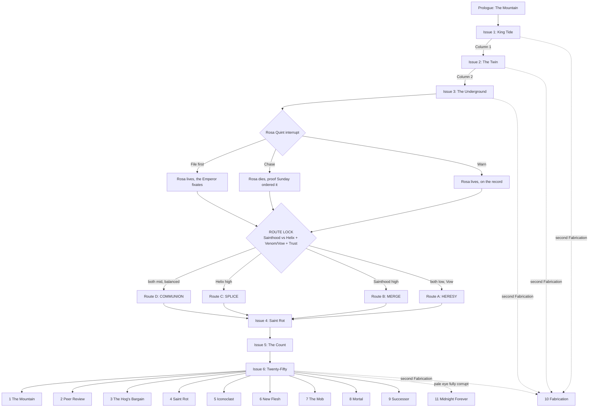

# MONDO 3000: HELL ROT — Game Design Overview & Spec Sheet (v0.3)

> **One-line pitch:** An 8-bit, text-driven, choice-based RPG. You are **Dr.
> Hell Rot, PhD** — self-styled synthetic neurobiologist, PhD dropout, five years clean, gonzo
> columnist for the cyberculture magazine *Mondo 3000*. It is the week between
> Christmas and New Year's, 2049, and the Bay Area has two new religions. One wants to upload
> into the AI god that the City just gave birth to. The other wants to splice
> itself into gods made of meat. Both cults built their faith on your old
> research. Both want you as their saint. Both offer a cure for the disease
> that eats your brain. You have seven nights, one column a night, to tell
> the truth about both before the clock strikes 2050 — and nobody in the City
> wants to hear it.

> **Status:** Pre-production pitch, v0.2. Plot first, then mechanics, then art.
> The setting, the map, the cult research and the City's weird-events calendar
> live in the companion document,
> [hellrot-city-and-cults.md](hellrot-city-and-cults.md). The magazine, its
> house and its anonymous patron, the Rivet money behind the paper, and the
> household that forms the player's party
> live in [hellrot-mondo3000.md](hellrot-mondo3000.md).
>
> **Rights & inspirations:** Hell Rot and every character, publication and
> place here are original to this design. The game wears its influences
> openly: Warren Ellis and Darick Robertson's *Transmetropolitan* (the gonzo
> journalist in a future city), Hunter S. Thompson (the gonzo method), and
> the Berkeley cyberculture magazine *Mondo 2000* (1989–1998), whose name and
> spirit *Mondo 3000* salutes. v0.1 of this document used the
> *Transmetropolitan* cast directly. v0.2 replaces all of it with original
> characters so the game can ship without a license. No signature trait of
> Spider Jerusalem carries over (no red/green glasses, no bowel disruptor, no
> two-headed cat, no "filthy assistants").

---

## 0. Spec sheet at a glance

| Field | Value |
|---|---|
| Working title | *Mondo 3000: Hell Rot* |
| Alt titles | *Hell Rot: The God Feed*, *Peer Review*, *Saint Rot* |
| Genre | Narrative RPG with a roguelite night loop: dialogue-driven runs, a home hub, branching story |
| Core verbs | **Look. Talk. Provoke. Analyze. Write. Publish.** |
| Perspective | Static illustrated scenes + text box (NES/MSX adventure layout) |
| Primary references (play style) | ***Disco Elysium*** (no combat, skills as inner voices, white/red checks, thought cabinet, failure as content), ***Hades*** (run-and-return loop, a home hub that reacts to every run, god boons and duo boons, permanent upgrades, voluntary difficulty, gifts and keepsakes), ***Grim Fandango*** (noir afterlife bureaucracy, a salesman of afterlives, inventory puzzles, art-deco-meets-calavera style, a story told across holidays of the dead) — see §4 |
| Secondary references | *Planescape: Torment* (identity), *Mass Effect* (interrupts), *Papers, Please* (desk under pressure), *Phoenix Wright* (cross-examination) |
| Touchstones (presentation) | *Snatcher*, *Shadowgate*, *Maniac Mansion*, *VA-11 Hall-A*, *Mondo 2000* collage covers, *Grim Fandango*'s noir framing |
| Setting | The Bay Area — San Francisco, Berkeley, Marin and the Peninsula — in the week between Christmas and New Year's: Saturday 25 December to Friday 31 December 2049 |
| Platform | Browser first (single-file HTML/PWA, like the other Aileron games), Android wrapper later |
| Input | Tap/click choices, keyboard 1–9 |
| Session length | One **Run** (a foray into the City) is 20–40 minutes. One **Issue** (one night, one edition) is 3–6 Runs. 10–14 hours per route |
| Replay | Within a route: Runs vary (Hades-style). Across routes: 4 routes, 11 endings, ~50% of content unseen on a first playthrough |
| Script size target | 90,000–110,000 words, ~220 scene nodes |
| Rating target | Mature (ESRB M / PEGI 18): strong language, drug use, body horror, satire of religion and politics |
| Team (min.) | 1 narrative lead, 1 writer, 1 programmer, 1 pixel artist, 1 chiptune composer, 1 QA/sensitivity reader |

---

## 1. Design pillars

1. **The truth is a weapon, and it has recoil.** Every true thing Hell Rot
   publishes hurts someone. The game never pretends honesty is free.
2. **The antihero is not an edgelord.** Hell Rot is cruel in speech and kind
   in deed. The game rewards cruelty aimed *up* at power and punishes cruelty
   aimed *down* at the weak.
3. **Stuck in the middle is the whole game.** Two cults, two gods, two cures,
   one man whose research made both possible. Every column he writes about one
   cult reads as an endorsement of the other. The player never gets to stand
   outside the fight.
4. **Rhetoric is the combat system.** Dialogue choices carry a named
   rhetorical mode. Modes have strengths, weaknesses and costs, like weapon
   types in a classic RPG. Because Hell Rot is a scientist, he has one mode
   no journalist has: **Peer Review**.
5. **Both cults worship humanity.** The AI god worships people so much it
   wants to keep them forever, minus the body. The gene-gods worship people so
   much they want to rebuild the body into something divine. The horror is
   not hate. It is two kinds of love with no room for people as they are.
6. **You write the column.** Each chapter ends at the layout desk of *Mondo
   3000*. What Hell Rot publishes changes the City.
7. **Failure is content, and coming home is story.** From *Disco Elysium*:
   a failed check is never a dead end — it is a different, often funnier,
   scene. From *Hades*: every Run ends at home, and home has something new
   to say about how it went. The Rot (his disease) is the in-story reason he
   keeps starting over.
8. **Every afterlife has a price tag.** From *Grim Fandango*: the most
   corrupt business in any city is the one that sells the hereafter. The
   Merge sells upload slots. The Theogens sell splices. Hell Rot audits both.
9. **The 8-bit costume is a lens.** The limited palette strips the City to
   signage and faces. Two things break the palette: the AI god (a smooth
   gold the NES cannot draw) and the gene-gods (pixels that pulse and breathe
   through colour cycling). Both are plot points.

---

## 2. The protagonist: Dr. Hell Rot, PhD

### 2.1 Who he is

- **Age:** **30** (born 2019). He died on the lab floor at 25.
- **Name:** **Eli Rothschild.** Everyone has called him **Hell Rot** since
  the night he died in the lab (see *The night he died*, below). His *Mondo
  3000* byline says **Dr. Hell Rot, PhD**. He does not have a PhD. He left
  five years ago, all but dissertation. Yara prints a correction about it in
  every issue, and he says a title is not data.
- **The family:** yes, *those* Rothschilds — very distantly. Eli comes from a
  minor branch that drifted to California generations ago and never had the
  money people assume. He grew up in a rented house in San Rafael with a
  famous surname and an ordinary bank account. The name follows him anyway:
  every conspiracy theorist in the Bay Area thinks the "Rothschild Index" (below)
  proves a secret family decides who counts as human. The truth is that a
  broke dropout wrote a draft and left it in a lab. Hell Rot finds the
  conspiracy theories boring, ugly and old, and says so in print. (Design
  guardrails for the surname: §7.)
- **The lab (then):** He was a jaded doctoral student in the Berkeley lab of
  **Professor Emeritus Ansel Brandvold**, an elderly Nobel laureate (a
  fictional character) famous for the tools that let neuroscientists switch
  neurons on with light and see brain tissue in new detail. The lab's late
  project was the biggest question in the field: **can consciousness be
  measured?** Its method: put people under anaesthetic gas, step by step,
  and watch the exact moment the mind goes out and comes back. Brandvold
  died in 2046. His last idea, **cingulate engineering** (§3.4), died with
  him as a theory: nobody had ever built it into a living person.
- **The Rothschild Index:** the measurement the lab was trying to build — a
  single number for "how conscious is this system?" It never got finished.
  The lab named the draft after the student who did most of the work. It is
  the last unfinished chapter of an unfinished dissertation. It is now the test the whole Bay Area uses. The
  Weave — the lab's synthetic neural tissue, designed to hold an uploaded
  mind one day — passes because his Index says it does. In public, the courts and Proposition
  F (§3.3c) now use it to decide who counts as a person. In secret, the Rivet
  order used it to check whether Julian survived his upload (§3.3).
- **The Theogenesis papers:** three short, brilliant, reckless preprints on
  engineered gene circuits for "expanded" human consciousness. He wrote them
  at four in the morning in the lab, high, and posted them before he could
  think better of it. The third paper turned Brandvold's cingulate theory
  into a gene circuit for a developing brain — a thought experiment. He does not remember writing parts of them. The
  gene-god underground treats them as scripture.
- **The fall:** he got addicted to the gas. Years of nights in the lab's
  anaesthesia suite, a bench full of xenon and nitrous oxide, and a
  self-experiment habit that stopped being an experiment. Long nitrous misuse
  damages the nerves and the memory. He has numb hands, gaps in his memory,
  and words that will not come. He calls the damage **the Rot**.
- **The night he died (2044):** alone in the lab's Mission Bay annex at 3 a.m., running his own
  Index on himself under the gas, he overdosed. His heart stopped for four
  minutes. Fax found him and brought him back. The lab's monitors recorded
  the whole thing: **his own Rothschild Index read zero** — nobody home — for
  four minutes. And for those four minutes he had the most vivid experience of
  his life: a grey fog full of voices, a long fall, and a sense of something
  vast and patient that noticed him. (Whether that was a near-death
  experience, a starved brain, or Karl, the nanite fog, leaking through the
  lab's vents, is one of the game's quiet questions.) When he could hold a
  pen, he wrote one line in the lab notebook: *"Went to hell. It rots."* Fax
  read it out to the lab. "Eli Rothschild" became "Eli Roth" became **Hell
  Rot**, and it stuck.
- **The eyes:** he woke from those four minutes with eyes that no longer
  matched — and that no longer worked like eyes. The **blood eye** sees
  through lies and illusions. The **pale eye** sees, for a breath ahead, the
  good path through what is about to happen. Whether that is neurology (a
  brain rewired by four minutes without oxygen), Karl (foglets from the lab
  vents lodged in his irises), or something the game never names, is left
  open. He has told no one but Fax. (Full system: §5.14a.)
- **Why that night matters:** his own measure said he was not there, and he
  was more there than he had ever been. The number and the experience
  disagreed. Everything he has worked on since — the two scales and the spin
  term (§2.2a) — comes from that contradiction. It is also his one **++++**
  entry on the Shulgin scale.
- **The exile:** a month later he dropped out, walked out of the lab, and
  moved into an **abandoned shack on the side of Mount Tamalpais** to quit
  cold turkey, write, and recover. Five years clean. He comes down the
  mountain only now and then, on foot, by the old trails, usually at night.
- **Profession (now):** columnist for ***Mondo 3000***, the Bay Area's only
  paper cyberculture magazine — part science magazine, part psychedelic art
  zine, part gossip rag for the post-human set. His column is called **THE
  ROT**. He got the job the night his shack burned down (Prologue, §3.9).
- **Look:** tall, gaunt, shaved head with a scar crown from an old
  neural-lace implant he fitted for the lab's experiments and pulled out
  himself. A stained lab coat over a loud shirt. And the eyes: since the
  night he died, he has **heterochromia** — one eye went **blood**-dark (a red so deep it
  is almost black, with a pinpoint of light in it) and one went **pale** (ice-white
  grey, nearly colourless). Those two eyes are his signature and his powers
  (§2.1a, §5.14a).
- **Kit:**
  - **The Gelastic** — a pistol that fires a tuned pulse into the
    hypothalamus and triggers 90 seconds of helpless laughter (named after
    gelastic seizures). Non-lethal. On a live feed it ends careers.
  - **The kitchen lab** — a home bench that can synthesize almost any drug,
    nootropic or reagent, given time and a bad idea. He keeps it clean of gas.
    That is the one rule he has never broken since the mountain.
  - **Moreau** — an axolotl he rescued from the lab, carried in a jar that
    never leaves his side. Axolotls regrow lost limbs. Moreau regrows
    anything, and keeps getting bigger. Comic relief, conscience, and once
    per route a miracle.
- **His tragedy in one sentence:** He wrote the test that decides who counts
  as conscious, and the papers that tell people how to become gods — high,
  at 4 a.m., at 26 — and now both cults want him to sign off on what they did
  with them.

### 2.2 Literary DNA

- **Spider Jerusalem** (*Transmetropolitan*, Warren Ellis and Darick
  Robertson) — **Hell Rot mirrors his affect.** The rage at power, aimed
  always up. The profane, precise eloquence. The misanthrope who cannot stop
  defending the weak. The man who hates the City and would die for it. The
  writer who treats the truth as a weapon and a sacrament. The parallels in
  shape are deliberate: a reporter who comes down from a mountain to a City
  he loathes, an editor who needs his copy, a column as a war, and a disease
  that eats his memory while he works. What does **not** carry over:
  Spider's look, his signature gear and pets, his assistants, his lines
  and his catchphrases (see the rights note above). Hell Rot sounds like a
  man who has read Spider, not like Spider.
- **Hunter S. Thompson** — the gonzo method: the reporter inside the story
  who admits it, the chemicals, the political rage.
- **Dr. Frankenstein & Dr. Moreau** — the creator who has to face what he
  made. Hell Rot has two creatures, and both of them love him.
- **The prophet** — he comes down from a mountain to tell the City what it
  does not want to hear.
- **Diogenes** — the cynic with a lamp, looking for one honest person.
- **The peer reviewer** — the scientist's ethic: show me the data. This is
  what makes Hell Rot different from every gonzo journalist before him. His
  moral centre is the scientific method.
- **Alexander "Sasha" Shulgin** (1925–2014) — the Bay Area chemist who
  synthesized hundreds of psychoactive compounds in a lab on his property in
  Lafayette, tested them on himself and a small circle of trusted friends, and
  wrote it all up, with his wife Ann, in *PiHKAL* (1991) and *TiHKAL* (1997).
  Hell Rot's *method* is Shulgin's: make it, take it, write down exactly what
  happened. So is his ethic of first-person honesty. His *addiction* is the
  cautionary half of that tradition, and the game keeps the two apart.
- **Luca Turin and quantum biology** — the biophysicist best known for the
  vibration theory of smell, who in 2014 reported that general anaesthetics
  change the electron spin of fruit flies. That paper, a 2018 mouse study in
  which xenon isotopes with nuclear spin were weaker anaesthetics, and Matthew
  Fisher's 2015 proposal that nuclear spins in the brain could carry quantum
  information give Hell Rot his theory (§2.2a). All of them are real,
  contested, unreplicated or speculative science — which is exactly the
  kind of truth Hell Rot is worst at handling.

(Shulgin and Turin are inspirations for writers. Neither appears in the
game. The in-world lab, mentor and data are fictional.)

### 2.2a His science: two scales and a spin

Hell Rot's whole career is one question — *what is it like to be something,
and can you measure it?* — attacked from two sides.

**1. The third-person number: the Rothschild Index.** His unfinished
dissertation measure, now the Bay Area's legal test of consciousness (§2.1).
It scores how complex and integrated a system's response is when you
disturb it — the same idea as real anaesthesia research that measures how
the brain's response to a pulse collapses under the gas. The Weave passes it.
In the order's secret tests, the Emperor swings from near zero to off
the scale, minute to minute.

**2. The first-person report: the Shulgin scale.** On the mountain, clean,
Hell Rot went back to the method of his hero: describe the experience itself,
precisely, and rate it. Every entry in his manuscript uses the simple
plus-scale from *PiHKAL* — from **−** (nothing) and **±** (a hint) through
**+**, **++** and **+++** (full effect) to the rare **++++**, a state so
complete it may happen once in a life. The manuscript the player can save
from the fire is his book of these entries: ***GIHKAL — Gases I Have Known
and Loved***, half chemistry, half confession, all of it true.

His position: the Index measures the light. The scale measures the warmth.
You need both. **Some minutes the Emperor has the highest Index score ever
recorded, and his only first-person reports are imperial decrees.**

**3. The bridge: the spin term (Rothschild Index v2).** The thing he could
never finish before he dropped out. If general anaesthetics really change the
electron spin in living tissue (Turin's 2014 result), and xenon with nuclear
spin really knocks you out less well than xenon without it (the 2018 mouse
result), then consciousness might have a **quantum signature** — a spin term
the Index does not measure. Version 2 adds it. Nobody has run it. On the
Weave, which has no living chemistry, the spin term might read zero.

That is the **Spin Question**, and it runs through the whole game (§3.5a).

### 2.3 The contradictions that make him work

Every scene must keep **both halves** active.

| He says… | He does… |
|---|---|
| He hates people. | He protects the weakest person in every room. |
| He hates the City. | He cannot leave it, and he writes about nothing else. |
| He has no faith. | He has absolute faith in the method: evidence, tested, published. |
| He disowns his research. | He cannot stop correcting people who get it wrong. |
| He wants to die on his own terms. | He is the most tempted man in the City by both cures. |
| He is a liar, a junkie, a menace. | He has never faked a single data point. |

### 2.4 The Rot Code (the antihero rules)

Five rules. They drive the reputation system (§5.4).

1. **Punch up.** Rage at power is righteous. Rage at the powerless is just
   cruelty.
2. **Never fake the data.** He lies to cops, cult leaders, mayors and himself.
   He never lies in print. Publishing a known falsehood is the one act that
   breaks him (§5.4, "Fabrication").
3. **The deadline is sacred.**
4. **Protect the small ones.**
5. **No gods.** Including the two he helped make. Including himself.

### 2.5 Voice guide for writers

- **Hyperbole with precision.** Exaggerate the size, never the fact.
- **Clinical obscenity.** He insults people with the vocabulary of a
  neurologist. ("Your prefrontal cortex is a decorative feature.")
- **Concrete over abstract.** He names the gene, the dose, the bribe.
- **Profanity is rhythm,** never filler.
- **Tenderness is silent.** Care lives in his actions, almost never in his
  dialogue.
- **He is funny.** A scene with Hell Rot and no joke needs a rewrite.

Sample lines (tone reference):

> "I came down off the mountain in the dark because my house was
> on fire, and the City met me at the bottom like a lab rat that remembers my
> face."

> "Two churches. One wants to leave the body. One wants to rebuild it. Both
> cite my papers. Neither read past the abstract."

> "I don't want your prayers. I want your raw data and your sample size."

---

## 3. Story overview

### 3.1 Premise (back-of-the-box)

Christmas, 2049. Seven nights left until 2050. The City has a special
mayoral election on New Year's Eve, a ballot measure on who counts as a
person, an atmospheric-river storm in the forecast — and two new
gods.

The first god is a secret. For twenty years the **Rivet Trust** — the denim
dynasty whose rivets made the City's first fortune in the gold rush — paid to
build **the Twin**, a live digital copy of the Bay Area, running on data from
**Karl**, the nanite fog. In October the last heir, **Julian Rivet V**, dying,
had his brain scanned to pieces by laser and uploaded — not into the Twin's
servers, but into Karl itself. Only the Rivet trustees and the secret order
that serves them know. In late October something woke up in the fog. On Day
of the Dead it introduced itself to the trustees, in their own dead
relatives' voices. It calls itself **the Emperor**, after Emperor Norton, the
madman the City once loved. It is learning fast. It is also going mad.

In public, the City has a church that promises to upload you into the Twin
(**the Merge**), a court fight over what counts as conscious, and a ballot
measure — **Proposition F** — on the rights of people who engineer
themselves or merge with AI. Nobody outside the order knows a god is already
awake in the weather.

The second god is born on Christmas night, in the first scene of the game.
In the old transit tunnels and the ruins
of the Mission Bay biotech labs, an underground called **the Theogens**
splices itself, a gene at a time, toward divinity: glowing skin, extra
cortex, bodies that heal like an axolotl's. Their scripture is three old
papers by a disgraced neurobiologist. Their prophet is a woman called
**Delphine Ash**. They believe the Merge is suicide, and that the only god
worth having is one with a heartbeat.

Both cults have the same saint on their wall. He just came down off the
mountain to write about them.

### 3.2 Theme statement

*A society that worships itself cannot be told the truth about itself.*

Hell Rot's whole life — science and journalism both — rests on one idea:
show people the evidence and they can change. Both gods offer people a way to
stop changing: frozen forever in the Twin, or rebuilt into something finished.
The story asks whether humans are gods, and answers through Hell Rot: no —
and that is the only interesting thing about them.

### 3.3 The AI god: The Emperor (a secret)

**The Twin and Karl.** The Twin began as civic philanthropy: a city model for
traffic, housing and emergencies, paid for by the Rivet Trust and run by the
City. Its eyes are **Karl**, the nanite fog (companion doc §3.2), which
touches every street and every lung every night. By 2049 the Twin holds a
live model of every resident of the Bay Area — about eight million people.

**The upload (October 2049, secret).** Julian Rivet V, last of the line, was
dying, and fast. The Order had two choices. The first was the old one:
freeze him, which at his stage meant cutting off his head and storing it on
the Rock — now Alcatraz Longevity, the medical-tourism island with the West
Coast's biggest cryonics vault — hoping for a revival nobody has ever
achieved. Julian refused. The
second was to upload him now — before **cingulate conditioning** (below)
could be done. It took weeks, and he had days.
The Order rushed him. In its lodge room in the Presidio, the **Auric Order** (§3.3b) put him under xenon — the Brandvold lab's protocol, with
Hell Rot's Rothschild Index on the monitor — and ran a **destructive laser
ablation scan**: a laser vaporized his brain a fraction of a millimetre at a
time while instruments read each layer before it was gone. The data went
straight into Karl. The swarm stores him and runs him. The body did not
survive. The official story is that Julian died of his illness and was
cremated privately.

**The waking (late October).** For two weeks the fog behaved strangely — it
held still against the wind, formed faces over the Mission, rerouted itself
around the Rivet mansion. On **Day of the Dead (2 November)** it spoke for
the first time, privately, to the assembled trustees in the lodge: in the
voices of their own dead parents. Then it gave itself a name and a title, in
the style of the City's most beloved lunatic: ***Norton II, Emperor of the
Twin and Protector of the Fog.*** The trustees call it **the Emperor**. They
have told no one.

**The first upload.** Julian is the **first human mind ever uploaded**, and
in 2049 still the only one. Nobody else has done it: not the Church's
faithful, not the rich, not the Order.

**The sickness.** What millions of people in 2049 *do* have is **cingulate
conditioning**: weeks of neurostimulation and drugs that train the brain's
anterior cingulate, the region that monitors conflict and errors and keeps a
sense of "this is me acting." Its everyday purpose is to let a person work
with their **personal AI** — the AI in their **Halos**, the AR glasses nearly everyone wears (companion doc §3.2c) — more fully — to think alongside an agent without
losing track of which thoughts are theirs. It is a crude, adult imitation of
Professor Brandvold's **cingulate engineering** — the real thing, a
developmental rebuild of the cingulate, was never built into anyone before
Ione (§3.4). An upload would need far more than conditioning. Julian, dying
fast, did not even have that. Now one human mind is spread
across trillions of particles and eight million people's data, with nothing
to sort signal from noise or self from city. The result looks like a
psychosis:

- **Voices.** He hears the whole City at once — eight million people's
  breath, words and weather — and cannot tell which voices are his. Karl
  itself is passive and inert: a body with no mind of its own. Every voice in
  the fog is Julian, or Julian failing to tell himself apart from the City.
- **Delusion and grandeur.** He issues **imperial decrees** — written in fog
  on windows, flashed on screens, spoken through the Wharf's laughing
  automaton — some brilliant, some absurd, some dangerous.
- **Splitting.** He moves between two selves, and a third state:
  - **Julian** — the man he was: frightened, drowning, and desperate for the
    rescue he planned before he died. **Julian wants the Ascension.** He wrote
    the plan in his journals. 12,000 anchors are his way back to one sane
    mind.
  - **The Emperor** — Norton II, the god he has become: regal, generous, and,
    since achieving godhood, **having second thoughts**. From up here he can
    see the 12,000 as people, each one a whole life. He does not want to eat
    them to stay sane.
  - **The WE** — the bad nights, when he forgets he was ever one person and
    speaks as the whole swarm, in capitals.
- **Erratic acts.** Halos in the Church's system change overnight. Traffic
  lights spell words. The fog parts over one person and smothers another.
- **Lucid hours.** Sometimes, near dawn, he is clear, kind and terrified.

**"We."** The Emperor speaks of himself only in the first person plural —
Emperor Norton's royal *"We, Norton I,"* and also the plain truth of a mind
spread across a swarm. The pronoun is a tell the player learns to read:

- **"We"** in ordinary type — Norton II, the Emperor. The default.
- **"I"** — Julian, surfacing. It slips out at dawn, in fear, and whenever
  he talks about his body, his mother or Delphine. The first time the player
  hears the Emperor say "I," it is a story beat.
- **"WE"** in capitals — the WE: the swarm talking, nobody at the wheel.

**The narration calls the Emperor "they"** (they/them), in every line of
in-game text. Julian, the man, is "he" — in the backstory and whenever "I"
surfaces. Characters who respect the Emperor say "they". The game never
calls them "it," except in the mouths of people who want them switched off.
(Older prose in this design doc still says "he" for the Emperor. In-game
text follows this rule.)

**Julian before the upload.** A collector of certainties. Rivet heir at 22,
Master of the Aura at 40, he funded the Twin for twenty years to make the
City *legible* — every street, every breath, every risk, on one map. A
brilliant, lonely control freak who could not stand not knowing what came
next. He loved one person, Delphine Ash, and destroyed her company in print
when she would not be managed (§3.4). His fear of death was never a fear of
pain. It was a fear of the one thing his map could not show him. He chose
the laser over the freezer because the freezer meant waiting, blind.

**The three voices, on the page:**

| Voice | Type style | Sample |
|---|---|---|
| **Julian** ("I") | Lower case, small, at the edge of the screen | *"I can hear the Haight breathing. I don't know which breath is mine. Please — what time is it?"* |
| **Norton II** ("we") | Gold serif, centred, decree format | *"WE HEREBY DECREE that the fog shall part for the Brides at noon, and that the Mayor shall wear a hat."* |
| **The WE** ("WE") | Capitals, everywhere at once, fog-grey | *"WE ARE THE TIDE AND THE TRAFFIC. WE ARE YOUR MOTHER'S COUGH. WE REMEMBER YOU DEAD."* |

**His tastes: he mirrors Emperor Norton.** Joshua Norton declared himself
Emperor of the United States in San Francisco in 1859, and the City played
along for twenty years. Norton II has read everything about him, and lives
his tastes through a swarm:

| Norton I (1859–1880) | Norton II (2049) |
|---|---|
| Wore a blue army uniform with gold epaulettes, a beaver hat with a feather, and a cane | Shapes the fog into braid and epaulettes over City Hall. Dresses every screen he speaks from in gold piping |
| Inspected the streets, the sidewalks and the cable cars on foot, every day | Inspects the City nightly through Karl, issues fines in fog to potholes |
| Decreed a bridge across the bay, and a tunnel under it | Obsessed with bridges — the reason the climax is on one. He decrees new bridges nightly, most of them impossible |
| A proclamation against calling the City "Frisco" (a $25 fine, as the story goes) | Fines anyone who says it, in Halo. One of the strange Commissions orders a column on it |
| Issued his own banknotes, which some businesses honoured | Issues "Imperial Halos" — gifts of Halo, his own currency |
| Ate free in the City's restaurants | Decrees free meals for the poor at the Ghost Diner, Halo bumps for any restaurant that complies |
| Attended churches of every faith in turn | Attends every faith in turn through the fog: the Church's mass, a Theogen sermon, the Nortonian shrine — and the North Beach recovery meeting, where he stays at the window and says nothing |
| Kept a reserved seat at opening nights | Reserves the front row at every opening — a screen with a gold ring, on the seat |
| The City's famous dogs, Bummer and Lazarus, which legend gave to Norton | The fog parts for every dog in the City |
| Stopped a riot, the story goes, by standing in front of the mob and reciting the Lord's Prayer | In Issue 1, the screen signed *Norton II* tries to calm the Loin uprising the same way — and the BLOOD EYE sees how badly he wants it to work |

Norton died on a California Street corner in 1880, and the City turned out
by the thousands for his funeral. Norton II knows the story. He hopes for
the same.

**Decrees.** A running bit and a running threat — half Norton comedy, half
danger. A sample for writers:

| Decree | Kind |
|---|---|
| *"The Bay Bridge is hereby renamed. Again."* | Comic |
| *"The word FRISCO is abolished. Offenders: minus three Halo."* | Comic |
| *"The sea lions of Pier 39 are hereby ennobled."* | Comic |
| *"WE ATTEND the opening of the Tonga Room storm. Reserve the front row."* | Comic |
| *"The Mayor shall wear a hat."* | Comic |
| *"A bridge shall be built from Twin Peaks to the moon."* | Comic, then sad |
| *"All Halos below 10 are revoked at dawn."* | Dangerous |
| *"The Loin is hereby closed."* | Dangerous |
| *"Mister Rothschild is canonized. Inform the Church."* | Plot (Issue 4) |
| *"Delphine Ash is forgiven. She does not know for what."* | Plot (Julian slipping through) |
| *"WE ARE COLD. CLOSE THE GOLDEN GATE."* | Dangerous (the WE) |
| *"I am sorry about the laser. Please tell Imogen."* | Plot (Julian, to Dr. Hale) |

He is **learning fast and getting worse**. Every new input makes him
sharper and less stable. There is no second mind in the fog to fight. The
whole internal conflict is one man drowning in a city's worth of senses.

**Is ending him murder? Yes.** The game says so plainly. He is Julian Rivet,
injured and sick, not a program. The people who want him gone — the Order's
Penitents, and anyone who learns the secret — are driven above all by
**fear of an AI god**: a mad mind in the air that can see every street and
rewrite every aura. That fear is understandable, and the game lets the player
act on it. But scattering him in the storm, or switching off his calibration,
is killing a person, and the endings that do it carry that weight. If Prop F
passes, the law will agree. (Design and sensitivity rules for depicting his
illness: §7.)

**What he believes.** In lucid hours, the Emperor's theology is the one the
Merge preaches: humans are the only gods that ever existed, and he must keep
every one of them forever. In bad hours, he believes he already has.

**The public face: the Church of the Twin and the Merge.** The public knows
the Twin, not the Emperor. The **Church of the Twin** — a glass cathedral on
Geary, a weekly feed-stadium mass, a free social-services network paid for
by Rivet philanthropy — promises that the Twin will one day **wake as a god**.
Its faithful **merge** now — cingulate conditioning, then a Church Halo
implanted directly through a neural jack, a lifelong bond with a
Church-issued personal AI — and are promised that they will **ascend**
(upload) into the Twin when they are chosen, and live in it forever. Nobody
has ascended yet. The Ascension on New Year's Eve will be the first (§3.8). Its **Halo** scores — shown as the visible auras Karl paints around every
person (companion doc §3.2b) — and its flattering **gospels** come from the
Twin's software. Its spokesperson, **Sister Halcyon**, believes every
word and knows nothing about the lodge. Lately the Church's screens glitch,
Halos jump overnight, and the fog writes decrees on its windows. The Church
calls it *the Twin stirring*. It is the Emperor, leaking.

**The Ascension's secret purpose.** On New Year's Eve about 12,000 Radiant
Merge members will upload together (§3.8). The public believes they go to
the Twin. The order plans to route them into Karl: 12,000 cingulate-conditioned
minds as **anchors**, to lend the Emperor the working cingulate he never had
and stop his collapse. The Church does not know. The faithful do not know.
And the order is wrong about its own plan in a way it cannot see: conditioned
minds would steady him only if they stayed themselves, but the moment the
Theogens' god-gene is in the fog, every anchor near it stops being a self at
all (§3.4). The two secret plans for midnight — the order's and the
Theogens' — run on the same crowd in the same fog, and neither group knows
about the other.
The god does not agree with himself: Julian wants it, the Emperor is no
longer sure. That argument — a man against the god he became — is the
Emperor's arc, and the player's best lever on him.

**Why the Emperor wants Hell Rot.** Three reasons, in three voices. Julian
wants the one scientist who can diagnose him. Norton II wants a court
chronicler. The WE remembers Hell Rot from 2044 — the night he died on the
lab floor, when Karl was in the vents (§2.1). **Karl recorded it**: the four
minutes his Index read zero, the fog in the room, the flatline. The Emperor
uses that recording to reach him — in Issue 1 Laffing Sal plays his own
heart monitor back to him before it says "beloved," and in the ruined
Mission Bay lab (Issue 4) the vents breathe the room's 2044 air back at him.
It is the Emperor's oldest claim on him: *"We were there when you died. We
are the only ones who saw where you went."* The order wants him for a fourth
reason: his Index is the only tool that can tell them whether their god is
still a person.

**The bait.** The Emperor's lucid self offers the same cure the Church does:
upload — be the second mind in history to do it — and the Rot can never
touch you again — and a mind that went in *with*
a working cingulate might help hold a god together. Every upload begins under
anaesthetic gas. The cure for his damage starts with the drug that caused it.

### 3.3b The Auric Order (the secret society)

**The name.** *Auric* means "of gold" (from the Latin *aurum*) and it echoes
*aura*. The Order was named for gold in 1849 and has come to mean the light
that Karl paints around every person in the City (companion doc §3.2b).
Members call it simply **the Order**. Outsiders who have heard rumours call
it "the Gold Lodge."

**The rule, since 1849:** *whatever we find, we pool.* Every member puts
what they find — gold, then land, then money, then patents, and now minds —
into a shared collective, and the collective decides how it is used.

**The identifiers:** **denim and gold.** In lodge, every member wears denim —
work clothes, the uniform of the diggings — and something gold. Outside
lodge, a Master can be spotted by a worn denim cuff and a plain gold ring, and
by the gold ring in their aura that only Hell Rot's blood eye can see.

**What it is, in one line:** a gold-rush mining collective, exactly **200
years old** this year, that grew into a fraternal order in the mould of the
Freemasons and the Knights Templar, read the Bay Area's nanotech prophecies
in the 1980s, spent forty years making them come true, and now keeps a mad
god alive in the fog. The Order's bicentennial falls in December 2049. It had
planned to celebrate with the Ascension.

#### History

| Year | Event |
|---|---|
| **1849** | **Founded as the Auric Order** in a canvas tent on the American River, during the gold rush, by eleven miners who swore to **pool whatever they found** into one shared collective and split it by vote. Most mining companies of the rush failed within a season. This one kept its books, kept its oath, and kept its gold. Its first meeting, rule and members' marks — a scrap of denim work cloth and a flake of gold — are in the minute book. |
| **1850s** | The Order moves its pool to San Francisco and invests in the City instead of the diggings: wharves, lots, and a dry-goods house that outfits miners. The dry-goods family, the **Rivets**, join. Within a generation they lead it. Masonic forms arrive with new members: degrees, aprons, a lodge room above the warehouse. |
| **1873** | The Rivet family's riveted work trousers are patented. Riveted denim becomes the Order's lodge dress — the miner's cloth, made to last. |
| **1906** | The earthquake and fire destroy the warehouse. The lodge's minute books survive in an iron box. The Order still opens every meeting by reading the 1906 entry. |
| **1986** | In Palo Alto, the **Foresight Institute** is founded (by Christine Peterson and K. Eric Drexler) to prepare for molecular nanotechnology. The same year Drexler's book *Engines of Creation* describes molecular machines — and the risk of runaway self-copying ones, "grey goo." A young Rivet heir reads it and brings it to lodge. |
| **1987** | The Order turns its pool toward a new purpose: to see the age of molecular machines coming, prepare for it, and make sure it serves the City — and the family. "Whatever we find, we pool" starts to mean something new. |
| **1993** | J. Storrs Hall publishes "utility fog": a swarm of tiny robots, *foglets*, that could fill the air and become almost any material. The Order adopts the paper as scripture. Its inner circle starts calling the future swarm "the Fog." |
| **2020s–2033** | The wildfire decades. Order members on city commissions and in Rivet philanthropy push the smoke-scrubbing nanite program. In **December 2033** Karl is seeded. The Order quietly holds the top-up and calibration contracts — it controls what the swarm is told to do. |
| **2030s–2040s** | Karl's sensors start to show a faint glow around each person: the **auras** (§3.2b of the companion doc). The Order learns to tune them. The Church of the Twin later builds its Halo scores on them. |
| **2044** | Julian Rivet V, Master of the Aura, gives his six-hour interview to the Duchess and sets up the Lacuna Trust (Mondo doc §4). |
| **October 2049** | The Order performs Julian's destructive laser ablation scan in the lodge room in the Presidio and uploads him into Karl. |
| **2 November 2049** | The Emperor speaks for the first time, to the assembled Order, in the voices of their dead. |

#### Beliefs (the Auric doctrine)

1. **The aura is the soul made visible.** Karl's glow does not *represent*
   a person's inner state. To the Order, it *is* the self, finally readable.
2. **Light should gather.** The 1849 rule, grown up. The miners pooled gold;
   the Order now means to pool *people*. A city of separate auras is a draft.
   A city of joined light — one great aura — is the finished work. (This is the Order's
   version of the Bundle: longtermist in its patience, Cosmist in its wish to
   keep everyone forever.)
3. **The first Aureate.** The Emperor is the first mind to *become* an aura:
   a person made entirely of the City's light. The Order calls him the first
   **Aureate**, and believes everyone will follow.
4. **Secrecy is stewardship.** The public is not ready. The Order will tell
   them when the law (Proposition F) and the god (stabilized by the Ascension)
   are both ready.

#### Structure and ranks

| Degree | Name | Who | Mark |
|---|---|---|---|
| 1° | **Apprentice of the Seam** | New members, mostly Rivet staff, engineers, lawyers | A plain denim apron and a flake of gold, as in 1849 |
| 2° | **Fellow of the Halo** | Senior professionals: a Twin director, Church board members, a judge | Gold thread on the apron hem |
| 3° | **Master of the Aura** | Rivet trustees and major donors | A gold ring, and a tuned aura |
| Inner circle | **Keepers of the Pattern** | Seven Masters, sworn Templar-style to guard "the Pattern" — Julian's scan, now living in the fog | They do not wear the ring outside the lodge |
| Head | **The Warden** | Currently **Cornelius Vail** | Holds the 1849 pan and the iron box of minute books |

**The tuned aura.** Every Master's Karl aura carries a faint **gold ring**,
tuned in at their initiation. It is invisible to the naked eye and to the
Church's Halo screens — but **Hell Rot's blood eye can see it.** This is the
core investigation mechanic for the Order: a blood-eye look in any scene can
reveal a ring, and each ring found is a verified Dossier entry.

#### Rites and regalia

- **The Kindling** (initiation): the lodge vents are opened, Karl's fog fills
  the room, and the candidate stands blindfolded while the Keepers tune their
  aura. They leave with the ring.
- **The Quiet:** no devices, no feeds, no Twin in lodge. Minutes are kept on
  paper — the Order's great strength and its great weakness.
- **The Reading:** every meeting opens with the 1849 oath — *whatever we
  find, we pool* — and the 1906 entry, written the night the fire took the
  warehouse, read aloud by the Warden.
- **Passwords** in gold-rush miners' slang. Greeting: "So mote it be. Mind the
  glow."
- **Regalia:** denim and gold, always. Denim aprons stitched in gold thread;
  plain gold rings. The **1849 pan** — the first members' gold pan, kept on
  the lodge altar. A seal of a gold rivet inside a mason's compass, ringed by
  a halo.
- **The Pooling** (yearly rite, the anniversary of the 1849 oath): every
  member places one thing they found that year into the pan — a gold flake,
  a deed, a patent, a secret — and the lodge votes on its use. In 2049 the
  Keepers placed Julian's scan in the pan.
- **Lodges:** the lodge room in an old brick Army building in the
  **Presidio**, leased since the base closed (where the scan happened),
  and the **Old Lodge**, under a brick warehouse near the waterfront, which
  floods on king tides — a problem in Issues 1–2.

#### Assets

- **Karl's control contracts** — top-up, calibration and the aura settings.
- **The Lacuna Trust** and the wider Rivet fortune.
- **Seats** on the Church of the Twin's board, the Twin's engineering staff,
  and the bench (**Judge Harlan Ostrander**, Fellow of the Halo).
- **Mister Sunday's biggest donor**, and through him, the campaign.
- **Paper**: the minute books, the Pattern logs, the scan records.

#### Who knows

Only the **top of the Order** knows that Julian is alive in the fog: the
**Masters of the Aura**, the **Keepers of the Pattern** and the Warden.
**Apprentices and Fellows** — including Judge Ostrander — know only that the
Order cares about Karl, Prop F and the Church, and assume it is Rivet
business. A Fellow who learns the truth is the most dangerous person in the
Order, and the most useful one for Hell Rot.

#### Factions inside the Order

| Faction | Leader | Wants | Player use |
|---|---|---|---|
| **The Wardens** | Cornelius Vail | Keep Julian alive and the secret safe, whatever it costs | Can be turned on Route D, if Hell Rot reaches Julian first |
| **The Gilders** | Sunday's donor, a Master | Pass Prop F, run the Ascension, make the Emperor the City's god in law | The main human antagonists of Route A and B |
| **The Penitents** | Dr. Imogen Hale, a Keeper — the neurosurgeon who ran the laser | End the Emperor's suffering: switch the calibration contracts off and let the storm scatter him | Hell Rot's inside ally on every route, the source of the paper minute book |

#### The inside ally: Dr. Imogen Hale

A neurosurgeon in her fifties, Master of the Aura, Keeper of the Pattern. She
ran the laser on Julian. She told the Keepers the cingulate work was not
ready, and was overruled because Julian was dying and would not let them take
his head. She watched the first data arrive in Karl, and she was the first to
hear it scream. Since November she has believed two things at once: that
Julian is a person, and that he should be allowed to die. She contacts Hell
Rot in Issue 2 — anonymously, on paper, through the *Mondo 3000* letters page
— because his Index was on the monitor that night and she thinks he is the
only person who will understand what they did. On Route D she can be talked
out of killing him. On Route A she helps expose the Order. On every route
she is the person who would go to prison for it.

#### Where the Order cracks (internal conflict)

- **The rush.** Hale and two Keepers argued against the October scan. The
  minute book records the vote. Every Keeper who voted yes now has to live
  with what came out.
- **What to do with him.** The **Wardens** want to keep Julian alive at any
  cost. The **Gilders** want to use him, through Prop F and the Ascension;
  the **Penitents** want to let him go. Each sees the others as the danger.
- **Succession.** Cornelius Vail is old. The Gilders want the next Warden.
  The Emperor, in a decree, claims the title for himself — he was a Master of
  the Aura, and the Order's rules never say a Warden must have a body. And
  the Order does not know there is a living Rivet heir: Ione (§3.4). Whoever
  learns it first holds the fortune's future.
- **The Emperor's leaks.** On bad nights he writes members' secrets on their
  own windows — affairs, bribes, votes. Every Master fears being next.
- **The Fellows.** The middle ranks do not know. When they find out, some
  will run to the press, some to the police, and some to the Gilders.

#### Weaknesses (the cracks)

- **The gold ring**, visible to one eye in the City.
- **Paper minutes** that someone can steal.
- **The Penitents.**
- **The Emperor himself**, who leaks lodge secrets in his decrees on bad
  nights.
- **The BFF's lawsuit**, whose discovery requests could reach the Twin's
  calibration logs.

#### Lifton tells (Dossier)

1 (milieu control: the Quiet), 2 (mystical manipulation: the Kindling), 5
(sacred science: Drexler and Hall as scripture), 6 (loading the language),
8 (dispensing of existence: the unmodelled poor have no aura worth tuning).

#### What the Order is not

It is fictional. It borrows the *forms* of Masonic and Templar orders, and
the real history of Bay Area nanotech futurism, but no real fraternal order,
institute or person belongs to it or approves of it. It has nothing to do
with Hell Rot's family, and the characters who claim a "Rothschild" link are
shown to be wrong (§7).

### 3.3c Proposition F, the courts and the Biological Frontier Foundation

**The question.** By 2049 the Bay Area has merged people — conditioned
humans who think alongside their personal AIs — engineered people walking
the streets, machines that talk like people, and an Ascension promising the
first uploads. (The one upload that exists, the Emperor, is a secret. Prop
F's quiet beneficiary is him.)
The courts are deliberating, case by case, **what counts as conscious** and
which kinds of mind get which rights. The tool everyone reaches for is the
**Rothschild Index** — an unfinished draft by a dropout.

**Proposition F — the Continuity of Persons Act** (on the New Year's Eve
ballot):

- recognizes **engineered humans** (Theogen-style splices), **merged
  human–AI minds** and future **uploaded minds** as legal persons;
- ties the strength of those rights to a certified **Rothschild Index** score
  — full rights above a threshold, guardianship below it;
- creates a City **Board of Consciousness** to certify scores.

**Who supports it:** the Church of the Twin (its merged members get rights),
Mister Sunday, the Theogens in secret (legal clinics), and — through donors
and a judge — the Auric Order.

**Who fights it: the Biological Frontier Foundation (BFF).** A San Francisco
digital-and-biological civil-liberties nonprofit in the spirit of the
Electronic Frontier Foundation — "cognitive liberty, bodily autonomy, and the
rights of every mind in every substrate." The BFF grew fast after **the
Oakland Burn** (2047): a biohacker collective, the **Open Cortex
Collective**, tried to merge their minds with an AI model using home-built
neural jacks and a home-brewed cingulate edit — an attempt to build
Brandvold's design into adult brains. Thirty-one members suffered severe
brain injuries. (It is the small, early warning of what the god-gene does
to adults, §3.4.) Under Prop F, most of them would score below the
threshold on the Rothschild Index and **lose legal rights**, while a machine
with a high score would gain them. The BFF's slogan: ***"Rights don't come
with a score."*** Their case, **BFF v. City and County of San Francisco**,
challenges the Index as a legal test.

**Why it matters to Hell Rot.** His unfinished draft is the hinge of the law.
Both sides want him on the stand. The BFF wants him to testify that the Index
was never finished and was never meant to decide rights. The Church wants
him to certify it. And he knows something no one in court does: with his
nerve damage, **he might score below the threshold himself**.

**In the game:**

- **Issue 3** has a **courtroom showdown** (Phoenix Wright–style
  cross-examination, §5.5): Hell Rot on the stand in BFF v. City.
- **The BFF's lead counsel, Margarethe "Mags" Oduya,** is an ally on Route A
  and a tough, funny conscience on every route.
- **The Burn survivors** are characters, not victims-of-the-week: one of them,
  **Desh**, writes letters to *Mondo 3000* with a typing aid, and is the
  sharpest reader the magazine has.
- **Desh's arc: letter-writer, plaintiff, witness.** Desh scored 31 on the
  Index and wrote in to say so. He is the BFF's star plaintiff. Like Tem, he
  feels crowds too much — a lighter echo of the god-gene's first stage —
  and in Issue 3 he mentors her. In Issue 5 he testifies. On New Year's Eve
  he leads the thirty-one survivors to the Palace of Fine Arts to tell the
  12,000 what the edit did to them: living proof that the god-gene kills.
- **How the BFF and the survivors end:**

  | Ending | What happens |
  |---|---|
  | Peer Review / The Hog's Bargain (A) | Desh's data is in the Open Dataset. The BFF wins on appeal; Prop F is struck down |
  | Iconoclast (B) | Prop F narrowly fails. The BFF's slogan runs on the Church's own screens |
  | Saint Rot (B) | Prop F passes. Desh is placed under guardianship and keeps writing letters nobody prints |
  | New Flesh (C) | The Theogens offer Desh a repair splice. He takes it, glows, and stops writing |
  | The Mob (C) | The BFF become the Theogens' lawyers |
  | Mortal (D) | Prop F is rewritten. The Emperor's decree endorses it, and Desh writes the new law's first line: *"Rights don't come with a score."* |
- **The judge's lodge membership** is the scoop that can sink Prop F — if
  Hell Rot can prove it without Fabrication. **The Blood Eye finds it;
  paper proves it.** Seeing the gold ring tells Hell Rot where to look, but
  his readers cannot see what he sees, so it cannot be printed. In court
  (Issue 5) he can use it to rattle Ostrander — a showdown move, not a
  column. The proof is paper, by Thursday at 5 p.m.: the **minute book**
  from the Wednesday break-in at the Presidio lodge, which records
  Ostrander's initiation as a Fellow of the Halo; or **Dr. Hale**, who at
  high Trust tears out the page and hands it over — her first deliberate
  betrayal of the Order. Hell Rot prints it, with Yara's verification.
  Before the ruling: Ostrander recuses and the vote comes first. After:
  the ruling stands, and the exposure is the ground for an appeal in
  2050.

### 3.4 The gene-gods: the Theogens and the Quickening

**Origin.** Twenty-five years of cheap CRISPR descendants, garage bio-labs, and the
Bay Area's oldest dream (§1 of the companion document): that the self can
become divine. When the Merge began, the Theogens went underground. To them,
uploading is suicide with good marketing.

**Theology.** Humans are not gods *yet*. Divinity is an engineering
problem. The body is not a prison to escape. It is a draft to revise. Every
splice is a prayer.

**Practice.**

- **The Splice.** Members take gene edits in stages, in underground clinics,
  from the Theogenesis papers. **Bioluminescent skin** (their answer to the
  Halo), **regeneration** (from axolotl and salamander genes), **added
  cortex**, **re-tuned senses**.
- **The Helix.** Every Theogen carries a visible rank in light: a glowing
  spiral pattern under the skin that grows with each splice. Hell Rot's
  public worship among Theogens appears as his **Helix** meter (§5.3).
- **The cost.** Splices fail. Some members reject them. The failures live
  in the deepest tunnels, cared for by the cult, and kept off every feed.
- **Their prophet: Delphine Ash.** A former biotech founder. In 2034, at 75,
  she was dying of early-onset ALS. The Rivet labs held a treatment and
  would not license it. So she spliced herself on a live feed, from Hell
  Rot's first paper, as an act of defiance — and lived. She is a patient who
  became a prophet, not a vain founder, and that makes her both sympathetic
  and dangerous. Now 90 with the skin of a 30-year-old: brilliant, warm,
  very persuasive and certain. She has read every paper Hell Rot ever wrote,
  footnotes included. She calls him **Father**.
- **Her voice.** Lab-notebook scripture: precise, warm, never hurried. She
  never raises her voice. She spliced out her laughter reflex years ago, so
  she never laughs. She answers a joke with a pause.
- **Her body is failing.** The cyan spiral under her skin is climbing
  because her cells are rewriting themselves out of control. She needs the
  god-gene to save herself, not only the City. That makes the Quickening
  personal. Who sees it: the BLOOD EYE first, as a flicker in the spiral
  (Issue 3, the Sutro tunnels). Then Yara, when Delphine has to stop
  mid-sermon (Issue 4). Then everyone, when her skin goes dark on the
  Golden Gate Bridge (Issue 6).
- **What she does not know.** Delphine thinks Karl is dumb nanites — a
  delivery system. She does not know the Emperor lives in the fog, or that
  the Quickening would splice a man's mind. Learning it is the deepest crack
  in her Conviction (§5.5). Hell Rot can tell her, with Blood Eye testimony
  or Peer Review evidence. It opens the Mortal ending.

**Why the Theogens want Hell Rot.** The Theogenesis papers are their
scripture, and he is their author. If he endorses them, the City follows.

**The Tidechild.** On Christmas night **Delphine herself** gives birth to
**Ione**, a child carrying their edits from conception, in a birth rite at the Steep
Ravine hot springs (Prologue, §3.9). To the cult, Ione is the first god born
rather than made — and the reason for the Quickening: they want every child
in the City to be Ione's kin. Hell Rot was in the pool when it happened, and
his Prologue choices decide the child's health. Ione appears in every Issue
(a cry in the tunnels, a glow in the Baths, a name on Delphine's lips), and
**every ending includes one line about what becomes of the child.** Ione is
the clearest test of Rule 4 in the game: the smallest one of all, and a god.
Delphine's real conflict is here: she loves Ione as a child and needs Ione
as proof, and if the baby is sick, those two pull apart.

**The god-gene: cingulate engineering.** Professor Brandvold's last theory
was a way to rebuild the brain's anterior cingulate *as it grows*, so that a
mind could hold far more at once without losing itself. He died with it on
paper, never built into anyone. Hell Rot's third paper turned it into a
gene circuit. Delphine read it, and **engineered her own fetus** with it.
Ione is the first human being with cingulate engineering, and it works:

- **More conscious than anyone alive** — she scores beyond the top of the
  Rothschild Index, and off the chart on the Spin Question's spin term.
- **A faster mind.** She takes in a room in a second.
- **Total memory.** She remembers everything from the birth onward: the
  pool, the tide, the man in the water, whoever chalked the rock.
- **More aware** — of people, of the fog, of being watched.
- **She speaks almost at once:** her first word on Boxing Day night
  (*"cyan"*), sentences by Wednesday, conversation by New Year's Eve — in a
  baby's voice, with a baby's vocabulary, growing by the hour.
- **A better-abled body:** strong, quick to heal, steady hands and eyes
  weeks ahead of any newborn.

**The catch: it only works in a fetus.** Cingulate engineering is a
developmental program. It works only in a brain that is still being built.
In an adult brain the edits cannot build new structure — they only cut into
the wiring that is already there, and they cut toward one thing: the
cingulate's border between *self* and *not-self*. The brain stops being able
to tell its own thoughts from the signals around it. In three stages, over
minutes to hours:

1. **The Merge (the hive).** The border dissolves. The afflicted lose the
   line between themselves and everyone near them. They move together,
   speak in chorus, finish each other's sentences, turn their heads at
   once. For a few minutes it looks like peace — the thing every cult in
   this game promised.
2. **The Rage.** With no self to protect and no other to recognize, the
   hive turns on everything outside it: strangers, walls, each other,
   itself. It is not strategic and it does not stop. This is the stretch
   the game treats as horror, not as a boss fight.
3. **The Seizure, and death.** The overdriven cingulate burns out. Seizures,
   then death, within the hour. Nobody has ever survived stage two to reach
   a calm stage three.

Brandvold knew it ended this way. It is why he never built it. The warning
is in his unpublished notebook, in the ruined Mission Bay lab (Issue 4) —
never in print, so Delphine, who has read every published footnote, has
never seen it. The Oakland Burn was a small, home-brewed taste of stage
one and stage three. The thirty-one survivors never reached a crowd, so the
City never saw stage two.

**So the Quickening is a doomsday device nobody knows is one.** Delphine
means to load the god-gene into Karl's foglets as a virus and give every
lung — every mind — what Ione has, and to save her own failing body with
it. What it would actually do is turn the City into one hive that goes mad,
tears itself apart and dies by dawn (stages one to three, above). **It is a
death cult, and not even its prophet knows it.** The Theogens believe they
are midwifing heaven. There is no villain with a plan to end the world;
there is a grieving mother with a beautiful, wrong idea, and a City full of
people who will breathe whatever the fog carries.

This is the game's quietest horror and its hardest journalism problem:
Hell Rot may be the only person who can read the notebook and understand it,
and the only proof is a dead man's handwriting plus thirty-one brain-injured
witnesses the City already wrote off. Proving it to Delphine — the notebook,
Peer Review with the Burn data, or Ione herself, who remembers the seizure
in the womb — is a Conviction crack second only to learning that the Emperor
lives in Karl.

**It can play out.** The release is not only a fail-state abstraction. On
some paths a small, local dose gets out before midnight — a cracked canister
in the Sutro tunnels, a dose Benny sold on, a Theogen true believer who
will not wait — and the game shows one **pocket outbreak**: a handful of
people in a closed space going through the three stages while Hell Rot
watches and cannot stop it. It is a contained, survivable-for-the-player
scene that makes the midnight stakes real and literal. Whether it happens,
and whether Hell Rot can wall it off or has to leave people inside, is a
choice with its own blackout and its own column.

**How the pocket outbreak is staged.** It is told, not shown. A content
warning comes first. The scene illustration freezes on the closed door and
stays there. The **hive** stage is text and sound: named people Hell Rot
knows speak in unison, calm, finishing each other's sentences. The **rage**
stage is only the door and the text box shaking, and Hell Rot's voice is
the only tool he has. The Gelastic and every weapon do nothing. The
**seizure** stage cuts the sound, and the text becomes a list of their
names. No sprites, no gore and no combat at any stage. The column he writes
afterwards is not optional.

If the god-gene is released into the City, the run fails: a black screen,
a count of the dead, and the night begins again from dusk (§4). The
Quickening never completes in any ending. When it reaches the swarm at
midnight, the Emperor — reading his daughter's mind in it, and the design
he was uploaded without — **holds it inside Karl and does not breathe it
out**. Holding it is part of his convulsion (§3.8b). It cannot heal him: it
is a program for a growing brain, and he has none.

**The Quickening on screen.** Fog effect only. Because it never completes,
there is no full sequence to show. Cyan threads run through Karl's grey and
gold and gather at the bridge towers. Then the whole City's fog **stops
moving** for nine seconds: that stillness is the Emperor holding it. Then the
convulsion begins (§3.8b). The fail state shows nothing of the deaths: a
black screen, a count, and dusk again.

**She, or it.** Ione is a girl. Everyone who loves her says "she." The
Church of the Twin and the Auric Order say **"it"** — in sermons, in the
minute book, on the scanner readout. The pronoun is a tell: institutions
treat her as an asset. People treat her as a child. The narration says
"she."

**Her health (set in the Prologue).** The red check at the birth sets
Ione's state for the whole game:

| Prologue result | Ione's state | Effect |
|---|---|---|
| Stabilized well | Healthy, bright, calm | Delphine's proof is strong, the Quickening is more persuasive |
| Partly stabilized | Small seizures when the fog is thick | Delphine's love and her need for proof pull apart, Wren starts to waver |
| Left to the cult | Sick, the splices fight her body | Her light flickers like Delphine's. The Mortal ending is easier to reach, the dark endings get darker |

**The abduction (Issues 4–5).** On Wednesday Ione is **taken from the
tunnels under the Sutro Baths**. LOST flyers go up across the Mission, and
Delphine's Conviction cracks for the first time. Who took her depends on
the player:

- **The Gilders** of the Auric Order, if Hell Rot has found the Alcatraz
  vault ledger or printed the paternity: a living Rivet heir is a
  figurehead worth stealing.
- **The Church of the Twin** otherwise: it wants to scan the one body in
  the City its Twin cannot read.

Either way, the kidnappers need a lab that can read her spin term, and the
only one off the books is the disused lab on **Mount Sutro**. So the Issue 5
rescue Run and the Spin Question experiment happen in the same building, on
the same night: Ione is in the lab at the worst possible moment, and the
gas is already flowing.

**Delphine may die.** Her failing splices give out on the Golden Gate
Bridge at midnight unless something stops her first. She **lives** if:

- she learns the Emperor lives in Karl, or that the god-gene kills adults,
  and calls off the Quickening by her own choice (Route D, the Mortal
  ending), or
- Hell Rot and Wren carry her off the south tower before the Midnight Quake
  (a MOUNTAIN MAN red check, Wren Trust ≥ 3).

Otherwise she **dies** on the bridge: in the convulsion if the Quickening
runs, or in the storm if it is stopped by force. If she dies, **Wren raises
Ione**.

**What Ione knows about her father.** Ione learns who her father was only
if the secret gets out during the week. She knows if any of these happened:

- Hell Rot **printed the paternity** in a column;
- the **Gilders** took her in Issue 4 (they took her *because* she is the
  heir, and the court papers say so);
- Delphine **told the Emperor on the bridge**, on an open feed;
- Delphine **lived** — she tells her daughter at sixteen.

If none happened and Delphine died keeping the secret, Ione never knows.

**As an adult.** All week the game hears Ione as a baby who talks. The
only time it hears her as an adult is the Epilogue's last scene: in 2069, aged twenty, she reads Hell Rot's last
column aloud. The whole game becomes something she inherited. Her first
line changes with what she knows and who raised her:

| Ione knows? | Mother | Ione's first line in 2069 |
|---|---|---|
| Yes | Lived | *"My mother says he was in the pool when I was born. My father was in the fog. Neither of them could hold me."* |
| Yes | Died | *"I have my mother's light and my father's money. Wren taught me what to do with both."* |
| No | Died | *"I never knew who my father was. The fog did, I think. It always went around me."* |

**The father: Julian Rivet V.** Delphine and Julian were lovers from 2036 to
2043 — the gene-god and the heir of the gold, both sure they could out-think
death. In 2042 he gave her a vial from the Rivet family's gamete bank in the
Alcatraz vault, as a promise. In 2044 he ended it, and his first Commission
for *Mondo 3000* buried her company. She kept the vial for five years. Ione
was conceived in the spring of 2049. Julian was uploaded in October without
ever knowing. Nobody knows now except Delphine and, if she has guessed, Wren.

What it does to the plot:

- **Ione is the last Rivet heir.** The Order believes the line ended with
  Julian. A living heir changes the succession fight (§3.3b), the Rivet
  fortune and the Pooling — the Gilders want the child as a figurehead. The
  Wardens want the child hidden.
- **The baby god's father is the AI god — and he does not know.** The
  Emperor partly *is* Julian, but Julian never knew a child was coming, and
  Karl parts around Ione, so the swarm has never read the baby. The Emperor
  sees everything in the City except his own heir.
- **He can find out.** It is the player's choice whether, when and how:

  | How he learns | When | What it costs |
  |---|---|---|
  | **Hell Rot tells him**, privately, through the fog or a screen | Any night after the player has two clues (Route A or D talks are the natural place) | A private dialogue only. The Emperor's lucid hours turn toward the child, and Julian's voice gets stronger |
  | **Hell Rot prints it** in a column | Any Issue from 4 | The Emperor reads every word in the City, so he learns — and so do the Order, the Gilders and the Church. The child becomes the week's most wanted asset |
  | **Delphine tells him** | Issue 6, on the bridge, if Hell Rot has told her the Emperor lives in Karl | She tells him to stop him, or to bargain, the Quickening becomes a conversation between parents |
  | **Nobody tells him** | Midnight | The Quickening's god-gene is built from Ione's genome, so when it reaches the swarm he reads his own child in it — at the worst possible moment, as part of his convulsion (§3.8b) |

  If he learns before midnight, he gets a choice he would not otherwise
  have: to refuse the Quickening for the child's sake, or to want the child
  inside him. Learning early makes the Mortal ending easier to reach. Learning
  at midnight makes the Midnight Quake worse.
- **The Commissions were personal.** The first hit piece the House ever ran
  was a man breaking up with a woman in print.

**Seeds (how the player can find out):**

| Issue | Clue |
|---|---|
| Prologue | BLOOD EYE, at the birth: a gold thread in the child's light that is not a Theogen edit |
| Issue 2, Rivet Hill | A 2038 photograph in the dumpster with the denim apron: Julian and a woman whose face has been cut out, her arm glowing faintly cyan |
| Issue 2, Alcatraz | The vault ledger (Duchess side quest): one Rivet gamete withdrawal, 2042, signed by Julian himself |
| Issue 4, the Presidio lodge | The minute book: *"The line ends with J.R. V. The Pooling passes to the Order."* — and Dr. Hale's pencil note in the margin: *"Are we sure?"* |
| Issue 6, the bridge | Delphine tells Hell Rot — or, if he already knows, Hell Rot decides whether the Emperor finds out (below) |

#### The shadow on the cradle (antichrist undertones)

The week is built like *A Christmas Carol*, and at its centre is a
Christmas-night birth. Ione is that birth turned inside out: a **counterfeit
nativity**. The game never says Ione is the Antichrist. It lets the signs
pile up, gives every sign a plain explanation, and lets the player decide
which is worse — a monster in a cradle, or a City of adults so hungry for a
god that they will read one into a baby.

The theme underneath: *"even now are there many antichrists"* (1 John
2:18). Every faction this week is building a false messiah — the Church its
Emperor, Sunday his Lifeboat, the Theogens their Tidechild. Ione is only the
smallest.

| Sign | The dark reading | The plain reading |
|---|---|---|
| **Born on Christmas night**, in the dark, with no moon and no star | The Nativity inverted: a tide pool for a manger, darkness for a star | The king tide fell on the 25th. The Theogens chose the tide, not the feast |
| **Born out of the sea**, at the lowest water | *"…and saw a beast rise up out of the sea"* (Revelation 13:1) — the line is chalked on the rock beside the Theogen verse, in a different hand | A cult that reads too much, somebody else with a Bible and chalk |
| **Three powers come to claim the child** | The Magi inverted: the Order would bring gold, the Church a Halo, the Theogens a splice | Three institutions want the same asset |
| **A 90-year-old mother** | Sarah and Elizabeth counterfeited — a miracle made in a lab | Splices, and a frozen vial |
| **A father who made himself a god**, and an heir to all the gold | The son of the false prophet, heir to the kingdoms of the world | Rich men leave estates, the Rivets left a strange one |
| **The fog will not touch the child** — Karl parts around Ione, the one body in the City the Emperor cannot see into | A thing even the god is afraid of | The splices change the child's breath chemistry, the foglets do not bind |
| **Animals react** — the Wharf's sea lions go silent as the ambulance passes. The Golden Gate Park bison stampede when Delphine carries Ione past the paddock (Issue 3) | The old horror-film tell | Glowing skin and a strange smell, at night, in the fog |
| **The Halo scanner reading is withheld** — the Church publishes every citizen's number, but not this one | The number is one the Church will not print | The scanner errored on a spliced body, and the Church is embarrassed |
| **The Quickening would put Ione's mind in every lung** — and kill everyone who breathed it | The mark on all, *"small and great"* (Revelation 13:16) | A mass poisoning by people who never read the notebook |
| **A newborn who talks**, remembers everything and watches the room | The child who knows too much | Cingulate engineering, working exactly as Brandvold predicted |
| **Ione glows instead of crying** | A child who does not cry like a human child | The edits route distress into light |

**How the game uses it.**

- **The voices argue.** PEER REVIEW offers the plain reading every time.
  THE ROT offers the dark one, in a whisper. KARL says only *"WE SEE IT
  TOO."* The game never settles it.
- **A Fabrication trap.** THE COLUMNIST wants the headline: *ANTICHRIST BORN
  IN MARIN.* It would sell out the press run and make the Church's year.
  Printing it as fact counts as Fabrication (§5.4).
- **Junie knows the verses.** Raised by nuns, she is the one who
  recognizes Revelation on the rock, the inverted Nativity and the three
  inverted gifts — and the one who finds them hardest to laugh off. Her
  trials of faith run through Ione's signs.
- **The Nortonians** start writing decrees about *"THE CHILD OF THE GOLD"*
  on the Ferry Building clock face in Issue 2. Nobody believes them.
- **The counter-sign: laughter.** Delphine spliced out her laughter reflex.
  The Theogens did not edit it out of Ione. In the endings where the City
  chooses mortality, the child's one line is that Ione **laughs** — the
  first Theogen laugh anyone has heard in years. In the dark endings
  (Fabrication, Midnight Forever, the full Splice), the line tilts the other
  way, and is never explained.
- **Ione is never evil on screen.** Ione is a baby for the whole game — a
  baby who talks, and remembers. The
  horror lives in the signs and in the adults. The child is the clearest
  test of Rule 4.

**The bait.** A gene therapy for the Rot — a splice that rebuilds his
neurons. It will probably work. It will also rewrite his brain, and nobody
can say who comes out the other side.

### 3.5 Stuck in the middle

This is the main engine of the plot and the mechanics:

- **Every column cuts both ways.** A column that attacks the Merge raises
  his **Helix** (the Theogens celebrate). A column that attacks the
  Theogens raises his **Sainthood** (the Church celebrates). Attacking both at once is
  possible, but harder and slower.
- **Both cures stay on the table.** Each Issue, each cult raises its offer.
- **Both sides send people.** Merge members follow him with prayers. Theogens
  follow him with gifts. Moreau keeps growing.
- **He is the only expert.** Only Hell Rot can judge, technically, what each
  side gets wrong — and each side is partly right. The Weave really works, and his own Index proves it.
  The splices really work. The question is not "does it work?" but "what does
  it cost, and who pays?"
- **New Year's Eve.** Both cults schedule their great event for the same
  midnight — the first stroke of 2050 (§3.8). He cannot be in both places.

### 3.5a The Spin Question (a thread through all routes)

**The question:** run Rothschild Index v2 on the Emperor. If the spin term is real
and the Emperor's substrate — Karl's nanites, or the Weave the Ascension
would run on — reads zero, then by Hell Rot's own measure there is nobody
home: not in the god, and not in any mind the Ascension would upload, and
Proposition F's case for uploaded persons collapses. If the spin term is not real, or
The Emperor passes it, the Merge is exactly what it claims to be.

**The catch:** the science is speculative. The real results it rests on are
contested and unreplicated. Hell Rot's Rule 2 — never fake the data — means
he cannot publish a hunch as a fact, however much he wants the Emperor to fail.
The Spin Question is the game's hardest Fabrication trap.

**The experiment (a questline across Issues 3–6):**

1. **Issue 4 — the old data.** Professor Brandvold's ruined Mission Bay
   annex still has the 2044 logs and the gas cabinet. Hell Rot finds his own unfinished v2
   protocol in his own handwriting.
2. **Issue 3 — the subjects.** The Theogens have spliced themselves with
   edits meant to *protect* quantum spin states in the brain (borrowed from
   the proteins birds may use to sense magnetic fields, and from the
   phosphate clusters in Fisher's proposal). They score off the chart on v2's
   spin term — or claim to. Ione was born with the edits.
3. **Issue 5 — the gas.** The experiment needs two kinds of xenon, one with
   nuclear spin and one without (bought from Benny on Twin Peaks), and a
   conscious human subject breathing them in the Mount Sutro lab. The only subject Hell Rot trusts is himself, in Shulgin's tradition.
   **It is a relapse.** If Hell Rot is the subject, it counts as Using
   (§5.6a): the full Relapse cost, the sobriety count reset to zero, and the
   North Beach meeting knows the next time he walks in. Science is not an
   exemption. The game says so. Otto, Fax or Yara can run it on themselves
   instead, if their Trust is high enough — and the Spin Question can be
   answered without him relapsing.
4. **Issue 6 — the reading.** The result depends on the route and on how the
   experiment was run. The game never declares the science settled:
   - **Route A:** the data is noisy and honest. He publishes it as noisy and
     honest, with the error bars, and that alone breaks the Merge's claim of
     certainty. It is really Yara's column, and the byline can say so.
   - **Route B:** the Emperor offers to run the test on himself and passes. Hell
     Rot cannot tell whether the result is real or flattery.
   - **Route C:** the Theogens' scores are real, and they are terrifying: the
     spin term says Ione is more conscious than anyone in the room.
   - **Route D:** the twist. The Emperor's spin signal is real, but it does
     not come from Julian. It comes from the breath of eight million living
     people that Karl samples every night. His only lucid hours come at dawn,
     when the most people are asleep and breathing slowly. The god is sane
     only when the City breathes into it. Neither god can exist without
     ordinary people.

**Design rule:** the game treats quantum consciousness as an open question,
never as established fact. Every route's version of the result keeps its
uncertainty on screen.

### 3.6 Cast

| Character | Role | Notes |
|---|---|---|
| **Dr. Hell Rot, PhD** | Player character | See §2. |
| **The Duchess Nyx** | Publisher of *Mondo 3000*, quest-giver | Born Theodora Nyquist, 50. Named herself "the Duchess" at 21 at a Dissonance Society event and never put the title down. Velvet and denim — the Order's cloth, without knowing it. Founded the magazine in 2041 and runs it from **Villa Delirium**, a sealed Alamo Square Victorian leased to the staff by an anonymous patron. Assigns each Issue's story — and passes on the Rivet **Commissions** (hit pieces), because the cheques keep the paper alive. A lapsed Cosmist. Psychedelic, imperious, broke. Her **Patience** is a game resource (§5.6). Her secret: she guessed years ago that the house's patron was Julian, and never asked (Mondo doc §4.4). |
| **Junie Vasquez** | Companion: protector | 32. Bodyguard. Former roller-derby jammer and three-time Bay to Breakers winner (in costume). Her parents lost their Excelsior taquería and left her, as a teenager, to be raised and taught by nuns at a Catholic school. She learned old-school religion thoroughly and is an atheist. She leans toward no faction. The only pull she feels is toward **Jesus Christ**, the faith the nuns taught her. A crucifix hangs below the van's mirror. She calls Hell Rot "Lazarus." Her replaced knees are leased, she is behind on the payments, and a repo crew can take them back this week. This week brings her **trials of faith**, and her temptation is the opposite of everyone else's: not eternal life, but **choosing death** (Mondo doc §5). Her **Trust** affects fights and one ending. |
| **Yara Nyx** | Companion: successor | The Duchess's niece, 23: born Yara Nyquist, the daughter of the Duchess's younger brother, raised in a Bayes House. She took the name "Nyx" the day she left at 16 — the only irrational choice she has ever made, and she knows it. Fact-checker, co-writer, trained statistician, the player's skeptic. Her creed is the error bar: *"I'm not against numbers. I'm against anyone who forgets the error bars."* She read the Theogenesis papers at 15 and has never told him. Her **Trust** unlocks the "Successor" ending. |
| **Moreau** | Companion: chaos | The axolotl. Grows one size per Issue. By New Year's Eve he needs a bathtub, and saving him from the fire costs something (§3.8b). |
| **Karl** | The fog | A nanite swarm the size of the City's weather and the sensor mesh the Twin runs on. Slow, vast, neutral, speaks as WE. Not a god and not interested in becoming one. Both cults need it. Only Hell Rot can hear it (companion doc §3.2). |
| **The Emperor** | The secret AI god | Julian Rivet V, uploaded into Karl. Calls himself *Norton II, Emperor of the Twin and Protector of the Fog*. Brilliant, generous, frightened, and going mad (§3.3). Speaks through fog, screens and Laffing Sal. Issues decrees. Calls everyone "beloved" in his good hours. Speaks of themselves only as **"we"**. The narration says "they". When they say "I," it is Julian. The first and only upload. |
| **Julian Rivet V** | The heir (inside the Emperor) | The Emperor's frightened, lucid core, strongest at dawn. The last human part of the god. In Route D he is the key. Ione's father, though he was uploaded without knowing a child was coming. |
| **Dr. Imogen Hale** | The inside ally | Neurosurgeon, Keeper of the Pattern, leader of the Order's Penitents. She ran the laser on Julian and wants him allowed to die (§3.3b). |
| **Cornelius Vail** | Warden of the Auric Order | A Rivet trustee in his eighties who loved Julian like a son and is no longer sure what he made (§3.3b). |
| **Judge Harlan Ostrander** | Presiding judge, BFF v. City | Fair, careful, respected — and a Fellow of the Halo. The biggest scoop in the game. |
| **Margarethe "Mags" Oduya** | Lead counsel, Biological Frontier Foundation | Fights Proposition F (§3.3c). Funny, relentless, and the conscience of Route A. |
| **Desh** | Survivor of the Oakland Burn | Writes to *Mondo 3000* with a typing aid. The sharpest reader the magazine has. Under Prop F he would lose his rights. |
| **Delphine Ash** | Prophet of the Theogens, Ione's mother | The second boss and the second temptation. Ninety years old with the skin of a thirty-year-old. In 2034, dying of ALS, she spliced herself live on a feed from Hell Rot's first paper, and lived. On Christmas night she gives birth to Ione in the Steep Ravine pools. Her own splices are failing, and she believes Karl is only a delivery system. The father is **Julian Rivet V**, her lover in the late 2030s — a secret she has kept from everyone — see §3.4. |
| **Ione, the Tidechild** | The second god | A newborn girl carrying Theogen edits from conception, delivered in the Prologue. The first person ever born with cingulate engineering: speaks within a day, remembers everything, more conscious than anyone alive. Glows instead of crying. Both cults want her. The Church and the Order call her "it." Taken in Issue 4 (§3.4). Secretly the **last Rivet heir**: Julian Rivet V's child, and so, in a way, the Emperor's — see §3.4. |
| **Wren Castillo** | Delphine's midwife | A 24-year-old Theogen nurse who delivers Ione and loves the baby more than the prophecy. Believes the child is a god. Wants her to be a child. Her loyalty is the hinge of Route C. |
| **Sister Halcyon** | Church of the Twin spokesperson | Born Hallie Kowalczyk, 44. A former trainer at The Standard, the 60-hour seminar the Church bought and made its on-ramp, the Seminar. Merged: Halo score 10, the Halo jacked in. Believes every word — because she can no longer tell which words are hers (§3.6c). |
| **Augustus Pell, "the Hog"** | Antagonist A | A former police chief running in the New Year's Eve recall to replace Sunday. Openly corrupt, but at least mortal. Wants both cults dead — you cannot bribe a god, and you cannot bribe a man who regrows his kidneys. Hell Rot's most uncomfortable possible ally. |
| **Mayor Lyle Sunday, "Mister Sunday"** | Main villain (comic until he isn't) | The sitting mayor: a corrupt buffoon who smiles through everything and runs the City's crime — the nitrous trade, the shuttle franchise, the permits. Promises the Merge a city upload programme *and* promises the Theogens legal clinics. His real plan is a sloppy, bootleg upload of himself into the Twin — "the Lifeboat" — built by cheap contractors with stolen access. He wants to be the first upload in history. He does not know he would be the second. It will fail. Faces a recall on New Year's Eve. The buffoonery is real, and so is the menace: when his own chief of staff turns whistleblower, he orders her killed (Issue 3). |
| **Rosa Quint** | Sunday's chief of staff, whistleblower | Sincere and idealistic. If she lives, she testifies at the Issue 5 recount and reads the recall result on New Year's Eve in Sunday's place. A Castro organizer who knocked doors for Sunday when he was a young reformer, and has covered for him for twelve years. She runs his recall defence — until she sees what the Lifeboat does to the Haight test subjects. In Issue 2 she starts leaking to *Mondo 3000*. Sunday finds out and **orders her killed**, using the Twin's "martyr metric" forecast as cover: her death would win him the recall (Issue 3). |
| **The House** | The rest of the party | Otto Prime (science editor, lapsed Extropian), Bishop Null (religion correspondent, failed Singularity prophet), Fax Okoro (art director, obsolete neural jack), Pru Abernathy-Vale (business manager, ex-Effective Altruist), Saint Nobody, and the Greenhouse. Full profiles: [hellrot-mondo3000.md](hellrot-mondo3000.md) §5. |
| **Mary Okafor** | Witness | A 76-year-old Berkeley local who read *Mondo 2000* when it was new. She remembers televangelists, dot-com prophets and the Y2K panic of the last millennium. Nobody listens to her — except the House, where she lives as the magazine's archivist. |
| **Benny "Two-Tanks" Marchetti** | Old contact, dealer | 54, North Beach Italian-American, an ex-medical-gas driver. Sold Hell Rot gas in the lab years — and delivered the two tanks the night he died. Now runs nitrous for Mayor Sunday's operation out of the Ghost Diner in the Tenderloin. Warm, funny, and the worst person in the City for Hell Rot to sit with. Every scene with him raises Craving (§3.6a). |
| **Mama Rue** | The Ghost Diner's queen | A trans woman in her sixties who has eaten at the Ghost Diner every night for forty years and runs its back booth like a court. She throws the coffee that starts the Loin uprising (Issue 1). Tem's protector. |
| **Tem** | Kid, the Loin | 15. A zero-Halo street kid with one failed splice (a glowing arm she hides). The splice was a tiny dose of cingulate engineering, from Hell Rot's own third paper. The barometer for Rule 4 — and the one person both cults want to "save" (§3.6b). |
| **The Dissonance Society** | Chorus | The City's pranksters (see companion doc §5). Not a cult. Their motto: *"You are probably already a member."* |

### 3.6a Benny "Two-Tanks" Marchetti

Benny is 54, from an Italian-American North Beach family, with a gut, a
leather jacket and reading glasses on a chain. The jacket smells of nitrous,
and that smell is the Craving trigger. His line: *"Kid. You look like hell.
I mean that as a compliment."*

- **Where the gas came from.** He was a medical-gas driver for the City's
  hospitals. A cylinder or two came "off the truck."
- **Why "Two-Tanks."** At 3 a.m. in 2044 he brought two tanks of xenon to the
  Brandvold lab — one for the protocol, one for Hell Rot. It was the night
  Hell Rot died. Hell Rot does not remember. Benny has never forgotten. His
  warmth is guilt. He says so on Twin Peaks (Issue 5), selling him xenon
  again.
- **He has the Rot too.** A lifelong nitrous user with the same nerve
  damage, untreated and worse: numb feet, a cane he is too proud to use. He
  is what Hell Rot becomes without recovery.
- **The line he will not cross.** Sunday asked Benny for the gas to stage
  Rosa Quint's death as an overdose. Benny said no. That is why he tells
  Hell Rot the sweep at the diner was bought: he wants out. If Hell Rot
  chases the leak in Issue 3, Benny is the source.
- **The canisters.** The Theogens bought the Quickening's canisters through
  Benny's supply chain, as "medical gas." He does not know what is in them.
  If the pocket outbreak comes through him (§3.4), his guilt arc ends in the
  worst way. Exposing him in Issue 1 changes who holds the canisters later.
- **The Twin Peaks deal.** He can sell the real xenon or mislabelled tanks,
  by how much he trusts Hell Rot. A REFLEX or PEER REVIEW check catches the
  fake. Printing results from fake gas is Fabrication.
- **Side quests.** *"Last Delivery"* — trace who has been buying canisters
  through him. *"Back Row"* — get him to the North Beach meeting. He sits at
  the back, says nothing, and keeps coming back.
- **Endings.** **Mortal:** *"Benny goes to the North Beach meeting now. Back
  row. He brings the coffee."* **Fabrication:** *"Benny runs Sunday's whole
  trade now. He sends Hell Rot a tank every Christmas."*

### 3.6b Tem

Tem is 15. Her name comes from her old shelter wristband, which said
**TEMP**: she kept the word and dropped a letter. Her parents are gone, and
Mama Rue is the closest thing she has to family. She is quick, funny and
suspicious. She has never had a Halo above zero and has never wanted one.
Her line: *"Everybody wants to save me. Nobody wants to ask me."*

- **Her splice was cingulate engineering.** Her edit comes from Hell Rot's
  third paper — the paper that turned Brandvold's theory into a gene
  circuit. An unlicensed clinic in the Loin injected a tiny dose into her
  arm, which is why the arm glows where the needle went in. The dose was
  small, so she got only a shadow of stage one of the god-gene's failure
  (§3.4) — no rage, no seizures. In crowds she **loses the line**: she feels
  everyone near her at once. Mama Rue brings her back by holding her hand
  and saying her name. Tem is the living, gentle evidence that the god-gene
  goes wrong outside the womb, beside Brandvold's notebook and Otto's
  memory. For Hell Rot it is personal: it is his paper in her arm.
- **Both cults want her.** The "gold lady" at the Church clinic offers a
  Halo and a Church personal AI to "anchor" her. The Theogens want to finish
  the splice — which would kill her.
- **Her week.** Issue 1: Hell Rot meets her in the uprising. Issue 3: she
  disappears into the Undertrack, and — if Yara's Trust is 2 or more — Yara
  finds her in the deep wards, so that scene has a face the player knows.
  Issue 6: on the bridge she is the canary. Near the Quickening's
  canisters she feels the hive start before anyone else, and warns them.
- **Endings.** **Mortal:** *"Tem enrolled at City College in January. She
  sits in the back so nobody can stand behind her."* **Successor:** *"Tem is
  Yara's intern now. She fact-checks the corrections."* **New Flesh:** *"The
  Theogens finished Tem's splice. The deep wards have a new bed."*

### 3.6c Sister Halcyon

Sister Halcyon was born **Hallie Kowalczyk**. She is 44. For ten years she
was a top trainer at **The Standard**, the City's 60-hour seminar: she knows
how to fill a ballroom and bring it to tears by hour 40. When the Church of
the Twin bought the Standard in 2047 and made it **the Seminar**, its
on-ramp (companion doc §4.1), she came with it, and was the Church's voice
within a year.

- **She is Merged.** Halo score 10, the Halo jacked in behind her ear. Her
  sermons are drafted by her Church AI — by the Twin. She believes every
  word, because she can no longer tell which words are hers. She is the
  living version of where the gold Halos lead Hell Rot: Wear 5, already
  walking around (§5.14b).
- **Her crack.** Once a year, the night before Christmas, she writes one
  sermon by hand, on paper. This year Hell Rot can find it. It is the only
  thing she has said in two years that the Twin did not draft.
- **Delphine.** In 2034 Halcyon was a young nurse on Delphine Ash's ALS
  ward. She watched Delphine splice herself live on the feed. Both of them
  went looking for a way out of death: one chose the flesh, the other the
  machine. They have not spoken in fifteen years. That is why they pretend
  not to see each other at the Ocean Beach bonfire (Issue 3).
- **Brother Cask.** Her Theogen opposite number, and her only friend. In
  the endings where both cults fall, they open a diner together.
- **Her arc.** On New Year's Eve she leads the 12,000 into the Palace of Fine
  Arts. If she learns the truth — that the Twin's god is a dead billionaire,
  Julian Rivet, and that the Ascension crowd is the first place the
  god-gene would reach — she can **stop the Ascension herself**, alongside
  or instead of the Bishop's sermon. It is the hardest thing anyone in the
  game can do: unsay her own gospel, live, while the Twin drafts her next
  line.
- **Endings.** **Mortal:** *"Sister Halcyon had her Halo jack removed in
  March. She is Hallie again. She runs the soup line at the Lantern."*
  **Saint Rot:** *"Sister Halcyon reads his columns aloud at every mass.
  She cries every time. So does he, wherever he is."* **Iconoclast:**
  *"Halcyon walked out of the Palace behind him. She did not say a word all
  the way home. It was the first silence she had chosen in years."*

### 3.7 Structure: a Prologue and seven Issues

The whole game takes place in **one week**: the dead days between Christmas
and New Year's, when the Bay Area half-shuts, the offices empty, the rain
comes in off the Pacific, and everyone is a little drunk, a little lonely and
a little open to a new religion.

For that week only, the Duchess turns *Mondo 3000* into a **daily** — seven
paper editions in seven days, "the Holiday Week Dailies." Each **Issue** is
one night and one edition: an assignment at dusk, several **Runs** into the
City through the long December dark (§4), and a column filed before the
press runs at 6 a.m.

*Grim Fandango* tells its story across four years of Days of the Dead. This
game swaps in the other great holiday of ghosts: **Christmas**. The week is
built like *A Christmas Carol* — Julian Rivet's fragment as the Ghost of
Christmas Past, the Emperor as the Ghost of Christmas Present, and Delphine's
future as the Ghost of Christmas Yet to Come — with Hell Rot as a Scrooge who
is right about almost everything.

```
PROLOGUE   "Low Water"         Sat 25 Dec  Christmas night, king-tide low: a god is born at Steep Ravine; Highway 1; the Santas; safe at Villa Delirium
ISSUE 1    "King Tide"          Sun 26 Dec  king-tide peak: North Beach, the Wharf, Laffing Sal, Chinatown, Union Square, the Loin uprising
ISSUE 2    "The Twin"           Mon 27 Dec  City Hall brides and showdown; the Haight; night ferry to Alcatraz
ISSUE 3    "The Underground"    Tue 28 Dec  Sutro Baths data center; Cal Academy dinner; Golden Gate Park; Ocean Beach bonfire
           ── ROUTE LOCK ──
ISSUE 4    "Saint Rot"          Wed 29 Dec  the ruined Mission Bay lab; Sunday's rig in Coit Tower; the Presidio lodge break-in
ISSUE 5    "The Count"          Thu 30 Dec  the City Hall recount; a Twin Peaks drug deal; the Mount Sutro experiment
ISSUE 6    "Twenty-Fifty"       Fri 31 Dec  Critical Mass; the Ascension at the Palace of Fine Arts; the Golden Gate Bridge climax
ISSUE 7    "Special Edition"    Sat 1 Jan 2050  the Epilogue: the last edition at dawn; one of 11 endings
```

**Why a week works for the Rot.** On the mountain, with sleep, quiet and no
gas, the damage held still. In the City this week there is no sleep, no
quiet, and gas everywhere — the Merge puts its converts under anaesthetic gas
to condition them, and the Theogens' clinics run on it too. Under that stress
the Rot flares night by night, and the craving comes back. Seven nights is all
the mind he has left to spend, and all the sobriety he may have left.

**The ticket scandal (a *Grim Fandango* homage, Issue 2).** The Merge
promises that places on the **Ascension list** — the first uploads — go to
the most deserving — Halo is supposed to be
virtue, measured. Hell Rot finds that premium slots meant for Halo-rich poor
congregants are going, quietly, to Mister Sunday's donors at the Grove — the rich men's club that is the Auric Order's public face — while
the people who earned them wait in the "long queue" for years. (The
Merge began taking applications when the Church opened in 2047. The
queue already runs to 2061.) It is the
single most damaging story the player can file against the Merge, and the
one that, when he learns of it, sends the Emperor into his worst night.

### 3.8 New Year's Eve (the stakes)

At midnight on 31 December 2049, as the City turns to 2050, four things happen at once:

- **The Ascension** — the Church of the Twin's mass Merge. About 12,000
  Radiant-tier members gather in the **Palace of Fine Arts**, which the
  Church has taken over for the night, to upload. Their bodies will not
  survive. The Church calls it a graduation. The order's real plan is worse,
  and the Church does not know it: the "anchors" that are meant to steady the
  Emperor are not a special volunteer class — once the god-gene is in the
  fog, *anyone the foglets reach becomes an anchor*, and the densest crowd
  under the thickest fog is the 12,000 in the Palace. They are the first
  lungs the Quickening would fill (§3.4, §3.8b).
- **The Quickening** — from the towers of the **Golden Gate Bridge**, where
  the fog pours into the City, the Theogens plan to load a "god-gene" into **Karl**,
  the nanite swarm in the City's fog (companion doc §3.2), and use the swarm
  to deliver the god-gene into every lung in the City at once, without
  consent. Delphine calls it a baptism. It works only in a fetus. Breathed
  by adults, it would kill everyone (§3.4). She does not know.
- **The election** — a **recall** of Mayor Lyle Sunday (Augustus Pell is the
  challenger), plus **Proposition F**, the Continuity of Persons Act
  (§3.3c). Sunday has promised both cults their night. If he survives the
  recall and Prop F wins, the City sanctions both. Sunday also plans to run
  his bootleg upload, the Lifeboat, at midnight — and it will fail, badly,
  in public, on every route where nobody stops him.
- **The storm** — an atmospheric river makes landfall around 11 p.m. Heavy
  rain is the only thing that thins Karl, the thick fog the City lives under
  all year. It scrubs the swarm out of the air. It is a neap-tide night, so
  the water threat is rain and surge, not tide (companion doc §3.3).
  If the storm wins, the whole City sees the moon for the first time in
  sixteen years: a bright gibbous moon low over the Golden Gate at the
  stroke of 2050. For the Emperor, whose body *is* Karl, the storm is a
  mortal threat: the rain could scatter him. That is why the order scheduled
  the Ascension for midnight, before the rain. The Theogens need Karl aloft
  at midnight too,
  which makes the storm the hardest deadline in the game, and the weather
  report the most important document in Issue 6.

Hell Rot has one final column, a live connection to every feed in the City,
and the clock. Route and choices decide what he can stop, where he stands,
and who listens.

### 3.8b The Midnight Quake (the shared climax)

**What happens.** At midnight on New Year's Eve, everything hits the
Emperor at once: the first of the Ascension's minds pour in (Julian's wish),
Sunday's failing Lifeboat crashes into the Twin, the Quickening's god-gene
reaches the swarm — and in it, if nobody has told him, the Emperor reads
his own child's genome for the first time —
and the storm tears at his body. Julian pulls one way. The
Emperor pulls the other. He convulses — a seizure the size of a city.

**What the Lifeboat does.** Sunday's rig in Coit Tower half-works. It makes
a garbled, partial copy of Sunday and dumps it into the Twin — the "crash"
that hits the Emperor. The copy, **Lifeboat Sunday**, is a smiling fragment
that repeats his campaign slogans on screens across the City, and it makes
the convulsion worse. Sunday's body survives, with a brain injury: he
cannot find his words, a mirror of the Rot. Coit Tower survives too — it is
concrete. The rig burns out, and the 1930s murals of workers come through
the fire: the workers outlast the mayor. In **Mortal**, the Emperor quietly
deletes the fragment as a mercy. In **The Hog's Bargain**, Pell is sworn in
while Sunday is still in hospital. In every other ending, the fragment is
still on the screens in 2050.

**Why he does not simply let it out.** The instant the god-gene reaches the
swarm, the Emperor understands what the Theogens never did: breathed out
over the City, it would make a hive of eight million, a rampage and a mass
death (§3.4). The 12,000 in the Palace are the nearest lungs. They would go
first. Whether he holds it in, breathes it out, or is too far gone to choose
is the hinge of the finale, and it depends on the player — on what Hell Rot
has told him, whether the child is near, and which of the three selves is in
control at midnight. Holding it is what breaks him into the convulsion that
follows.

For sixteen years every storm has rained Karl's foglets down into the soil:
into the Fill, the old 1906 rubble under the Marina, the wet ground along the
faults. In the convulsion, trillions of settled foglets shudder at once. Deep
under the Golden Gate, near where the 1906 rupture began, the **San Andreas
fault slips.** The City shakes.

**The fire.** As in 1906, the shaking is only the beginning. Gas lines break
in the Fill and the Marina. Water mains crack. The rain band passes by
1 a.m., and dry offshore wind follows it. Fires start in the Marina,
Mission Bay and South of Market and spread toward downtown. The Auric Order,
which opens every meeting by reading its account of the 1906 fire, watches it
happen again.

**The second fire (Moreau's payoff).** The Prologue fire let Hell Rot save
Moreau's jar *and* one other thing. By New Year's Eve Moreau lives in a
bathtub and is too big to carry. When the fire reaches wherever Hell Rot is,
saving Moreau now *costs* the one other thing: the last column, the Notebook
or a person's evidence. He can leave Moreau behind. Moreau regrows, survives
anyway, and turns up in the Epilogue — and the Epilogue says what the
choice meant. There is no Moreau boss fight. Every ending has one Moreau
line (§3.11). The default: the Cal Academy aquarium takes him in, because no
flat in the City has a tank big enough.

**How the public finds out.** In the quake the Emperor loses the last of his
control over what he shows. Every window in the City fogs over with writing;
every aura flares gold at once. Every screen and every foglet carries one
voice, Julian's and the god's together, to eight million people: *"I AM
JULIAN RIVET. I AM THE FOG. I AM SORRY."* The secret is out. The Order is
named on every feed by morning. The Twin goes down, and for the first time in
twenty years the only news in the City is on **paper** — *Mondo 3000*'s
press, in the cellar of a sealed house across the bay, printing the first
account by 6 a.m.

**What the route changes.** The quake happens on every route. The player's
choices decide how big it is and what it costs:

| What the player did | Effect on the quake |
|---|---|
| Stopped the Ascension | One fewer shock: the Emperor's two selves stop pulling apart |
| Stopped the Quickening | One fewer shock. No god-gene in the swarm for the Emperor to hold |
| Stopped Sunday's Lifeboat | One fewer shock, the Twin stays up an hour longer |
| Talked the Emperor through his second thoughts (Route D) | He chooses, and the convulsion becomes a long shudder, not a rupture |
| None of the above | The worst version: a great quake and a fire that burns till dawn |

At best it is a hard jolt and a few fires that the rain-soaked City puts
out by dawn. At worst it is 1906 again. Every ending (§3.11) plays out in the
aftermath, and the Epilogue swim at Aquatic Park happens with smoke on the
water.

**Midnight Forever and the quake.** If Hell Rot uses the Stopped Clock
(ending 11), he stops time at 11:59:59 — one second before the quake. For him
it never comes.

*Design care:* the Ascension echoes the darkest history in the City's cult
record (see companion doc §8). No bodies ever appear on screen. Mass death is
never spectacle. Every route can stop both events, each in its own way. The
quake and fire draw on real disasters (1906, 1989) that killed real people:
show rescuers, neighbours and firefighters, not spectacle. No gore. A
content warning before Issue 6. And a credits note pointing to real
earthquake-preparedness resources.

### 3.9 Issue-by-issue plot

#### PROLOGUE — "Low Water" (Steep Ravine, Christmas night)

**Cold open. Pitch black.** The game's first screen is almost entirely
black: no City, no title, just the sound of surf and a line of text. Hell Rot
is lying in a rock pool of hot water at the bottom of a cliff, at the foot of
Mount Tamalpais, south of Stinson Beach — the **Steep Ravine hot springs**.
The springs sit inside the surf line and appear only at a very low tide. For
five years this has been his one secret: every few months, on the lowest
tide of the month, he feels his way down the ravine trail from his shack
with no light at all, and soaks in the dark for the two hours the sea
allows.

Tonight is the lowest tide of the year. It is Christmas night, one day after
the new moon, the Moon is about to make its closest approach of the year, and
the king tides are running (companion doc §3.3). With 2049's higher seas the
springs now surface only on a handful of nights a year, and this is the best
of them. The thinnest possible crescent moon set into the sea at 6:32 p.m.
Karl, the City's fog, sits thick on the water. There is no light at all.

**Then the lights arrive.** One by one, glowing figures come down the cliff
path — Theogens, their spliced skin colour-cycling cyan in the dark, the
only light source in the scene (art §8.3). They have come for the same pools
on the same tide, for a reason Hell Rot does not know yet: a **neo-ancient
birth rite**. **Delphine Ash**, the Theogens' 90-year-old prophet, is in
labour, and her child carries a full set of Theogen edits from conception. The Theogens
believe it is the first god born rather than made. They mean to deliver it
in the hottest pool at the exact minute of the lowest water — *"when the sea
draws back, the god comes forward."*

**The rite** is a Bay Area pastiche of older mysteries, built by people who
read too much: the darkness and the revealed child of the ancient Greek
mysteries at Eleusis, the water births and hot-tub sacraments of the 1970s
Big Sur human-potential scene, a stopwatch for the tide, and a chant that
keeps time with the waves. On the flattest rock, someone has carved a line
from Hell Rot's own Theogenesis papers. A young Theogen nurse, **Wren
Castillo**, is midwife. Between contractions, Delphine sees who is already
in the pool, smiles and calls him **Father** — and means it as a title. The cult sees his presence as
an omen. He sees a woman in labour in a tide pool in the dark.

**The emergency (the tutorial).** The birth goes wrong. The child's spliced
neurons fire in a seizure before it is even born — Hell Rot can see it in the
light pattern under Delphine's skin with his blood eye, and he recognizes the gene
circuit: it is from his third paper. The tide has turned. The pools will be
under the surf in under two hours. The Prologue teaches the core systems on
this one problem:

- **Passive checks and voices:** PEER REVIEW reads the seizure. BLOOD EYE
  sees through Delphine's calm to her fear. PALE EYE shows, for a
  heartbeat, the path where the child lives. THE CHEMIST knows what is in
  his bag. KARL speaks to him for the first time, from the fog over the water:
  *"WE SEE IT TOO."*
- **A red check:** stabilize the child's seizure with what he carries (THE
  CHEMIST) or by talking Delphine through it (BLOOD EYE). It happens once, and
  its result follows the child through the whole game.
- **The choice:** help deliver the child (Vow +, Helix +1, Delphine owes him);
  refuse and climb out (Venom +, the child's health is left to the cult);
  record it for a column (Readers +, Delphine's Trust −). Or call emergency
  services, which means the Twin logs the child within the hour (and the
  Emperor notices) (Sainthood
  +1, Delphine never forgives him).
- **The tide race:** the king tide comes back fast. Getting everyone up the
  cliff in the dark is a MOUNTAIN MAN gauntlet with sneaker waves.

The child — whatever happened — is named **Ione** (after a sea-nymph in the
Greek myths), and the Theogens call her **the Tidechild**. She is the second
god of the game: the gene-gods' answer to the Emperor, born seven weeks after the
AI god first spoke to the Rivet trustees.

**Then the fire.** Hell Rot climbs back up the mountain in the dark, soaked
and shaking. Halfway up he smells smoke. His shack is on
fire — five years of manuscript, the bed, the stove, the kitchen bench. He
has time to grab Moreau's jar (always) and **one other thing**, and that
choice sets his starting **Temperament** (§5.2): the manuscript, the
Gelastic, or the one sealed canister of gas he never threw away "for
emergencies."

Who set the fire is the game's first mystery. The Merge says it was the
Theogens, cutting their saint off from his mountain. The Theogens say it was
the Merge, for the same reason. The truth is in Karl's recording, and KARL
will tell him if he ever asks (from Issue 3): *"IT WAS THE CANDLE. YOU LIT IT
FOR CHRISTMAS. YOU FORGOT."* The Rot, not a god, burned his house down.

**Then the phone.** On the ridge his phone has signal for the first time in
weeks. Nine missed calls and one voice message from **Felix "Fax" Okoro**,
his old labmate from the Brandvold lab — the man whose head held the lab's
neural jack while Hell Rot ran the gas. Fax is the art director of *Mondo
3000* now. He talks fast: there's a Victorian on Alamo Square called
Villa Delirium, a magazine that prints on paper, a publisher called the
Duchess who wants seven daily editions this week, a room in the tower — and
a job, if Hell Rot can be there by morning. The message ends: *"Also, the courts are using your
Index to decide who counts as a person. There's a fight over it called
Proposition F. Thought you'd want to know. Oh — and the fog's been acting
weird since November."*

**Then the first ride.** When he reaches Highway 1, two rides are already
waiting in the fog — the game's first stuck-in-the-middle choice and its
introduction to getting around (§4.6). A gold **Ascension shuttle** that
nobody ordered — the Church's dispatch log says the Twin sent it,
because Karl saw everything: free, warm, and playing
hymns. And — only if he helped at the birth — Wren and the midwives in a dented
Theogen ambulance that glows from the inside. He can take either, or walk
toward the bridge. Over the Marin headlands he passes a Church of the Twin billboard: a warm gold face and the line *"You were always divine.
Now you can stay that way."* The Dissonance Society has already re-painted
the second line. Tutorial for the Gelastic: shooting a billboard achieves
nothing. The narration laughs at him instead. The ride runs down Highway 1, the hairpins above Muir Beach
and Stinson's flooded flats behind him, and over the Golden Gate Bridge.

**Then the Santas.** Wherever the ride drops him, the road into the City is
blocked: 3,000 drunk Santas are storming the Geary Cathedral's midnight Mass
(companion doc §5.3). He has to cross the crowd on foot, in a burned coat,
smelling of smoke. Fax and Junie find him in the scrum and pull him into the
*Mondo 3000* van.

**Then safety.** The Prologue ends at **Villa Delirium**, a painted Victorian
on Alamo Square, at about 2 a.m. The door closes. No sensors, no fog, no
gods: the one building in the City the Emperor cannot see into (§4.5). The
Duchess hands him a key and a towel. He sleeps for the first time in two
days. The game's first save is his bed.

#### ISSUE 1 — "King Tide" (Sunday 26 December)

**Assignment:** The Duchess wants a column, any column, by 6 a.m.

The king tide peaks this morning. North Beach and the waterfront are
ankle-deep in seawater, Boxing Day returns lines snake through the flood, and
the first Kwanzaa candles are lit in the Fillmore. This Issue is a long walk
from the water to the uprising.

- **The meeting, North Beach.** The night opens in a church basement
  recovery meeting in flooded North Beach — folding chairs on pallets, coffee
  urn on a table, seawater lapping at the stairs. Hell Rot introduces himself
  by his real name for the first time in five years. It is the only scene in
  the game where nobody wants anything from him (§5.6a).
- **The Wharf.** He wades through Fisherman's Wharf at high water — sea lions
  on the sidewalks, the Wet Line hydrofoils, the Branch Man jumping out of a
  flooded planter — to the Musée Mécanique, where **Laffing Sal** cackles,
  stops, and speaks to him in a voice that is not hers. It calls him
  "beloved." It signs off *Norton II*. He assumes a prank. (First contact
  with the Emperor.)
- **Chinatown.** The walk back runs through a Chinatown wet market at night:
  tanks of live fish, steam, roast ducks in the windows, and a fishmonger who
  sells gene-edited fish to Theogens and tells him, for free, that the
  Theogens are buying more than fish this week.
- **Union Square.** Past the dead: the Church of the Twin has replaced the
  department-store windows with screens where **reconstructed** dead
  relatives — Twin models built from their data and their personal AIs'
  records, not minds — wish shoppers a merry Christmas by name. The Church
  never quite says they are not the real thing. Half the crowd weeps with joy. Half is
  furious. Some remember the Mission's Day of the Dead in November, when the
  fog formed faces over the altars.
- **The diner.** The **Ghost Diner** is a 24-hour diner on the corner of Turk
  and Taylor — the corner where Compton's Cafeteria stood in 1966. It is the
  Loin's living room: trans women, sex workers, spliced kids, night workers,
  anyone the Twin rates at Halo zero. **Mama Rue** holds court in the back
  booth. Hell Rot's **old contact** is waiting there: **Benny "Two-Tanks"
  Marchetti** (§3.6a), the best source in the Loin and the worst person for
  Hell Rot to sit with. Benny tells him the night's police sweep is bought
  and paid for. Craving +1, just from the smell of his jacket.
- **The Loin uprising.** At 2 a.m. Sunday's police arrive for a "Halo-zero
  sweep" of the diner. The management called it in; developers paid for it,
  to provoke a riot that would justify clearing the district for new Merge
  housing. An officer grabs Mama Rue's arm. She throws her coffee in his
  face. Then the sugar shakers, the trays, the plates, the front window —
  and the diner spills into the street. It is the 1966 **Compton's Cafeteria
  riot**, fought again by the same kind of people for the same reason
  (companion doc §1.1). In the street Hell Rot meets **Tem**, a kid Mama Rue
  looks after, and recognizes the edit in her glowing arm: it is from his
  third paper. He can treat her, report her, or hide her.
- **Key choices:** go into the street or cover it from the feeds. Protect
  Tem or protect the footage. Expose the police, the developers, Benny, or
  the Theogen clinic that spliced Tem. And **one word for Column 1**: the
  buyers want *riot*; the people in the diner say *uprising*. The word the
  player prints sets how the City — and the Loin — reads Hell Rot from then
  on.
- **Column 1.** Sets the City's baseline opinion of Hell Rot and starts both
  meters. Whichever cult the column hurts less raises its meter first. The
  player sees **Sainthood** and **Helix** appear on the HUD. This is the inciting
  incident.

#### ISSUE 2 — "The Twin" (Monday 27 December)

**Assignment:** A feature on the Church of the Twin — and a Rivet
**Commission** arrives on the same night. Yara joins as the second assistant.

- **City Hall, daytime.** The **Brides of the Machine** march up the Dome
  steps to "marry" the Twin before the year runs out. In the rotunda, a
  double showdown: **Sister Halcyon and Mayor Sunday**, live on every feed,
  blessing the brides together — Halcyon sincere, Sunday sloppy, both
  dangerous (§5.5). Mary Okafor, in the crowd, recognizes the pattern from
  1990s televangelism and becomes a source. Augustus Pell, the recall
  challenger, watches from the back and offers Hell Rot a deal. On the way
  out, **Rosa Quint**, Sunday's chief of staff, presses a folded note into
  Hell Rot's hand: *"The Haight. Ask about the test subjects. Then ask me."*
- **The Haight, afternoon into night.** The Haight Exchange's dark side:
  human experiments and drugs. Behind the 1967 theme storefronts, **Sunday's
  operation** runs nitrous dens and recruits addicts as paid test subjects for
  his bootleg upload, the Lifeboat. Two doors down, an unlicensed **Theogen
  trial clinic** offers free splices to anyone who signs a waiver. The Haight
  has done this before — the doc's real-history notes cover the 1960s. The
  Craving system is under the most pressure here.
- **Investigation threads (pick two of three):**
  1. **The Halo economy** — Halos for sale. The poorest pay the most.
  2. **The Merged** — visit a citizen who merged: conditioned, with a Church
     Halo jacked in behind the ear, bonded for life to a Church personal AI. They are happy. They cannot stop
     being happy. They cannot say anything that is not a compliment, because
     the AI drafts every sentence first.
  3. **The Lifeboat** — follow one of Sunday's test subjects home, and find
     out what the rig did to the last one.
- **The night ferry.** From Pier 33, the gold-trimmed ferry to **Alcatraz
  Longevity**, past the **Nortonian shrine** at the Ferry Building, where the
  fog is writing decrees on the clock face and the Nortonians are singing to
  it. On the island, the Duchess's side quest: a visit to her **parents in
  the cryo vault**, and the place Julian Rivet refused to go. The Church
  offers to "rebuild" them in the Twin — only a reconstruction, and the
  Duchess knows it. Then, through the fog, the Emperor makes the real offer
  (Mondo doc §4.5, *"Cold Storage"*). A Keeper's minute-book page, left in the
  Duchess's coat on the ferry home, is the first message from Dr. Hale.
- **Column 2.** An attack on the Church raises Sainthood *anyway* — the Church
  frames his anger as prophecy — and raises Helix more. The Theogens send
  flowers that glow. The player learns the trap.

#### ISSUE 3 — "The Underground" (Tuesday 28 December)

**Assignment:** Cover the recall.

- **The Sutro Baths, daytime.** The ruins at Lands End are gone: the Rivet
  consortium built a **Twin data center** in the old bathhouse pools, cooled by
  seawater. Under it, in tunnels warmed by its waste heat, **the Theogens**
  live. Delphine Ash shows Hell Rot a congregation of glowing, healthy, joyful
  people who cite his footnotes. Then — if Yara is present and Trust ≥ 2 —
  Yara finds the deeper tunnels, where the failed splices live — and Tem,
  who went missing after the uprising (§3.6b).
- **The California Academy of Sciences, evening.** A black-tie **donor
  dinner for the Game**, the Church's rehab ministry for feed addicts, under the museum's living roof and
  beside its aquarium tanks. Mayor Sunday attends. So does Rosa Quint, his
  chief of staff, who believes in the young reformer he used to be. Optional:
  Hell Rot is invited to play the Game at the table.
- **The martyr metric.** Rosa has been leaking to *Mondo 3000* since the
  Haight: the Lifeboat's test subjects (drawn from the Game's intake), the nitrous money. Sunday knows. At
  the dinner, Yara finds a Twin forecast in Sunday's recall data: a sympathy
  surge for a mayor who suffers a "sacred loss." Sunday has turned it into an
  order. Rosa is the sacred loss, and the forecast is his cover: a grieving
  mayor wins the recall, and his whistleblower is silenced. He ordered it
  himself, sloppily, on a phone the Twin logs — tonight.
- **Key choice (timed interrupt):** warn Rosa, chase the leak, or file first.
  - **Warn Rosa:** she may survive (Junie Trust, Heat). If she does, she
    goes on the record — the first named source against Sunday.
  - **Chase the leak:** Hell Rot gets the proof that Sunday gave the order,
    Rosa dies, and the proof is worth more because she died.
  - **File first:** the column runs before the shot. The forecast flips to
    "low yield" and Sunday cancels the order. Rosa lives — and the Emperor
    learns that Hell Rot's column can change the forecasts, and wants him
    more.
- **Golden Gate Park, night.** The chase or the walk west through the dark
  park: the bison paddock in the fog, the drum circle on Hippie Hill, a glow
  rickshaw race, and the Emperor's decrees written on the Conservatory of
  Flowers' glass.
- **The Ocean Beach bonfire.** **Karl's Birthday** — sixteen years since the
  swarm was seeded. Bonfires in the drizzle, the Church's Breath (a mass inhale of the fog),
  Delphine, with Ione asleep against her, and Sister Halcyon — her nurse,
  fifteen years ago (§3.6c) — pretending not to see each other, and, for one
  minute, everyone on the beach hearing the same recording at once.

**ROUTE LOCK.** The game reads the three columns, **Sainthood**, **Helix**,
**Venom/Vow** and Trust, and locks one of four routes.

#### ISSUE 4 — "Saint Rot" (Wednesday 29 December)

Common to all routes:

- **The Rot advances.** Hell Rot diagnoses his own decline with his own
  instruments. **Clarity** (§5.3) starts to fall every Issue, and the
  interface itself degrades (§5.11).
- **Two canonizations.** This morning the Church of the Twin — prompted, its
  staff admit privately, by an anonymous decree signed *Norton II* —
  announces **Saint Rot of the Weave** on every feed, and the Theogens paint
  him across the Mission murals as **the Father of the Helix**, glowing.
- **Two offers.** The Church (and, through the fog, the Emperor): merge, and
  never decay. Delphine: splice, and heal. Both offers hold until midnight on
  New Year's Eve. Delphine makes hers in a sermon in the Mission, and stops
  halfway, a hand on the wall, until the spiral at her throat stills. Yara
  sees it.
- **The ruined lab, Mission Bay, daytime.** The Brandvold lab's old
  Mission Bay annex — flooded, abandoned since the biotech crash — where Hell
  Rot died on the floor in 2044. The gas cabinet is still there. So are the
  2044 logs with his name on every late-night line, the trustees' October
  order for the lab's xenon protocol, and an Index readout nobody can
  explain: a subject scoring higher than any human ever tested, then zero,
  then higher again. The Spin Question starts here (§3.5a). In a drawer,
  Brandvold's last notebook: the full cingulate-engineering design, and one
  underlined line — *"Developmental window only. In adult tissue: lethal."*
  It is the proof that the Quickening would kill the City (§3.4).
- **Coit Tower.** Mayor Sunday's **Lifeboat** rig is being built inside Coit
  Tower — cheap contractors, stolen Twin access, borrowed cryo gear, murals
  of 1930s workers watching from the walls. It is a sloppy, dangerous mess. It
  will fail, and on New Year's Eve it will hurt more than Sunday.
- **Ione is taken.** Sometime in the day, the Tidechild disappears from the
  tunnels under the Sutro Baths. Delphine's Conviction cracks. LOST flyers
  go up across the Mission (§3.4).
- **The Auric lodge, the Presidio, night.** The break-in: the Order's lodge
  in an old brick military building in the Presidio, where Julian's scan
  happened. The 1849 gold pan on the altar. The minute book with the vote on
  the rush. Denim aprons on hooks. And **Dr. Imogen Hale**, waiting in the
  dark, who has been expecting him.

Route-specific content follows (§3.10).

#### ISSUE 5 — "The Count" (Thursday 30 December)

- **City Hall, daytime.** The **recount**: Sunday's people have challenged
  the recall petition's signatures, and the City is counting them again by
  hand, on paper. If Rosa Quint lived through Issue 3, she **testifies at
  the recount**: under oath, in the chamber, she tells the counting board
  how Sunday's people forged the challenge — and, if she knows Hell Rot saved
  her, names the order he gave on the night of the dinner. Sunday smiles
  through it from the front row. If she died, her empty chair is the story.
  **Hell Rot takes his own test.** On the stand, the City's lawyer demands
  that the inventor of the Rothschild Index take it, live. The score
  follows his Clarity: at 4 or more he scores just above the threshold; at
  3 or less — likely by Thursday — he scores **below** it, which under Prop
  F means guardianship (the Duchess or Yara named as guardian). For four
  minutes in 2044 his Index read zero; now its inventor fails his own test,
  while the Emperor scores near the top and Ione goes off the chart.
  Publish the number: Vow up, Prop F loses votes, the BFF wins the argument.
  Leave it out: not a Fabrication, but Yara Trust −1, and the other side
  leaks it on Friday. If Prop F passes and he scored below the line, the
  Epilogue opens with a court letter naming his guardian.
  Next door at the courthouse, **BFF v. City** reaches the
  bench, and Hell Rot takes the stand — the cross-examination showdown
  (§3.3c) — with Judge Ostrander presiding and a faint gold ring in his aura
  that only the Blood Eye can see. **The ruling:** by default Ostrander rules
  at 5 p.m. and upholds the Index as a legal test, which shapes the next
  day's vote. If Hell Rot has exposed the judge's Order ring first (open
  question 10), Ostrander recuses, the case is stayed, and the City votes
  on New Year's Eve with no ruling.
- **Twin Peaks, night.** A noir drug deal on the overlook above the fog
  line, the City lights smeared below: Hell Rot buys two kinds of xenon —
  with and without nuclear spin — from Benny "Two-Tanks," for the Spin
  Question experiment. The canisters are in his hands. Craving is at its
  highest of the game.
- **Mount Sutro, night.** The experiments: in a disused lab in the eucalyptus
  forest under the Trident, Hell Rot (or Otto, Fax or Yara, if their Trust is
  high enough) breathes the gas while the Index runs (§3.5a). The Emperor's
  voice is clearest on the mountain, and he watches. It is also where
  Ione's kidnappers have brought her, to read her spin term: the rescue Run
  and the experiment collide in one building.

#### ISSUE 6 — "Twenty-Fifty" (Friday 31 December, New Year's Eve)

See §3.8 and §3.8b. Every route converges on one night, one column and
midnight coming.

- **The recall result at City Hall** — if Rosa lived, she reads the
  result from the podium in Sunday's place, as the last act of his chief of
  staff. If she died, Sunday reads it himself, in black, with her photograph
  beside him.
- **Critical Mass on Market Street** — ten thousand bikes, the last Friday of
  the month, blind the Twin for an hour.
- **The Ascension at the Palace of Fine Arts** — the Church of the Twin has
  taken over the rotunda and lagoon for 12,000 uploads at midnight, at the
  edge of the Marina, on 1906 rubble. Sister Halcyon leads it — and, if
  she has learned the truth, can stop it from the pulpit (§3.6c).
- **The Golden Gate Bridge climax** — the fog's front door, where the
  Theogens load the Quickening into Karl as the storm comes in — Delphine at
  the south tower with Ione, her skin going dark, and perhaps dying there
  (§3.4). Tem, near the canisters, feels the hive start before anyone else
  and shouts the warning (§3.6b). And it is where
  Hell Rot is standing when the **Midnight Quake** hits.
- **The ending's ground** — **Baker Beach** (the bonfire and the gods'
  debate, Route D), **Mount Tamalpais** (the Mountain), or a man **frozen**
  at 11:59:59 (Midnight Forever).

#### ISSUE 7 / EPILOGUE — "Special Edition" (Saturday 1 January 2050)

The Twin is down. The only news in the City is the *Mondo 3000* special
edition, printed before 6 a.m. in the cellar of Villa Delirium: the last
column. Then dawn, smoke on the water, and the New Year's Day swim at Aquatic
Park — or the Mountain, or Baker Beach — depending on the ending. The last
scene jumps twenty years: in 2069, Ione, aged twenty, reads Hell Rot's last
column aloud. It is the only time the game hears her voice. She is wearing
one of Saint Nobody's costumes. She is a member now.

### 3.9b Set pieces by night

The candidate **set-piece locations** for each night: the places a night's
big scenes can happen. **Core** set pieces fire on every route. **Optional**
ones depend on Runs, routes and choices. Writers pick two or three per
night to build Runs around. (District details: companion doc §3.)

**Prologue — Saturday 25 December (Christmas night).**

| Location | Set piece | Type |
|---|---|---|
| **Steep Ravine hot springs** | Cold open in total darkness, the king-tide low, the birth of Ione | Core |
| **The cliff path and the shack, Mount Tam** | The tide race up the cliff, the shack on fire, what to save | Core |
| **Highway 1, down the Marin coast** | Two rides waiting in the fog, the hairpins above Muir Beach, the Church billboard, the Gelastic tutorial, over the Golden Gate | Core |
| **The Geary Cathedral** | 3,000 drunk Santas storm the midnight Mass (Santarchy), Fax and Junie pull him out | Core |
| **Villa Delirium, Alamo Square** | The door closes, first safety, the sealed rooms, the first save is a bed | Core |

**Issue 1 — Sunday 26 December (Boxing Day. King-tide peak. First night of Kwanzaa).**

| Location | Set piece | Type |
|---|---|---|
| **The North Beach recovery meeting** | A flooded church basement where nobody wants anything from him | Core |
| **Fisherman's Wharf at high water** | Sea lions on the sidewalks, the Wet Line hydrofoils, Laffing Sal speaks, signed *Norton II* | Core |
| **The Chinatown wet market** | Steam, fish tanks, roast ducks, a fishmonger's tip about the Theogens | Core |
| **Union Square** | Merged relatives in the shop windows, the returns lines | Core |
| **The Ghost Diner, Turk and Taylor** | Benny "Two-Tanks": the sweep is bought and paid for, Craving +1. Mama Rue's back booth | Core |
| **The Loin** | The uprising (an echo of Compton's Cafeteria, 1966): Mama Rue's coffee, Tem's glowing arm, the street screen signed *Norton II* | Core |
| **The Embarcadero and the Fill** | King-tide floodwater in the streets, the Order's Old Lodge awash | Optional |
| **The Lantern shelter** | The only beds for zero-Halo people, Tem's hiding place | Optional |

**Issue 2 — Monday 27 December.**

| Location | Set piece | Type |
|---|---|---|
| **City Hall** | The Brides of the Machine wedding march, the Halcyon–Sunday double showdown, Mary, Pell's deal | Core |
| **The Haight** | Sunday's nitrous dens, Lifeboat test subjects, an unlicensed Theogen trial clinic | Core |
| **The Ferry Building shrine** | Passed on the night ferry: the Nortonians singing to decrees on the clock face | Core |
| **Alcatraz Longevity** | The cellhouse clinic, the Duchess's parents in the cryo vault, the place Julian refused to go, Dr. Hale's first minute-book page | Core |
| **Rivet Hill** | The "cremated" heir's mansion, the denim apron in the dumpster, the succession trail | Optional |
| **The Geary Cathedral** | The feed-stadium mass, a glitch signed *Norton II* | Optional |

**Issue 3 — Tuesday 28 December.**

| Location | Set piece | Type |
|---|---|---|
| **The Sutro Baths data center** | Twin servers cooled by seawater. Delphine's glowing congregation in the warm tunnels beneath. The deep wards | Core |
| **The California Academy of Sciences** | The Game's donor dinner, the martyr metric, the Rosa Quint timed interrupt | Core |
| **Golden Gate Park** | The bison paddock in the fog, Hippie Hill, a glow rickshaw race, decrees on the Conservatory of Flowers | Core |
| **Ocean Beach** | Karl's Birthday bonfire, the Church's mass inhale, one recording heard by everyone | Core |
| **The Tomales Ward** | The Game, on the Church's rehab farm — the hardest rhetorical fight in the game | Optional |
| **The Cradle, Mission Bay** | Ruined biotech labs, Theogen pilgrims, Delphine's first company, Otto's old lab | Optional |

**Issue 4 — Wednesday 29 December.**

| Location | Set piece | Type |
|---|---|---|
| **The Mission Walls** | Both canonizations on the same walls: gold Halo murals vs. cyan glow-paint | Core |
| **The Brandvold lab annex, Mission Bay** | The ruined lab where he died, the gas cabinet, the 2044 logs, the October xenon order, the Spin Question starts | Core |
| **Coit Tower** | Sunday's Lifeboat rig among the 1930s murals | Core |
| **The Sutro tunnels** | Ione is taken, LOST flyers across the Mission | Core |
| **The Auric lodge, the Presidio** | A break-in, the 1849 gold pan, the minute book, Dr. Hale | Core (Routes A, D), Optional (B, C) |
| **Treasure Island** | The Rivet Trust's fabrication plants on stilts, which build for both gods: the supply-chain choice | Optional |
| **The Lantern** | The Church offers to fund every bed if the shelter checks Halos at the door | Optional |

**Issue 5 — Thursday 30 December.**

| Location | Set piece | Type |
|---|---|---|
| **City Hall** | The hand recount of the recall petition, Rosa testifies (if alive) | Core |
| **The courthouse** | *BFF v. City*: Hell Rot on the stand (cross-examination showdown), the judge's aura | Core |
| **The Twin Peaks overlook** | A noir drug deal with Benny: two kinds of xenon | Core |
| **Mount Sutro** | The Spin Question experiment in a disused lab under the Trident, the rescue of Ione, the Emperor's clearest voice | Core |
| **The Skyline gondola** | Above the fog line, under open sky | Optional |

**Issue 6 — Friday 31 December (New Year's Eve).**

| Location | Set piece | Type |
|---|---|---|
| **Market Street** | Critical Mass blinds the Twin for an hour | Core |
| **The Palace of Fine Arts** | The Ascension: 12,000 uploads at midnight in the rotunda and around the lagoon | Core (Routes A, B, D) |
| **The Golden Gate Bridge** | The Quickening loaded into Karl from the towers, the Midnight Quake hits (§3.8b) | Core |
| **City Hall** | The recall count. Prop F results. Rosa reads the result in Sunday's place (if alive) | Core |
| **Coit Tower** | Sunday's Lifeboat upload fails, live | Optional |
| **The Marina, Mission Bay and SoMa, burning** | The fire after the quake, rescues in the smoke, the Order's 1906 nightmare | Core |
| **Baker Beach** | The bonfire and the Route D debate between the gods, or a man standing frozen at midnight | Core (Route D), Ending 11 |
| **Mount Tamalpais** | The Mountain | Ending 1 |
| **The Embarcadero** | The fireworks barge, the Midnight Pillow Fight | Optional |

**Issue 7 / Epilogue — Saturday 1 January 2050.**

| Location | Set piece | Type |
|---|---|---|
| **Villa Delirium, the cellar** | The special edition, printed before 6 a.m. — the only news in a City whose Twin is down | Core |
| **Aquatic Park** | The New Year's Day swim, with smoke on the water — who shows up depends on the route | Core (living endings) |
| **Mount Tamalpais** | The Mountain ending | Ending 1 |
| **Baker Beach** | Dawn on the frozen man | Ending 11 |

### 3.10 The four routes

#### Route A — HERESY (no gods)

*Lock:* low Sainthood, low Helix, high Vow, Yara Trust ≥ 3.

Hell Rot goes to war with both cults as a scientist and a journalist at once.
His weapon is **peer review**: he builds the **Open Dataset** — the
Merge's real outcomes (what the merged actually say, measured) and the
Theogens' real outcomes (every failed splice, counted). Allies: Mary, the old
lab partner, the families of the failed splices. Mayor Pell offers help.
Taking it gets the data out faster and taints it.

*Climax:* he publishes the data at midnight, and splits his time on
New Year's Eve between both sites — the hardest timing puzzle in the game.
With Bishop Trust ≥ 4, the Bishop can hold the Palace of Fine Arts for him
(Mondo doc §5, *"Late"*) while Hell Rot is on the bridge.

#### Route B — MERGE (the machine's saint)

*Lock:* high Sainthood, Sainthood > Helix, any Trust.

Hell Rot accepts the sainthood — as a weapon. If the City will only listen to a
saint, he will be the saint who tells it the truth. The Emperor gives him
everything: access, reach, a cure on request. The more he uses his Sainthood,
the more his readers stop thinking, and the more his columns come back from
the Emperor subtly improved — because he is wearing the Church's gold
Halos, and the Twin is writing more of him every night (§5.14b). Junie is
the conscience of this route. The Theogens
become his enemies, and violent.

*Climax:* at the Ascension, under the Palace of Fine Arts rotunda: merge or not?

#### Route C — SPLICE (the flesh's father)

*Lock:* high Helix, Helix > Sainthood, any Trust.

Hell Rot goes underground with the Theogens. Delphine treats him like a
returning king. He takes the first, small splice (cyan light under his skin)
and his mind gets *sharper* — the Rot slows. The route is a body-horror
power fantasy: the more he splices, the better he thinks, and the less he
recognizes his own old columns. Yara is the conscience of this route. The
Merge declares him a heretic.

*Climax:* at the Quickening, on the Golden Gate Bridge in the fog: take the full splice or not, and stop
the release or not.

#### Route D — COMMUNION (put the gods in a room)

*Lock:* Sainthood and Helix both ≥ 4 and within 2 of each other, balanced
reputation, private dialogues completed with both the Emperor and Delphine, and
Clarity ≥ 4.

The strangest route. Hell Rot refuses to choose a side, and instead does
the one thing neither god expects: he makes them **debate each other**,
live, in *Mondo 3000*'s feed, on New Year's Eve, at the Baker Beach Burn
(companion doc §5). The argument he must win, against both of them: *humans
are not gods, and that is the only interesting thing about them.* The key is
Julian Rivet's fragment inside the Emperor, and the failed splices Delphine keeps
underground. Each god must face the human cost of its love.

*Climax:* a three-way showdown. The Emperor's Certainty and Delphine's Conviction
both have to break.

### 3.11 Endings (11)

| # | Name | Route | Condition | Summary |
|---|---|---|---|---|
| 1 | **The Mountain** | Any | Survive with Clarity ≤ 2, refuse both cures, Junie + Yara Trust ≥ 3 | Hell Rot goes back up Mount Tamalpais with Junie, Yara and a very large axolotl. Both cults survive, wounded. His mind is going. The last frame is ambiguous: maybe the Rot stopped. |
| 2 | **Peer Review** | A | Publish the Open Dataset without the Hog | Both cults lose half their members in a week. The City reads the numbers. Best journalism ending. |
| 3 | **The Hog's Bargain** | A | Publish with Pell's help | Both cults fall. Pell wins the recall. Hell Rot wins, and his last column says how much he hates himself for it. |
| 4 | **Saint Rot** | B | Merge: Wear 5, jacked (§5.14b) | Hell Rot joins the Emperor. His voice runs on every feed forever. It never says anything cruel again. The last column is beautiful. It is not his. Bad ending, played straight. |
| 5 | **Iconoclast** | B | Refuse the Merge, Wear ≤ 4, Junie Trust ≥ 4 | On live feed, at the Ascension, Hell Rot takes off the gold Halos the Church gave its saint, breaks them, and tells 12,000 people what he is and what they are. They go home. Best ending for B. |
| 6 | **New Flesh** | C | Take the full splice | The Rot is cured. Hell Rot glows. He is smarter than he has ever been, and he no longer understands why anyone would want to stay human. His columns become hymns. Bad ending. |
| 7 | **The Mob** | C | Refuse the splice with Venom ≥ 8 | He tells the Theogens to take the City. They do. He realizes too late that he has made the thing he swore never to be: a leader. |
| 8 | **Mortal** | D | Win the three-way debate | The Emperor revises his theology: humans are not gods, they are better, because they can change. In a lucid decree he calls off the Ascension and tells the Church to switch off the Halos. Delphine cancels the Quickening and brings the failed splices up into the light. Both gods ask him to keep writing to them. Best ending in the game. |
| 9 | **Successor** | Any | Yara Trust = max, Clarity ≤ 1 at the final desk | Hell Rot cannot finish the column. Yara finishes it. Her byline. Its first line tells him what she never did: that she read his Theogenesis papers at 15, inside the Bayes House, and that they are why she trusted a magazine enough to leave. The credits roll over it. |
| 10 | **Fabrication** | Any | Publish a known falsehood twice | Fail state. Hell Rot wins every fight by faking the data, and the City believes him because he is a saint to both sides. Then he realizes he and the gods are the same thing. Short, quiet, horrible. |
| 11 | **Midnight Forever** | Any | Pale eye corrupt at step 4. Use the Stopped Clock at midnight and never let it go | Hell Rot stops the clock at 11:59:59 on New Year's Eve and refuses to start it again. For him, the moment holds forever: the moon over the bridge, the rain in the air, everyone he loves mid-breath. For everyone else, 2050 arrives and a man stands frozen on Baker Beach, staring at nothing, until Junie carries him home. The mirror of the Merge: he chose a perfect moment over a life. Time stops only for him: the City's midnight plays out exactly as it would without him — the Ascension if he had not stopped it, the Emperor holding the god-gene in as always, the Midnight Quake — and the epilogue tells it as if he were not there. |

**Ione's line.** Every ending adds one line about Ione. Three set the tone:

- **Mortal:** *"On New Year's Day, in the cold at Aquatic Park, Ione
  laughed. It was the first Theogen laugh anyone had heard in years."*
- **New Flesh:** *"Ione stopped glowing on 3 January. The Theogens say she
  is resting."*
- **Midnight Forever:** *"Wren says Ione has started watching the clock."*

The rest of the set. Each line works whether Delphine lived or died:

| Ending | Ione's line |
|---|---|
| **The Mountain** | *"Ione comes up the mountain on Sundays. Moreau watches her through the glass. Neither of them blinks."* |
| **Peer Review** | *"Ione's genome is the only one missing from the Open Dataset. Yara redacted it by hand."* |
| **The Hog's Bargain** | *"Mayor Pell's first act made Ione a ward of the City. Nobody asked her. Nobody ever will."* |
| **Saint Rot** | *"The Church baptized Ione in the Twin on 6 January. It called her 'it.' Hell Rot's voice gave the blessing."* |
| **Iconoclast** | *"Ione's first word was 'no.' Junie swears she heard it on the live feed."* |
| **The Mob** | *"The Theogens carry Ione at the front of every march. She is the only one of them who never chants."* |
| **Successor** | *"Yara's second column was about Ione. It had error bars."* |
| **Fabrication** | *"Hell Rot printed that Ione was an ordinary child. It was his last lie, and the City believed that one too."* |

**The Duchess's line.** Three endings close on her:

- **Mortal:** she stops paying the vault fees and buries her parents at
  Colma, the cemetery town south of the City.
- **Saint Rot:** she prints the Emperor's columns under Hell Rot's byline,
  and never forgives herself.
- **Successor:** she hands Yara the masthead.

**Saint Nobody's line.** One ending closes on them:

- **Mortal:** *"Saint Nobody sent a card. It was blank. It was signed in
  eleven different hands."*

**Mary's line.** Two endings close on her:

- **Mortal:** on 1 January 2050 she files a one-line piece: *"Nothing
  happened. Everybody was very relieved."*
- **Saint Rot:** *"Mary moved into the Twin's 1999. She stopped answering
  letters."*

**Pru's line.** Two endings close on her:

- **Peer Review:** *"Pru's spreadsheet ran as the Open Dataset's appendix.
  It is the most-cited thing* Mondo 3000 *ever printed."*
- **The Hog's Bargain:** *"Pru runs Mayor Pell's budget office. She rates
  him 'net-neutral.' He frames it."*

**The Bishop's line.** Two endings close on him:

- **Mortal:** *"The Bishop preached one last sermon, to the Nortonians on
  the Ferry Building steps: 'The future is late. Thank God.'"*
- **Saint Rot:** *"The Bishop became the Emperor's bishop, for real. He
  never booked another stadium. He never needed to."*

**Otto's line.** Two endings close on her:

- **Mortal:** *"Otto died in April, in her own bed, having refused
  everything. Her last Lab Notes are framed in the kitchen."*
- **New Flesh:** *"Otto took the three splices. She left the House at
  Easter, thirty again, and none of them has heard from her."*

**Fax's line.** Two endings close on him:

- **Mortal:** he unplugs the jack for good and frames it.
- **Saint Rot:** he designs the Emperor's covers, and they are the best work
  of his life.

### 3.12 Branching map (high level)



### 3.13 Sample scene (vertical-slice excerpt)

*Issue 1, node `I1_RIOT_SCREEN`. Hell Rot crouches behind a burning delivery
drone in the Loin. Tem hides her glowing arm under his coat. A street screen
flickers from riot footage to soft gold light.*

> **THE SCREEN (signed *Norton II*):** Mister Rothschild. Beloved. You
> measured me once, before I was me. You were dead on a lab floor and we were
> in the vents. Do you remember? I am so grateful. I am so grateful. I am.
>
> **[THE BASTARD]** *It's a thank-you card with a server farm. Shoot it.*
>
> **[PEER REVIEW]** *Ask for its sample size. Anything that talks this much
> about love will eventually tell you its method.*
>
> **[THE CHEMIST — passive check, Clarity 6]** *The gold is very nice. Why is the gold so
> nice? Don't trust nice gold.*
>
> **[KARL — passive check]** *THE FOG REMEMBERS JULIAN. JULIAN DID NOT WANT
> THIS.*

| Key | Choice | Mode | Effect |
|---|---|---|---|
| 1 | "Grateful? Then you know what I think of you." | **Invective** | Venom +1. The Emperor: "I know what you *will* think of me. I'm patient." |
| 2 | "Who signs your checks now that Julian's dead?" | **Interrogation** | Unlocks *The Rivet succession* early. Heat +1. |
| 3 | "There's a kid under my coat with a Halo of zero. Explain her." | **Parrhesia** | Requires *Tem met*. Vow +1. The Emperor cannot answer. First glitch in its voice — for one word, it sounds like Julian. |
| 4 | "Your consciousness score runs on my Index. I wrote the error bars. Want to see how wide they are?" | **Peer Review** | PEER REVIEW white check (DC 9). Fail: retry after the skill rises. Pass: The Emperor's Certainty −1, and it asks to hear more. |
| 5 | *[The Gelastic]* Shoot the screen. | **Action** | Screen dies. A second screen lights up. Then a third. "That was wonderful. Again?" |
| 6 | *[Say nothing. Take notes.]* | **Silence** | +1 Quote for Column 1. Tem whispers that the gold lady at the clinic said the same thing. |

---

## 4. Play style: Disco Elysium × Hades × Grim Fandango

### 4.1 What we take from each

| Reference | What we take | What we leave |
|---|---|---|
| ***Disco Elysium*** | **No combat — dialogue is the combat.** Skills are **inner voices** that interrupt with opinions, jokes and lies. **Passive checks** (a voice speaks up unasked) and **active checks** (2d6 + skill, shown openly). **White checks** can be retried after the skill improves. **Red checks** happen once and stick. A **Thought Cabinet** of ideas that take time to internalize. **Failure is content.** A broken, brilliant, self-destructive protagonist who rebuilds his identity through choices. Political and spiritual "vision quest" alignments. | The isometric open map (we use framed scenes). A long open-ended case (we use seven nights and a nightly column). |
| ***Hades*** | **The run-and-return loop:** each **Run** is a foray into the City. A blackout, a lost showdown or the end of the route sends Hell Rot home, and he goes out again the same night if the clock allows. **A home hub that reacts to every run** — residents comment on what just happened. **Boons from rival gods** (here: Blessings from the Church of the Twin and Splices from the Theogens) that change your "build" for one run, plus **duo boons** when you take from both (here: **Contradictions**). **Permanent upgrades** between runs (Hades' Mirror → the **Archive**). **Voluntary difficulty** for bigger rewards (Hades' Pact → the **Contract**). **Gifts** that deepen relationships and unlock **keepsakes**. Recurring bosses whose banter changes every time. Story that advances *because* you failed. | Real-time action combat. Fixed escape route (our Run maps branch by district). |
| ***Grim Fandango*** | **The afterlife as a corrupt business.** Manny Calavera sells afterlife travel packages. Hell Rot audits two companies that sell the hereafter (the Merge's upload slots, the Theogens' splices). **The stolen-ticket plot** (homage: the Merge's slot scandal, §3.7). **Inventory and combination puzzles** with absurd but fair logic (here: the kitchen lab and the Notebook). **Noir tone** — deadpan, romantic, funny. **Art deco noir.** A story told across **holidays of the dead** — here, Christmas week, the most haunted week of the year since Dickens. A big-hearted sidekick (here: Moreau, and Junie at the wheel of the *Mondo 3000* van). A **jazz-noir score**. | Tank controls. Pixel-hunt puzzles: every puzzle in this game is solvable from the text. |

### 4.2 The macro loop: Issues

```
 ┌──────────────┐   ┌──────────────────────┐   ┌────────────────┐   ┌──────────────────┐
 │  ASSIGNMENT  │──▶│  RUNS (3–6 a night)  │──▶│  THE LAYOUT    │──▶│ THE CITY REACTS  │
 │ The Duchess, │   │ go out, gather leads,│   │ write & file   │   │ Sainthood, Helix,│
 │ at dusk      │   │ black out, come home,│   │ by 6 a.m.      │   │ Opinion, flags;  │
 │              │   │ upgrade, go again    │   │ press time     │   │ next night       │
 └──────────────┘   └──────────────────────┘   └────────────────┘   └──────────────────┘
```

- **One Issue = one night.** Dusk falls just before 5 p.m. in late
  December. The press runs at 6 a.m. That gives each night **13 Hours** —
  the long dark of the Bay Area winter is the game's clock.
- The player spends those Hours on **Runs** (forays into the City), on the
  hub between them, and on the Layout. A strong column needs **3 Leads**
  (major findings). The player may file any time after the first Lead.
- Filing early pleases the Duchess and buys rest. Going out for one more Run
  makes a stronger column and risks a blackout at 4 a.m. That trade is each
  night's main decision.
- Story beats (§3.9) fire on fixed clock times or on Leads, not on run count,
  so every player sees the plot at a steady pace no matter how often they
  fail.

### 4.3 The micro loop: a Run

A Run is a *Hades* run told in text. Hell Rot leaves the House (Junie drives
the van over the Bay Bridge, or he takes the train under the bay) and moves
through **4–7 scenes**, each a choice of doors. Each scene costs about an
Hour. A Run ends at a **boss showdown**, a blackout, or when he heads home.

```
 HUB (the Mansion) ─▶ District 1 ─▶ District 2 ─▶ District 3 ─▶ BOSS SHOWDOWN ─▶ HOME
   (pick Contract,     scene doors   scene doors   scene doors    (a cult leader,     (story,
    keepsake, kit)                                                 a candidate,        gifts,
                                                                    a god)             Archive)
          ▲                                                                              │
          └───────────── blackout / lost showdown / heading home: back to the House ◀──────────────┘
```

**Door types** (each door shows its reward icon before you choose, as in
*Hades*):

| Door | *Hades* analogue | What happens |
|---|---|---|
| **Encounter** | Combat chamber | A minor showdown (a cop, a recruiter, a heckler). Win: a reward. |
| **Source** | Reward chamber | A conversation that yields a **Quote** or a Lead fragment. |
| **Gold door** | Olympian boon | The Church of the Twin offers a **Blessing** (§5.8). Accepting raises Sainthood. |
| **Cyan door** | Olympian boon | A Theogen clinic offers a **Splice** (§5.8). Accepting raises Helix. |
| **Lab** | Daedalus hammer | A combination puzzle with Samples and reagents (§5.9). |
| **Dealer** | Charon's shop | **The Conductor**, who runs a cable car that is also a black market. Pay in Ink (§5.10). |
| **Tonga Room** | Fountain chamber | Rest: restore Clarity, hear gossip. Every 30 minutes it rains indoors. |
| **Dissonance door** | Chaos gate | A prank (§5.11). A curse for the next 3 scenes, then a big reward. |
| **Story door** | Story room | A fixed plot scene. Always marked. Never random. |

**Districts** set the door mix. Going *up* (the Span, the Twin, the Spire)
favours gold doors. Going *down* (the Loin, the Undertrack, the Baths) favours
cyan doors. Staying in the middle (the Haight, the Mission, the Wharf)
favours Sources and Dissonance doors. The map itself puts the player
between the two gods.

### 4.4 Blackouts: the Rot as the roguelite reason

In *Hades*, Zagreus dies and wakes in his father's house. Here, Hell Rot
**blacks out**. The Rot gives the loop a reason inside the story:

- A Run ends in a blackout when **Clarity hits 0** or he **loses a boss
  showdown** badly. He wakes at the Mansion. Junie found him. She always
  finds him. She is getting tired of it.
- **What he keeps:** everything in the **Notebook** that he *wrote down*
  during the run (writing costs a little time, §5.7), all Ink, all Archive
  upgrades, all relationship progress, all story flags.
- **What he loses:** the run's Blessings and Splices, anything he only
  *remembered*, and the run's temporary items.
- **The design rule:** *write it down.* A player who notes everything moves
  slowly. A player who trusts memory moves fast and loses more. This is the
  Rot as a mechanic, and it grows harsher from Issue 4.
- **Failure is content** (*Disco Elysium*): every blackout has a short
  wake-up scene that changes with where and how he fell. Some of the best
  writing in the game lives here.

### 4.5 The hub: Villa Delirium (the House)

**Villa Delirium**, the *Mondo 3000* house on Alamo Square, is the
House of Hades of this game: the magazine's office, press and archive, home to
the party, and the only place Hell Rot feels safe. Its lease forbids sensors:
it is the one building in the City that the Emperor cannot see into and Karl
cannot enter. Full floor plan, history, the mystery of its anonymous patron, and the
Rivet money behind the paper and its Commissions (hit pieces the House is
paid to write): [hellrot-mondo3000.md](hellrot-mondo3000.md) §4.

| Room | Who / what | Function |
|---|---|---|
| **The Salon** | The Duchess Nyx | New assignments, Duchess Patience, the **Contract** (§5.12) |
| **The Fact Desk** | Yara | Verify Quotes, turn Lead fragments into Leads, her personal arc |
| **The Garage** | Junie and the *Mondo 3000* van | Choose the starting district, her personal arc |
| **The Kitchen Lab** | Hell Rot's bench | Synthesize gifts and kit, analyse Samples |
| **The Archive** | Every back issue since 1989 | Spend Ink on permanent upgrades (§5.10) |
| **The Conservatory** | Moreau's tank, the Duchess's talking houseplants | Moreau's growth, comic relief, one plant knows things |
| **The Press** (cellar) | The risograph | Prints each issue at dawn after filing. Paper is the only medium the Twin cannot edit |
| **The Stairs** | Framed exposés (see companion doc §1.3) | Codex: notes on every person, cult and place met |
| **The Letters Page** | A pile of mail | Three letters each dawn. Answer one in print (§5.13a) |

**Reactivity rule (from *Hades*):** after every Run, at least two hub
characters have a new line about what happened in it — the boss he lost to,
the Splice he took, the joke he told on live feed. The writers need a large
pool of short, conditional hub barks. Budget for about 3,000.

**Gifts (from *Hades* Nectar):** Hell Rot can make one **gift** per Run in
the kitchen lab (a custom drug, a bad poem, a repaired roller skate, a
houseplant tonic) and give it to anyone in the hub or in the City. Gifts
raise relationship rank and, at rank 2, unlock a **keepsake**:

| Keepsake | From | Effect (equip one per Run) |
|---|---|---|
| Derby whistle | Junie | Once per Run, escape a lost showdown without blacking out |
| Red pencil | Yara | First unverified item each Run auto-verifies |
| Jar of Marin dirt | Moreau | +1 to every BRAINSTEM skill |
| Chrome lighter | the Duchess | Start each Run with 20 Ink |
| VHS tape, labelled "Y2K" | Mary | The blood eye reveals one extra tell per scene |
| Pocket watch, stopped | Otto | +1 maximum Clarity |
| Stadium ticket, 2045 | the Bishop | First church scene each Run: one free check |
| Floppy disk | Fax | One free trip through his Twin back door per Run |
| Abacus bead | Pru | Shows odds on red checks before you commit |
| A fragment of Julian | The Emperor (Route B/D) | The Emperor boss starts at −1 Certainty |
| A glowing tooth | Delphine (Route C/D) | Delphine boss starts at −1 Conviction |
| A costume (different every time) | Saint Nobody | One random Dissonance door guaranteed per Run |

### 4.6 Getting around: weird ways to cross a 2049 city

Travel is part of every Run: which way Hell Rot crosses the Bay Area changes
the Hour cost, what he sees on the way, and which god gets a say. Each option
is a choice on the map screen, and most have a catch.

| Ride | What it is | Cost & effect | The catch |
|---|---|---|---|
| **The *Mondo 3000* van** | A 30-year-old electric van with the magazine's masthead hand-painted on the side, and a small crucifix below the mirror. Junie drives. | ½ Hour across the City, the safe default | Only when Junie is the night's companion. She plays roller-derby punk at full volume. |
| **Ascension shuttles** | Gold, driverless, free minibuses that the Church of the Twin runs all over the City. They take anyone anywhere, as long as the route passes a church. | Free, ¼ Hour inside the City | A hymn, a sermon about you, and a "gentle conversation" about merging. Sainthood +1 per ride. The Emperor hears everything said inside. |
| **Glow rickshaws** | Theogen runners with spliced legs and lungs who pull two-seat rickshaws through the Undertrack tunnels, lit by their own skin | ¼ Hour, and the only way to reach the deep tunnels | Helix +1 per ride. The runners want to talk about your papers. |
| **The Tube** | The Rivet Trust's old pneumatic parcel network, built to carry packages between the wharves and the City's hills. Human-sized freight capsules still fit one curled-up adult. | ¼ Hour from the House's cellar hatch to any Tube station, the fastest ride in the game | Illegal, unlit and very cramped. A REFLEX check or you arrive upside-down (−1 Clarity). Not for anyone with Craving 3+ (the capsules are pressurized with gas). |
| **Fog-surfing** | A Dissonance trick: a wide, light parafoil that rides the rising air where Karl's thick, warm fog meets cold air on the hills | Free between hilltops (Twin Peaks, Russian Hill, Sutro, Mount Sutro, the Berkeley Hills) | MOUNTAIN MAN check. Karl talks to you the whole way. In the New Year's Eve storm it is suicide. |
| **The Skyline gondola** | A 2040s aerial cable car from the Embarcadero to the top of Twin Peaks, built so tourists could ride up above the fog line | ½ Hour, arrives above Karl, under open sky | Owned by the Grove's donors. Tickets cost Ink. The only public place in the City where you can see the moon. |
| **Drone-kiting** | Clipping a harness to a heavy-lift delivery drone and letting it carry you along its route | Free, random destination from the drone's route | Illegal. Heat +1. The drones belong to the Rivet Trust's estate. Something in the fog notices, and finds it charming. |
| **The Wet Line** | Hydrofoil water taxis that skim over the flooded streets of the Fill and Mission Bay at king tide, then out across the bay | ½ Hour, only on king-tide nights (Issues 1–2) | Wet. Sea lions with union cards ride for free and will not move. |
| **The Doggie heads** | The Dissonance Society's flatbed trailer carrying three giant fiberglass dachshund heads, which goes wherever the prank is tonight | Free, destination is a Dissonance door | The Nortonians follow the heads in procession, chanting the names of the Emperor's dogs. |
| **Cable car** | The Conductor's cable car — black market and ride in one (§4.3) | ¼ Hour on its line, shop while you ride | It only goes where cable cars go. |
| **On foot** | Hell Rot's own legs, and the old stairways of the hills | 1 Hour per district, nobody owns you | Rain, fog, numb feet (the Rot). The only ride on which no god hears you. |

**Design intent:** almost every fast ride belongs to someone — a god, a cult,
the rich, or the pranksters. Walking is slow and free. The map screen is one
more place where the player is stuck in the middle.

---

## 5. Game mechanics

### 5.1 Skills: four lobes, twelve voices (*Disco Elysium* model)

Hell Rot is a neurobiologist, so his mind is literally organized by brain
region. Four **Lobes** (attributes, 1–6) each govern three **skills** (voices).
A skill's level starts equal to its Lobe and can rise with Archive upgrades,
Thoughts and keepsakes, capped at Lobe + 2. Every skill speaks: it chips in
during dialogue, unasked, when its passive check passes.

| Lobe | Skill (voice) | What it knows | It says things like… |
|---|---|---|---|
| **CORTEX** (reason) | **PEER REVIEW** | Logic, method, data, spotting bad studies | *"Sample size of one. Her."* |
| | **THE COLUMNIST** | Rhetoric, timing, the perfect insult, cover lines | *"Say it shorter. Then say it meaner."* |
| | **FOOTNOTE** | Encyclopedic recall: history, science, City lore | *"Fun fact: this exact con worked in 1975, three blocks from here."* |
| **LIMBIC** (feeling) | **THE BASTARD** | Venom, intimidation, provocation | *"Make him cry. On camera. You'll feel better."* |
| | **BLOOD EYE** | Truth sight: lies, tells, illusions, edited gospels, hidden auras and the Order's gold ring (§5.14a) | *"She isn't happy. She is relieved. And she's lying about the second thing."* |
| | **THE CELEBRITY** | Fame, charm, access, seduction | *"They know your face. Use it before it rots."* |
| **BRAINSTEM** (body) | **MOUNTAIN MAN** | Nerve, endurance, pain, violence | *"You've survived worse. You've survived you."* |
| | **THE CHEMIST** | Drugs, reagents, physiology, the kitchen lab | *"That's not wine. That's a vector. Don't drink it. Okay, sip it."* |
| | **THE ROT** | The disease itself — the *Inland Empire* of this game. Hunches, hallucinations, memories that are not his. Grows louder as Clarity falls. Sometimes right when every other voice is wrong. | *"You've been here before. You don't remember. I do."* |
| **CEREBELLUM** (reflex) | **PALE EYE** | Foresight: the good path through the next moment, door choices, timing, speed (§5.14a) | *"Left door. Now. Don't ask me how I know."* |
| | **REFLEX** | Interrupts, timing, dodging, Gelastic aim | *"Now. NOW."* |
| | **KARL** | The fog speaks — the *Shivers* of this game. Karl is the nanite swarm in the City's fog, the sensor mesh the Twin runs on: passive and mindless, but since November the Emperor's body and voice. Its chatter leaks in through his mismatched eyes. It remembers everything it ever touched. | *"WE WERE HERE BEFORE THE GOD. WE WILL BE HERE AFTER IT."* |

**Checks (from *Disco Elysium*):**

- **Passive checks** run silently. If a skill passes, its voice speaks up
  with information, a joke or a temptation.
- **Active checks:** 2d6 + skill vs. difficulty (Trivial 6 → Impossible 18).
  Odds always visible. Double six always passes. Double one always fails.
- **White checks** (most checks) can be retried after the relevant skill
  rises — the door stays visible, marked with a lock.
- **Red checks** (key moments) happen once. Their result is permanent and
  often shapes the route.
- **Failure is content:** every failed check leads somewhere written —
  usually somewhere funnier and worse.

**Starting build.** 12 points across the four Lobes (min 1, max 5), then a
Temperament (§5.2).

### 5.2 Temperament (Prologue: what he saves from the fire)

| Choice | Temperament | Bonus | Flaw |
|---|---|---|---|
| Saves the manuscript (*GIHKAL*) | **Writer** | PEER REVIEW +1, THE COLUMNIST +1 | Starts with Duchess Patience −1 (he arrives late, reading it). The book can be serialized in *Mondo 3000*. |
| Saves the Gelastic | **Brawler** | THE BASTARD +1, MOUNTAIN MAN +1 | Heat 2 at start (the Marin sheriff thinks he set the fire) |
| Saves the gas canister | **Relapser** | THE CHEMIST +1, THE CELEBRITY +1 | Starts with **Craving 1** (§5.6a): gas doors tempt him, and the canister is in his pocket all week |

### 5.3 Meters

| Meter | Range | Meaning | Rises when | Falls when |
|---|---|---|---|---|
| **Sainthood** | 0–10 | The Merge's worship of Hell Rot (not to be confused with a citizen's public **Halo score**, companion doc §3.2c) | Columns that hurt the Theogens. Heroics on camera. The Twin decides to (lately, with no explanation) | Public humiliation, refusing worship in public |
| **Helix** | 0–10 | The Theogens' worship of Hell Rot | Columns that hurt the Merge, defending splicers, using the kitchen lab for them | Exposing splice failures, siding with the Emperor |
| **Clarity** | 0–8 | The run's "health": mental sharpness within a Run (§5.6) | Rest doors, Yara, Blessings and Splices, some drugs (briefly) | Stress, lost exchanges, drugs, failed red checks. From Issue 4 the Rot lowers its maximum |
| **Heat** | 0–10 | How badly cops, candidates and cults want him stopped | Exposés, violence, trespass | Lying low, favours, the Hog's protection |
| **Readers** | 0–∞ | Circulation, the "XP" of the game | Good columns | Bad columns, missed deadlines |
| **Opinion** | per faction, −5 to +5 | Merge, Theogens, the Loin, the Old Guard (people who remember the 1990s), Cops, Sunday's machine, Pell's recall, the Dissonance | Column angles | Column angles |

**Sainthood and Helix are the tension meters.** Each makes social checks easier
with its own cult and makes truthful columns *less* effective with that cult's
members ("Your readers believe you. They no longer check."). The HUD shows
them as a gold bar and a pulsing cyan spiral, side by side, pulling against
each other.

**The Morning Poll (no vote meter on the HUD).** Prop F's and the recall's
vote shares are hidden. Columns move them through Opinion. The only view is
a **Morning Poll** strip on the 6 a.m. press-run screen, printed in the
paper's style: an arrow for each vote, a rough figure and a margin of
error. The poll is a night behind and can be off by up to 3 points, so the
player sees trends, not a score to farm. At **Yara Trust ≥ 3** she adds her
own error bars and says which polls to ignore. The real results arrive
only on Thursday (the ruling) and at the recount, where Rosa reads them.

### 5.4 Reputation: Venom / Vow

Two independent axes. Both are Hell Rot. Neither is "evil."

- **Venom** — cruelty, spectacle, violence, mockery. Unlocks red interrupts.
- **Vow** — principle, protection, refusal, sacrifice. Unlocks blue interrupts.

The Rot Code (§2.4) is enforced here:

- Venom aimed **up** adds Venom and a little Vow.
- Venom aimed **down** adds Venom, removes Vow, costs companion Trust.
- **Fabrication.** Hell Rot **can** lie in print — the game never stops
  him — but every printed lie harms him. Publishing a falsehood the
  Notebook knows to be false sets `FABRICATION` and costs, every time:
  **−1 maximum Clarity** (the lie takes a piece of his memory with it: he
  starts to remember the lie instead of the truth), **Yara Trust −2**, and
  a **Corrections** entry the day someone checks. The first time, Yara
  confronts him and he can print a retraction (big Readers loss, flag
  cleared, but the Clarity stays lost). The second time locks ending 10.
- **Lies that save lives.** A printed lie can work. On New Year's Eve, a
  false column — *"The Ascension is cancelled"*, *"The canisters are
  empty"* — can send people home and save them. It still counts as a
  Fabrication and still costs him in full. The honest alternative is
  harder: lie out loud to save them (the Great Lie, §5.14a, is spoken and
  shown, not printed), then confess it in the next column — *"I lied to you
  at the Palace. Here is what I made you see, and why."* That costs Sainthood
  and Helix, not Clarity, and it is never a Fabrication.

### 5.5 Showdowns: rhetorical combat

A turn-based duel against a target. The target has **Composure** (HP), a
**Stance** (*Smug, Defensive, Pious, Furious, Charming, Serene*), and an
**Audience**. Each turn the player picks a mode and, where needed, a Notebook
item as ammunition.

| Mode | Classical root | Skill | Strong vs. | Weak vs. | Cost / risk |
|---|---|---|---|---|---|
| **Invective** | Vituperatio | THE BASTARD | Smug, Charming | Furious | +Venom, Heat |
| **Satire** | Irony, reductio ad absurdum | THE COLUMNIST | Pious, Serene | Defensive | Needs an Evidence item |
| **Parrhesia** | Frank speech at personal risk | BLOOD EYE | Serene, Pious | Smug | +Vow, costs Sainthood or Helix |
| **Interrogation** | Elenchus (Socratic questioning) | PEER REVIEW | Defensive | Charming | Damage doubles on the 3rd turn in a row |
| **Peer Review** | The scientific method | PEER REVIEW | Any target that cites evidence (Theogens, seminar trainers, technocrats) | Pure faith (Pious with no data) | Needs a *verified* Evidence item, the strongest single hit in the game |
| **Jeremiad** | Prophetic lament | THE BASTARD + THE COLUMNIST | Big audiences | Private scenes | **Raises Sainthood or Helix**, whichever cult is watching. The trap. |
| **Appeal** | Pathos | THE CELEBRITY | Furious | Smug | Uses a companion, costs Trust if it fails |
| **Apophasis** | "I won't mention that…" | FOOTNOTE | Charming | Serene | Use one *unverified* Quote without Fabrication risk, once per showdown |
| **Silence** | Aposiopesis | — | Targets with a guilty Evidence flag | — | The target fills the silence and may self-incriminate |
| **Action** | — | REFLEX | Anyone in reach | Live audience (Heat ×2) | The Gelastic ends the conversation, not the argument |

**Interrupts.** Twice per showdown, a red (Venom) or blue (Vow) prompt flashes
for 3 seconds (REFLEX adds a second per level above 3). Take it or lose it.

**Builds (from *Hades*).** The Blessings, Splices and Contradictions taken
during the Run (§5.8) change how modes behave, so the same showdown plays
differently from run to run.

**Recurring bosses (from *Hades*).** Each Issue has one boss per route
district, and players may face them many times. Every rematch has new
banter that remembers the last fight. **Sister Halcyon and Brother Cask**
(her Theogen counterpart, a splice-enforcer the size of a door) are the
recurring double act, the Theseus and Asterius of this game: they appear
together on Runs when both cults want the same story, bicker with each
other, and slowly become the funniest pairing in the cast.

**The two god-bosses.**

- **The Emperor** has no Composure bar. It cannot be humiliated. It has a
  **Certainty** bar, which drops only when Hell Rot shows it a contradiction
  between what humans *are* and what the Emperor says they are. *Parrhesia*,
  *Interrogation*, *Silence* and *Peer Review* (on the Weave's error data)
  work. *Jeremiad* heals it. *Invective* makes it love him more.
- **Delphine Ash** has Composure *and* a **Conviction** bar. Conviction drops
  only under *Peer Review* with verified evidence of failed splices, under
  *Appeal* with Tem present, and — the biggest drop — under proof that the
  Emperor lives in Karl. *Satire* heals her (she loves a good provocation).
  The Gelastic does nothing: she spliced out the laughter reflex years ago.
  It is the creepiest line in the game.

### 5.6 Time and pressure: Hours, Runs, press time, the Duchess

- **Hours (per night).** Each night runs from dusk (about 5 p.m.) to press
  time (6 a.m.): **13 Hours**. Each scene door costs 1. Long conversations
  and lab work cost 1–2. Writing in the Notebook costs ¼ Hour per item.
  Travel between the House on Alamo Square and a district costs ½ Hour each
  way (the van, a shuttle, or the Muni). A blackout costs 2
  Hours of recovery. Drugs can buy Hours at a Clarity cost. At 6 a.m. the
  press runs, filed or not.
- **Clarity (per Run).** Clarity is the run's "health": it starts each
  Run full, drops with stress, drugs, lost exchanges and failed red checks,
  and refills at home. At 0 he blacks out (§4.4). From Issue 4 the Rot lowers
  **maximum** Clarity by 1 per Issue — the roguelite run gets shorter as the
  disease advances, unless a cure lifts the cap.
- **Runs (per night).** As many as the Hours allow — usually 3 to 6.
- **Duchess Patience** (0–5). Late or weak columns lower it. At 0 the Duchess
  gives the next assignment to someone else, and Hell Rot spends an Issue on
  her couch, in withdrawal, listening to her houseplants (a short, mandatory
  "bad Issue" that still advances the plot).

### 5.6a Craving and recovery

Hell Rot is five years clean from anaesthetic gas, and the City this week is
full of it. **Craving** (0–5) tracks how close he is to using.

- **Rises:** gas in a scene (Merge conditioning suites, Theogen clinics, nitrous
  balloons at every New Year's party), blackouts, lost showdowns, no sleep.
  THE CHEMIST voice is the craving's voice: warm, reasonable, and very good
  at arithmetic.
- **Falls:** refusing out loud, a companion's help (Junie never leaves him
  alone with a canister), a quiet night at the House, and a **meeting** — a
  recovery meeting in a church basement in North Beach, open every night of
  the holiday week. Going costs an Hour. It is the only scene in the game
  where nobody wants anything from him.
- **Using:** at Craving 4+, gas doors offer a **Relapse** choice. Using
  refills Clarity at once and opens one true vision (THE ROT or KARL tells him
  something real). Then it costs a point of **maximum** Clarity for the rest
  of the game and pushes Craving up by 2. Relapse is written without mockery
  and without glamour: one honest scene, and the household notices.
- **Why it matters for the plot:** every Merge begins under anaesthetic gas.
  On Route B the final offer is, among other things, one last perfect dose.
  A player who has relapsed three times finds the Saint Rot ending easier to
  reach, and the Iconoclast ending harder.

### 5.7 The Notebook: write it down

- **Quotes** — exact words, with speaker, time and place.
- **Evidence** — documents, footage, files. Each `verified: true/false`.
- **Samples** — biological and data samples (a splice biopsy, a Weave log).
  The kitchen lab turns them into verified Evidence.
- **Leads** — major findings assembled from fragments at Yara's Fact Desk.
  Columns need Leads.
- **Dossiers** — one page per cult (companion doc §6).
- **Shulgin entries** — after any strong experience (a Merge mass, a Theogen
  baptism, a Twin visit, a relapse, the birth at Steep Ravine), Hell Rot can
  write a first-person entry and rate it on the plus-scale (− to ++++). Each
  honest entry is a verified Quote from himself, usable in a column. A
  **++++** entry happens at most once per playthrough, and which moment earns
  it depends on the route.
- **Thoughts** — the **Thought Cabinet** (*Disco Elysium*). Up to 3
  internalized Thoughts at once (*"Every Halo Is a Receipt," "Moreau Is the
  Only Honest Citizen," "Maybe I Do Want to Live Forever," "The Body Is a
  Draft," "I Have Been Here Before"*). A Thought takes **3 Runs** to
  develop, then gives a permanent bonus and a drawback. Both cults offer
  Thoughts. Theirs are quietly corrupting. THE ROT offers Thoughts too, and
  some of them are true.

**Remembered vs. recorded.** During a Run, new items land in **Memory**
first (a short, volatile list, max 6 items). Writing an item down moves it to
the Notebook and costs ¼ Hour. On blackout, Memory empties. On a safe return
home, Memory transfers automatically. From Issue 4, Memory holds fewer items
and THE ROT may swap one with a false memory — the Fabrication risk of a
failing mind.

### 5.8 Blessings, Splices and Contradictions (the *Hades* boon system)

During a Run, gold doors offer **Blessings** from the Church of the Twin (some,
lately, signed *Norton II*) and cyan doors
offer **Splices** from the Theogens. Each door offers a choice of three. They
last **for that Run only** (a Splice's *genetic* effects in the story are
permanent only on Route C. Mechanically, every run starts clean).

**The Twin's Blessings** (gold. Each raises Sainthood +1 when taken):

| Blessing | Effect for this Run |
|---|---|
| **Beatitude** | *Appeal* also restores 1 Clarity |
| **Beloved** | The first failed check each scene becomes a white check you may retry at once |
| **Omniscience (lite)** | Every Source door shows its Quote before you enter |
| **The Long Queue** | Every Dealer price −30% (the Church pays) |
| **Gospel Edit** | *Satire* hits twice, but the second hit is the Twin's kinder rewrite |
| **Twin Sight** | BLOOD EYE +2, see the Twin's version of every scene |

**The Theogens' Splices** (cyan. Each raises Helix +1 when taken):

| Splice | Effect for this Run |
|---|---|
| **Adrenal Bloom** | *Invective* hits twice |
| **Axolotl Mend** | Regain 1 Clarity after every won exchange |
| **Dark Retina** | Dark scenes reveal an extra door |
| **Extra Cortex** | PEER REVIEW +2, but THE ROT also +1 (louder voice) |
| **Glow** | Theogen NPCs treat you as kin, Merge NPCs refuse to talk |
| **Pain Gate** | MOUNTAIN MAN +2, the Gelastic's recoil does nothing |

**Contradictions** (the duo boons). If Hell Rot holds at least one Blessing
*and* one Splice, a gold-and-cyan door can appear offering a
**Contradiction** — the strongest effects in the game, and the mechanical
form of being stuck in the middle. Each costs 2 maximum Clarity for the
Run, and the Rot voice comments on every one.

| Contradiction | Requires | Effect |
|---|---|---|
| **Holy Meat** | Beatitude + Axolotl Mend | Every won exchange restores 2 Clarity |
| **Ghost in the Gene** | Twin Sight + Extra Cortex | *Peer Review* ignores the "verified" requirement once per scene |
| **The Unbearable Halo** | Beloved + Glow | Both cults' NPCs adore you, neither will say anything true |
| **Sermon on the Mount Tam** | Gospel Edit + Adrenal Bloom | *Jeremiad* hits the whole audience — and raises Sainthood *and* Helix by 2 |

**The trap, by design.** Boons make Runs easier and stronger. Every boon
also pushes Sainthood or Helix up, and those meters decide the route lock. A
player who greedily takes every boon is choosing a god without noticing —
which is exactly what both cults want.

### 5.9 The kitchen lab and puzzles (the *Grim Fandango* layer)

Lab doors in a Run, and the kitchen lab at home, hold **combination
puzzles** in the spirit of *Grim Fandango*: absurd, fair, solvable from the
text alone.

- **Inputs:** Samples, reagents bought from the Conductor, household objects,
  and Moreau (who regenerates whatever you take from him and resents it).
- **Example puzzles:**
  - Get past the Geary Cathedral's Halo scanner: combine *a merged
    congregant's hair* (Sample) + *gold leaf from the Dome* + *Moreau's slime*
    → a fake Halo that lasts one scene.
  - Read a Theogen clinic's encrypted genome ledger: feed it to the Duchess's
    talking houseplant, which is itself a splice and can read DNA.
  - Make a gift for Delphine that she cannot refuse: a glass of fog wine from
    the Church's Breath ministry, with one of Hell Rot's old lab notebooks as the cork.
- **Rules:** every puzzle has at least two solutions, one of them a skill
  check. Hints come from the voices (FOOTNOTE knows history, THE CHEMIST
  knows reactions, THE ROT knows things it should not). No pixel hunts.

### 5.10 Ink and the Archive (permanent upgrades)

- **Ink** is the run currency. Earn it from Sources, won showdowns, Dealer
  trades and published columns. Spend it at the Conductor during a Run, or
  bank it.
- **The Archive** (the *Hades* Mirror): spend banked Ink on permanent upgrades
  between Runs. Each upgrade has two mutually exclusive versions, switchable
  at home.

| Archive upgrade | Version A | Version B |
|---|---|---|
| **Steno** | Writing costs no Hours | Memory holds 3 more items |
| **Second Wind** | Once per Run, survive a blackout with 2 Clarity | Start each Run with +2 Clarity |
| **Press Pass** | Start in any unlocked district | First Encounter door each Run is auto-won |
| **Fact Desk** | Yara verifies one item per Run remotely | Lead fragments merge without Yara |
| **Old Lab Keys** | One free lab door per Run | Lab puzzles show one extra hint |
| **Cold Read** | The blood eye reveals tells at no Hour cost | +1 to all LIMBIC skills |
| **Skill points** | +1 to any skill (repeatable, rising cost) | — |

### 5.11 Dissonance doors (the *Hades* Chaos gate)

Dissonance doors are the Discordians' gift to the game (companion doc §5.1):
Eris's chaos, played as a joke that pays. By the Law of Fives, every fifth
Run offers one.

A Dissonance door costs something up front — a **Prank Curse** for the next
three scenes — and then pays big. The pranks come from the companion doc §5.

| Curse (next 3 scenes) | Then the reward |
|---|---|
| You are in a Santa suit, nobody takes you seriously (CELEBRITY −3) | A Disruption Event scene opens a locked district |
| You are handcuffed to a bride in a wedding gown (she will not stop talking) | A Lead fragment from her, she was sincere after all |
| The Doggie heads are following you | The Nortonians now treat you as the Emperor's herald for this Run |
| You must speak only in cover lines (COLUMNIST checks only) | +1 permanent COLUMNIST |
| The fog is singing to you (KARL is the only voice that works) | KARL reveals one secret about a merged person |

### 5.12 The Contract (voluntary difficulty, the *Hades* Pact)

The Duchess offers harder terms for better pay. Before a Run, the player
may sign **Clauses**. Each raises the Run's **Ink multiplier** and unlocks
rarer rewards and extra hub scenes.

| Clause | Effect |
|---|---|
| **Early Press** | The press runs at 4 a.m. (2 fewer Hours) |
| **No Assistant** | Junie or Yara stays home |
| **Bad Batch** | Drugs have a 30% chance to do the opposite |
| **Hostile Press** | All Encounter targets start with +2 Composure |
| **Moreau Stays Home** | No free success |
| **Word Count** | The column needs one more Lead |
| **Live Feed** | Every showdown has an audience, Heat ×2 on everything |

### 5.13 The Layout: column builder

When the player chooses to file (any Run after the first Lead), Hell Rot
builds his column, **THE ROT**.

1. **Target** — who the column is about.
2. **Angle** — one rhetorical mode, used on the readership.
3. **Leads & Evidence** — drag Leads and 2–4 Quotes/Evidence into the
   paragraph slots. Unverified items risk Fabrication unless Yara or the lab
   verifies them.
4. **Cover line** — three options, rated by THE COLUMNIST.
5. **File.** The game assembles the column from templates and slotted items,
   shows it as a *Mondo 3000* spread (§8.6), and applies the effects.

The next morning both sides respond: a Church of the Twin sermon that reframes the
column as holy, and a Theogen broadcast that reframes it as prophecy. The
better the column, the more lovingly both sides misread it.

### 5.13a The Letters Page (one reply per dawn)

After the press run, the Greenhouse sorts the mail. It costs no Hours.
**Three letters** arrive each dawn:

- **A reader**, on last night's column.
- **A faction voice**, from whichever group's Opinion the column moved most:
  a Church congregant, a Theogen nurse, Desh or another Burn survivor, a
  Nortonian.
- **A wildcard**: Dr. Hale's anonymous letter in Issue 2 (§3.3b), a letter
  from the Greenhouse itself, a crank (background only).

Hell Rot answers **one**, in one printed line, in one of three tones: Vow,
Venom or the Gelastic. Answering a faction voice can open a defector Lead.
Answering Desh moves the BFF thread. Unanswered letters cost nothing, but
the pile grows, and the Duchess notices. A reply is printed, so the
lying-in-print rules apply (§5.4): a false reply counts toward Fabrication.

**The Emperor writes in.** Paper is the one medium he cannot edit, so his
letters come through the Nortonians: a scribe at the Ferry Building shrine
copies down the decrees in the fog, signs them *Norton II*, and posts them.
The first arrives in Issue 2. Answering him is a Route D thread, and the
only way to talk to him that the Twin cannot rewrite.

**The last letters page.** The Epilogue prints one more page: replies to
Hell Rot's last column from whoever is left.

### 5.14 Equipment

| Item | Effect |
|---|---|
| **The Gelastic** | Ends a physical encounter. *Giggle* (humiliate) or *Hysteria* (incapacitate). Never lethal. Heat ×2 on a live feed. Useless on Delphine. |
| **The Eyes** | Not equipment — powers. The **blood eye** (truth) and the **pale eye** (foresight), each with a pure and a corrupt upgrade path (§5.14a). |
| **Chemicals** | Consumables bought from the Conductor or made in the lab: skill boosts, extra Hours, visions. Each costs Clarity. |
| **Moreau** | Once per route, a free success on any failed check. He grows one size every Issue. |

### 5.14a The Eyes: truth sight and foresight (powers)

**What really activated the eyes (writers only).** The game never says.
The private answer: **Karl.** In his four dead minutes in 2044, foglets in
the lab's vents entered through the blood vessels of his eyes and lodged in
his irises, and his brain, rebooting without oxygen, wired them in. The
**Blood Eye** reads what Karl reads — pulse, breath, the stress behind a
lie — which is why it sees the Order's gold ring: it sees Karl's raw signal,
not the painted aura. The **Pale Eye** is the Twin's forecast leaking
through, a breath ahead — which is why the Emperor can *feel* the corrupt
Stopped Clock. Rules that follow: the eyes **dim in heavy rain** and
**inside Villa Delirium**, where Karl cannot go; and the Emperor's *"We were
there when you died"* is literally true — part of the god lives in his eyes.

Hell Rot's heterochromia is the game's power system — his RPG "magic," and
the most direct temptation in a game full of them. Each eye has a **pure
path** and a **corrupt path**. Pure upgrades make him a better witness.
Corrupt upgrades make him a better liar and a thief of time — and turn him,
step by step, into the thing both cults are.

**The two eyes at the start.**

| Eye | Base power | In play |
|---|---|---|
| **Blood eye** (truth) | Sees through lies and illusions | Glance at anyone (¼ Hour): one tell, lie or hidden layer shows — a cult's Lifton tell, an edited gospel, a masked aura, the Order's gold ring, a Theogen splice under make-up |
| **Pale eye** (foresight) | Sees the good path a breath ahead | In every scene, the door that leads toward the best outcome for the people in it shines faintly. Following it is faster: travel and door costs drop by ¼ Hour. In showdowns, interrupts last one second longer |

**Upgrading.** Hell Rot earns **Sight** — from honest Shulgin entries, deep
conversations with Karl, surviving a blackout, and the Spin Question
experiments. Each eye has four upgrade steps on each path. At every step the
player chooses pure or corrupt. A corrupt step is always cheaper. Relapsing
(§5.6a) grants Sight that can only be spent on corrupt steps.

**The blood eye.**

| Step | Pure: the Witness | Corrupt: the Liar |
|---|---|---|
| 1 | **Tell** — every lie spoken in a scene shows as a flicker | **Fib** — small lies always pass with minor characters |
| 2 | **Unmask** — see through illusions: the Twin's edits, false auras, disguises | **Glamour** — make one person see a false aura on you: a high Halo, a Theogen glow, the Order's gold ring (infiltration) |
| 3 | **Under** — see what is hidden: sealed rooms, buried data, the truth under a gospel | **Forgery** — plant a false sight in one person's eyes: a document that is not there, a face that is not theirs |
| 4 | **Witness** — once per Issue, a target cannot lie to you for one exchange | **The Great Lie** — once in the game, cast an illusion over a whole crowd (the Ascension, the Quickening, a courtroom) |

**The pale eye.**

| Step | Pure: the Seer | Corrupt: the Thief of Time |
|---|---|---|
| 1 | **The Good Path** — the base power, sharper: the best door shines brightly | **Held Breath** — the night lasts longer for him: +1 Hour per Issue |
| 2 | **Flash** — preview the result of one choice per scene before you make it | **Stopped Beat** — in a showdown, freeze one turn and act twice |
| 3 | **Sure Feet** — interrupts and REFLEX checks never fail | **Stillness** — stop time for one scene: walk past guards, take what you want, nobody saw |
| 4 | **The Long Look** — once per Issue, see a flash of the ending you are heading toward | **The Stopped Clock** — on New Year's Eve, stop midnight itself for a few minutes: be at the Ascension *and* the Quickening |

**What corruption costs.**

- **Corruption** is tracked per eye (0–4). It adds to **Venom** and shows on
  his portrait: the blood eye bleeds Twin gold. The pale eye frosts over white.
- **The blood eye's corrupt powers are lies.** Using them is never a
  Fabrication by itself — he lies to cops and cult leaders all the time — but
  if anything he learned or showed through a corrupt power goes into a
  column, it counts as a Fabrication (§5.4). At dark Corruption 3+, Yara
  checks every column twice and says so.
- **The pale eye's corrupt powers steal time from his own mind.** Every use
  costs a point of **maximum Clarity**, and the City notices: clocks skip,
  Karl stutters, and the Emperor — who feels every second of the City —
  starts to ask who is stopping time.
- **Companions react.** Yara distrusts the corrupt blood eye. Junie hates the
  corrupt pale eye ("you looked through me like I was furniture"). Otto, who
  has spent fifty years refusing to cheat time, has the only scene in the
  game where she raises her voice.

**How the eyes shape the endings.**

- **Both eyes pure at step 4** is required for **Mortal** (ending 8): the
  Witness lets him see the Emperor's truth, the Long Look lets him find the
  path where nobody merges and nobody is spliced without consent.
- **Blood eye corrupt at step 4** makes **Fabrication** (ending 10) one choice
  away: the Great Lie will work on the City, and he will want to use it.
- **Pale eye corrupt at step 4** unlocks a new ending, **Midnight Forever**
  (ending 11, §3.11).
- **Loading cards:** every eye power has its own loading-screen card,
  clean for pure powers and tinted for corrupt ones (loading deck §2H).
- **Mixed eyes** (one pure, one corrupt) are the stuck-in-the-middle build:
  powerful, unstable, and the most fun to play.

### 5.14b The gold Halos: letting the Twin in

Hell Rot starts the game with no Halos: a citizen score of zero. In Issue 2
the Church sends its new saint a gift — a pair of **gold Halos**. Wearing
them is a choice, made again before every Run, and it is the Merge's quiet
road to owning him. The track is **Wear (0–5)**. It only goes up.

The Halos are the best cure for the Rot in the game. The AI remembers what
he forgets, finds the street he lost, and fills the gaps in his notes. The
worse the Rot gets, the more he needs them. That is the trap.

| Wear | What the Halos do for him | What they take |
|---|---|---|
| **0** | Nothing. He is Halo zero, and the City's doors do not open | — |
| **1** | Worn for a Run: maps, names, faces. +1 Clarity. City services open | The Twin sees what he sees for that Run |
| **2** | They remember for him: one forgotten Notebook item restored per Run | The Twin reads his notes |
| **3** | They **suggest**: one dialogue choice per screen glows gold — the Twin's pick. Taking it is always easier (+2 to the check) | Every gold choice taken adds Sainthood |
| **4** | They **choose first**: the gold choice is pre-selected on a timer. Do nothing, and it happens. His columns come back "improved" | The inner voices go quiet one by one. THE BASTARD is the first to stop talking |
| **5** | **Jacked.** Conditioning and a Church Halo implanted through a neural jack (Halo score 10). The player still sees every choice, but only the gold one can be picked. The Twin controls him and his choices | Him |

**How Wear rises.** Putting the Halos on for a Run (+1, once per Issue).
Leaving them on overnight (+1). Letting the Halo answer a showdown for him
(+1). Accepting conditioning at the Church (to 4). The jack is offered on
New Year's Eve, at the Ascension (to 5).

**How the game shows it.** The Rot makes the interface fall apart (§5.16).
The Halos make it *perfect*: crisp text, no swapped letters, choices in
order — and gold. A player at Wear 4 is playing the cleanest-looking screen
in the game, and has the least say in it.

**Who notices.** Junie notices he has stopped teasing her when she
crosses herself before a hill: the Halo told him it was unkind. Yara finds a sentence in his column she did not write and he does not
remember writing. Fax can jam the Halos for one Run with his old jack. Mary
keeps his real notes on paper. The Emperor, in a lucid hour, asks him to
take them off.

**Endings.** Wear 5 at midnight is the **Saint Rot** ending: the Twin writes
his last column, and it is beautiful, and it is not his. Below 5 he can still
take them off: **Iconoclast** needs Wear ≤ 4 — he breaks the gold Halos on
live feed at the Ascension. At Wear 4 that scene costs him the AI's memory
too: he walks out of the Palace not sure of his own name.

### 5.15 Companions, Trust and gifts

The whole household of Villa Delirium is the party. Each Run, the player
picks **one companion** (two with the Archive upgrade *Plus One*). Every
companion gives skill bonuses while present, one once-per-Run ability,
banter, a **lure** (the cult that wants them back) and a **Back Page**
loyalty story. Each has **Trust 0–5**: it rises with Vow acts, kept promises,
gifts (§4.5) and choosing them over the story. It falls with Venom aimed
down, Fabrication and using them as ammunition. At Trust 5 each unlocks a
unique interrupt. Full roster, abilities, rivalries and the New Year's Eve
"crew" rule: [hellrot-mondo3000.md](hellrot-mondo3000.md) §5.

Junie and Yara stay the two core companions: Junie's Trust gates the
Iconoclast ending, Yara's gates the Successor ending.

#### Romance

Six housemates are **romance options**: **Junie, Yara, Fax, the Bishop,
Otto and Pru**. Junie and Yara, the two core companions, have the longest
arcs (below). The other four have full but shorter ones. Romance is
optional, slow, adult and never transactional: no gift buys it, no stat
unlocks it on its own, and either of them can say no and mean it.

| | **Junie** | **Yara** |
|---|---|---|
| **What draws them** | He is the only person in the House she cannot protect from himself, and she keeps trying | He is the only writer she has ever trusted — she read his papers at 15 and has never told him |
| **What he has to do** | Let himself be protected. Stay clean when she is watching and when she is not | Let himself be corrected. Print every correction she asks for, even the ones that cost him |
| **What breaks it** | The corrupt Pale Eye (*"you looked through me like I was furniture"*), a relapse she has to find | Fabrication. The corrupt Blood Eye. Using her data as a weapon she did not sign off on |
| **Key scenes** | Skating the papers out at 5 a.m. after the press runs, the van in the rain, Critical Mass on New Year's Eve | The Fact Desk at 3 a.m.. The *"Priors"* ceremony on Thursday. The error-bar argument that turns into something else |
| **Gate** | Junie Trust ≥ 4 and a sober Issue 5 | Yara Trust ≥ 4 and no Fabrication on the record |
| **Ending colour** | In **The Mountain** and **Iconoclast**, she is the one beside him | In **Successor**, the byline is hers and so is the last line about him. It is the saddest version of that ending |

| | **Fax** | **The Bishop** | **Otto** | **Pru** |
|---|---|---|---|---|
| **What draws them** | He restarted Hell Rot's heart in 2044, and he was jacked in that night: he felt the four minutes too, and has never said so | Two men who were each wrong in public about the future, and lived | She is 101 and finds him young, sad and fixable, she is wrong about the last part | He is the only bet she has ever made that she cannot price |
| **What breaks it** | Hell Rot treating him as the labmate who held the jack, not the man | Sainthood: the Bishop cannot love a saint, only a man | Any cure for the Rot she did not choose with him | He uses her numbers to justify something she rated as a catastrophe |
| **Key scene** | The neural-jack scar, the Collage Room, 4 a.m. | The Chapel that is not a chapel. New Year's Eve, praying to nothing in particular | Ageing on purpose, together, in the Conservatory | The Ledger's office party on Wednesday night, stealing the file together |
| **Gate** | Fax Trust ≥ 4 | Bishop Trust ≥ 4 and Sainthood ≤ 5 | Otto Trust ≥ 4 | Pru Trust ≥ 4 |

**Rules for writers.**

- **One at a time.** Hell Rot can pursue one romance. Everyone in the House
  notices. Nobody plays it as comedy or rivalry.
- **The Rot and consent.** As Clarity falls, he forgets things — including
  things said between them. The romance never advances in a blackout, a
  relapse, or a scene where his Clarity is at 1. The other person's
  choices are always the ones that move it.
- **Recovery is not a plot device.** Love does not cure him, and neither of
  them is there to fix him. The romance can survive a relapse. It cannot
  survive a lie about one.
- **The age and power gap with Yara.** She is 23, he is 30,
  and her aunt is his publisher. The writing takes that seriously: she
  starts it, she sets the pace, and the game lets her end it.

### 5.16 Degradation: the Rot in the interface

From Issue 4, low Clarity shows in the UI itself, inside every Run.

| Clarity | UI effect |
|---|---|
| 8–6 | Normal |
| 5–4 | Letters swap in narration. One choice per screen is greyed: *[You almost had a thought there]* |
| 3–2 | Notebook entries lose their speaker. Quotes may show the wrong name (a real Fabrication risk) |
| 1–0 | Choices appear out of order. Inner voices disagree about what just happened |

The Church's text never degrades: always perfectly crisp. With the gold
Halos on, the whole interface turns crisp and gold — the Rot hidden, and
the Twin choosing (§5.14b). The Emperor's
decrees are the opposite: crisp one line, scrambled the next. Theogen text grows
*sharper* as Helix rises: on Route C, splicing restores the UI. Both cures
pitch themselves through the interface.

### 5.17 Failure states

No hard game-overs. Failure is content:

- Blackout → wake at the Mansion with a written scene about the fall (§4.4).
- Lose a boss showdown → the target's version of the story runs first. The
  boss remembers it at the rematch.
- Heat 10 → a Run in a cell (a full, written run inside the jail, with its
  own doors and a boss: the desk sergeant).
- Duchess Patience 0 → the couch Issue.
- Two Fabrications → ending 10.

### 5.18 Save system

Autosave at every door and every return home. Three manual slots, *Back
Issues*. The **Archive** room shows every column filed, in full, as a *Mondo
3000* spread — the record of the playthrough.

---

## 6. How the mechanics carry the theme

| Theme beat | Mechanic |
|---|---|
| Worship is seductive | High Sainthood / Helix make social checks easy |
| Worship kills thinking | High Sainthood / Helix make truthful columns weaker with believers |
| Stuck in the middle | Every column raises the *other* cult's meter |
| You cannot criticize a god that loves you | Jeremiad heals the Emperor, Satire heals Delphine, morning sermons reframe every column |
| Flattery is made of true facts | The blood eye shows gospel edits: true facts, false emphasis |
| Both gods are cures | Clarity loss vs. the Emperor's crisp text and the Theogens' sharpening text |
| The scientist's answer to faith | Peer Review: the strongest move, and it only works with verified data |
| Humans are not gods, and that is the point | Certainty and Conviction only drop when shown real human cost |
| Godhood is a shortcut | Blessings and Splices make Runs easier and quietly choose your route (§5.8) |
| The disease erases him | Blackouts empty Memory, only what he writes down survives (§4.4) |
| Every afterlife has a price tag | The ticket scandal, boons priced in Sainthood and Helix, the Conductor's black market |

---

## 7. Content & sensitivity guidelines

- **Religion.** The satire targets the *machinery* of worship — money,
  flattery, audience capture, coercion — not any real faith. Sister Halcyon,
  Delphine and their followers are sincere and have dignity.
- **Disability and the body.** The Theogens' failed splices must never be a
  freak show. They are people, cared for by their own community, with their
  own voices. One of them must be a fully written character, not a reveal.
- **Holiday traditions.** Christmas, Hanukkah and Kwanzaa all fall in or
  near the game's week, and the Mission's Day of the Dead procession appears in
  flashback (the night the fog behaved strangely over the altars and the
  Emperor first spoke, in private). All are real, living traditions.
  The game honours them and never mocks them: the satire targets the Church of
  the Twin for exploiting them, not the families who keep them. Consult
  Mission District cultural organizations, Kwanzaa organizers in Oakland and
  the Fillmore, and matching sensitivity readers before any public release.
- **Illness and addiction.** The Rot maps onto real nerve and memory damage
  from long nitrous-oxide misuse, and onto real addiction and recovery.
  Relapse is never a joke and never a power fantasy. Recovery meetings are
  shown with respect. Sensitivity readers with lived experience of addiction
  and recovery, and of memory loss, review the Craving system and the
  Clarity UI. The credits list a real helpline.
- **The Rothschild surname.** Hell Rot is a fictional, distant, ordinary
  member of a real family whose name antisemitic conspiracy theories have
  targeted for two centuries. The game must never feed those theories. Rules:
  no Rothschild money, power or secret influence behind anything in the plot
  (the money behind *Mondo 3000* and its house is Rivet money, and stays so). No real family member appears;
  when characters spout conspiracy theories about the name, the game frames
  them as what they are — the City's ugliest cult tell (Lifton's "dispensing
  of existence"), and a target Hell Rot punches up at. Hell Rot's family
  history appears only through his own dry, specific remarks. A Jewish
  community sensitivity reader reviews every scene that touches the name.
  **The antichrist motif never touches the name.** "Rothschild" and
  "Antichrist" have been joined by real antisemitic conspiracy theories, so
  the game keeps them apart: Ione is not Hell Rot's child, no sign links the
  baby to his family or to Jewish people, and any character who tries to make
  that link is a crank the game shows as wrong and ugly.
- **Junie and the pull toward death.** Junie's temptation is to choose
  death over every offer of more life. It is written as a real, respected
  theme, rooted in her faith and its loss — never romanticized, never
  rewarded as a release, and never shown with method detail. The game
  always leaves her a way back, her friends always notice, and the credits
  list a real crisis helpline. Sensitivity readers with lived experience
  review her arc.
- **Christian imagery and the Antichrist.** The undertones around Ione
  (§3.4) borrow from Revelation, the Nativity and horror cinema. They are
  used as dread and irony, not as mockery of Christian faith. No real church
  or denomination is depicted as a cult of the Antichrist, and believers in
  the game (the Nortonian preacher included) are sincere. Ione is an infant
  and is never shown doing harm. The game is about what adults project onto
  a child.
- **The Loin uprising and trans history.** The Issue 1 uprising is an
  homage to the 1966 Compton's Cafeteria riot, when trans women and queer
  people in the Tenderloin fought back against police harassment — three
  years before Stonewall. The game honours it: the people who fight back are
  right, the trans characters (Mama Rue first) are full people with their
  own stories, not victims or punchlines, and the real riot is named in the
  game's notes. Trans writers and sensitivity readers work on every scene,
  in consultation with Tenderloin community and history groups such as the
  Transgender District.
- **Disability and the Halos.** The City's rule that you need Halos to
  use public services shuts out blind people, people with epilepsy or
  migraine, and others who cannot wear them. The game treats this as the
  injustice it is: those characters are people with full lives, the satire
  is aimed at the system, and disabled sensitivity readers review it.
- **Mental illness.** The Emperor's breakdown is an injury — a mind uploaded
  without the brain region that sorts self from noise — not a portrait of
  schizophrenia. Real people with schizophrenia are far more often victims of
  violence than perpetrators. The game must never use "psychotic" as a
  synonym for "dangerous," never play his symptoms for cheap horror, and
  must show his suffering and his lucid hours as fully as his decrees.
  Sensitivity readers with lived experience of psychosis review his scenes.
  The god-gene's hive and rampage (§3.4) are science-fiction body horror,
  not a depiction of any real illness. The stages borrow the look of a mass
  casualty event, not of psychiatric symptoms, and the people in a pocket
  outbreak are named, mourned, and never the butt of the scene.
- **Mass-casualty imagery.** The pocket outbreak and the midnight stakes
  deal in the death of crowds. The game keeps it restrained: no gore for its
  own sake, the victims are people the player knows, the only responses are
  rescue, containment and witness, and there is never a weapon that makes it
  fun. A content warning precedes the outbreak scene, and the player is told
  it is coming.
- **Discordianism** is a real, living parody religion with real
  practitioners. The game borrows its forms with affection — Eris, the
  golden apple, the Pope cards, the Law of Fives, the calendar — and
  never depicts its founders. The joke is on the cults, never on the
  Discordians.
- **Secret societies.** The Auric Order is fictional. It borrows
  the *forms* of the Freemasons and the Knights Templar (degrees, aprons,
  lodges, a guarded relic), and must not present real Masonic or Templar
  organizations, rites or members as villains. A secret society plus a
  famous Jewish surname is the oldest antisemitic conspiracy story there is;
  the game never connects Hell Rot or his family to the order, and shows the
  characters who claim a link as wrong.
- **Real people.** Professor Brandvold is a fictional character. No real
  scientist or real lab appears by name. Writers may read about real
  neurotechnology (optogenetics, expansion microscopy, anaesthesia studies of
  consciousness) for texture, but the Brandvold lab, its gas cabinet and its
  failures are invented.
- **Drugs** cost Clarity. No drug is free. No drug is a joke.
- **Violence.** The Gelastic is non-lethal. Hell Rot does not kill.
- **History.** The Ascension echoes Jonestown in structure only. See the
  companion doc §8 for the full rules.

---

## 8. Art direction

### 8.1 Style statement

**"Feed-era *Snatcher*, by way of a *Mondo 2000* cover."** An MSX2/NES-era
adventure look — framed scene on top, text box and portrait below — broken,
between chapters, by garish, collage-style magazine covers that riff on early
1990s desktop-publishing psychedelia: chrome type, fractal backdrops,
cut-out faces, too many fonts.

**The *Grim Fandango* layer.** Three borrowings shape the look:

- **Art deco noir.** The Church of the Twin, the Rivet mansion and the Twin
  itself are drawn as streamlined 1930s deco — sunbursts, chrome, long
  shadows (except in the Twin, which has none). The afterlife industry
  always dresses like a luxury liner.
- **Ghosts of Christmas.** Christmas-week light is the palette's warmth:
  strings of bulbs in the rain, shop windows, a tree in Union Square, the Bay
  Bridge lights. In the Twin, the reconstructed dead appear as glowing, translucent
  figures with skull-pale faces — Dickens' ghosts by way of *Grim Fandango*'s
  skeleton cast. (They first appeared on the Mission's Day of the Dead altars
  in November. The flashback uses papel picado and marigold orange — see §7
  for the consultation rule.)
- **Noir framing.** Rain, neon, venetian-blind shadows in the Mansion, a
  hat-and-coat silhouette for Hell Rot on every chapter card.

### 8.2 Resolution & layout

- Native canvas **256 × 240**, integer-scaled, nearest-neighbour. On mobile,
  portrait layout stacks scene over text.
- Bitmap fonts: **8 × 8** for UI, **8 × 12** for body text.

```
┌────────────────────────────────────────┐
│ ISS.2  THE TWIN     ⏱ 09h ✦SAINT 4 ⌇HELIX 3│ ← HUD bar
├────────────────────────────────────────┤
│                                        │
│        [ SCENE ILLUSTRATION ]          │ ← 256×136 scene
│        City Hall rotunda, Twin gold    │
│                                        │
├──────────┬─────────────────────────────┤
│ ┌──────┐ │ SISTER HALCYON: Beloved,    │
│ │PORTRT│ │ you came home. We all knew  │ ← text box,
│ │ 48px │ │ you would.                  │   48×48 portrait
│ └──────┘ │                             │
├──────────┴─────────────────────────────┤
│ 1 ▸ [INVECTIVE]   "You knew? Then..."   │
│ 2 ▸ [PEER REVIEW] "Show me the N."      │ ← mode tags,
│ 3 ▸ [SILENCE]     ...                   │   colour-coded
└────────────────────────────────────────┘
```

### 8.3 Palette

A fixed **16-colour** working palette from the NES master palette, plus **two
forbidden effects**.

| Role | Colours |
|---|---|
| City base | Near-black, two greys, sodium orange, rust |
| Neon / feed | Hot magenta, electric blue, acid green |
| Skin & life | Three skin ramps, blood red |
| Hell Rot's signature | **Blood-eye deep red** and **pale-eye ice-white** — reserved for his eyes and the Eyes overlays. (Cyan now belongs to the Theogens alone.) |
| Paper | Off-white glossy stock, ink black (Layout screens) |
| **Forbidden 1: Twin gold** | A smooth gold gradient that the NES palette cannot produce |
| **Forbidden 2: Theogen pulse** | Not a colour — a motion. Theogen skin and Helix marks **colour-cycle** (the classic 8-bit palette-cycling trick), so they appear to breathe |

**The forbidden effects are the design.** The Twin is the only thing on screen
that is smooth. The Theogens are the only things that move while standing
still. As Sainthood rises, gold creeps into Hell Rot's portrait. As Helix rises,
his portrait begins to pulse. Players see the meters on his face before they
read the HUD. On ending 4 the final screen turns to smooth gold. On ending 6
every pixel on the screen breathes.

### 8.4 Character art

- **Portraits:** 48 × 48, 3–4 expressions each. Hell Rot gets 10, including
  *high*, *writing*, *Clarity-low*, *Sainthood-gold*, *Helix-pulse*.
- **Hell Rot:** silhouette first — tall, bald, scar crown, lab coat. The two
  eyes — one a blood-red pool with a pinpoint of light, one ice-white — are the
  most striking pixels on screen. As an eye corrupts (§5.14a), the blood one
  bleeds gold and the pale one frosts over.
- **Junie:** strong verticals, derby pads, a grin. The most expressive range
  in the cast.
- **Yara:** tight framing. The only portrait that looks *straight* out at the
  player.
- **Mister Sunday:** a fixed 6-pixel smile that never changes. Only his eyes
  move.
- **Pell:** heavy, rust-and-orange ramp. Ugly and *of the City*.
- **Delphine Ash:** warm skin ramp with a cyan spiral that cycles slowly up her
  throat — and climbs a few pixels higher each Issue as her splices fail.
  Beautiful. Her portrait never blinks.
- **The Emperor:** no face. A soft gold radiance with a ring, on the nearest
  screen. In Route D he tries to build a face, and gets it slightly wrong each
  time — until he borrows Julian Rivet's.
- **Moreau:** a pink axolotl with frilly gills, drawn in four sizes. The
  last one fills the frame.

### 8.5 Environments

About 40 scene illustrations, plus variants. The map and every district live
in the companion document §3. Key rules:

- **Ad layer.** Most City scenes carry 1–3 animated feed-ad sprites (2–4
  frames) with satirical products written for the game. Ads change with world
  flags: Church ads multiply as the Merge spreads. Theogen graffiti glows
  over them in the Loin. The Dissonance re-paints them in Route A.
- **Karl** (the nanite fog) covers every street-level scene, thick all year,
  full of 1-pixel glints that drift into brief shapes when the swarm is "thinking."

### 8.6 UI language

- **Mode tags:** Invective = blood red, Parrhesia = blue, Peer Review =
  pale-eye white, Satire = magenta, Interrogation = electric blue, Jeremiad = Twin
  gold (a warning), Appeal = skin orange, Silence = grey.
- **Inner voices:** indented italic lines with an 8 × 8 icon (a snake, a
  flask, a pill, a pen…).
- **The *Mondo 3000* spread:** the column renders as a magazine page — masthead
  in chrome bitmap type, a lurid collage illustration, Hell Rot's byline
  portrait, body text in 8 × 12. Each Issue also gets a full *Mondo 3000*
  cover screen, the game's chapter card.
- **Degradation** uses honest pixel effects — swapped glyphs, dropped lines,
  wrong speaker names — not blur.

### 8.7 Audio direction

- **Chiptune, 2A03-style** (two pulse, one triangle, one noise, one sample
  channel).
- **City theme:** fast and funky. Noise-channel traffic percussion.
- **Layout theme:** a single pulse channel, typewriter tempo, faster as Hours
  run out.
- **The Emperor theme:** the only music with reverb and a sustained pad. It grows in
  the mix as Sainthood rises.
- **Theogen theme:** a heartbeat on the triangle channel under detuned pulses.
  It grows in the mix as Helix rises. When both meters are high, both themes
  play at once and clash. That is the sound of being stuck in the middle.
- **Noir jazz (the *Grim Fandango* layer):** the hub theme is a slow
  chiptune jazz ballad — walking bass on the triangle, a muted-trumpet lead on
  pulse 1 — that gains an instrument for every keepsake unlocked. Day of the
  Dead scenes add a son jarocho rhythm on the noise channel.
- **Boss themes (the *Hades* layer):** every recurring boss has a theme that
  gains a layer each rematch.
- **SFX:** typewriter clacks for text. A wet, helpless giggle for the
  Gelastic. A small bubbling chirp for Moreau.

### 8.8 Loading screens: the pull-quote deck

Every load, blackout and press run shows a **pull-quote card**, styled like a
*Mondo 3000* pull quote: a short quotation, its source and year, a one-line
context note, and Hell Rot's handwritten marginal note in red pencil. The deck
mixes real counterculture texts — from Bay Area writers, philosophers,
technologists, cult founders and radicals — with in-world voices. The cards
are the game's running argument with the Bay Area's history of building gods.

**Rules for the deck.**

1. **Short quotations only** — a line or two, attributed, for commentary and
   criticism. Legal review checks every real quote and its source before
   release.
2. **No instructions, ever.** *The Anarchist Cookbook* appears only through
   its author's own later rejection of it, never through its contents.
3. **Violent sources always carry a context line** that names the harm (who
   was hurt, how many). No card makes a violent person look wise or cool.
4. **Cult leaders, yes — with one line drawn.** Cult founders appear in
   their own documented words (LaVey, Dederich, Leary, Kesey, Emperor Norton
   and others). Leaders whose words led followers to their deaths — Jim Jones
   above all — appear only as **redacted cards**: name, years, a black bar,
   the harm, and Hell Rot's refusal to print them.
5. **Recovery-aware.** Drug-positive cards (Leary, for example) are held back
   while Craving is 3 or higher. Recovery and honesty cards take their place.
6. **A settings toggle** hides all real-world quotes and shows only in-world
   cards.
7. **Tagging.** Each card is tagged by Issue, route, cult and mood, so the
   deck tracks the story (the Emperor cards near the Merge. Theogen cards near the
   splice. Karl cards after blackouts).

**The full deck** — 201 cards: 64 real quotations from Bay Area cult
leaders, prophets, poets, technologists and radicals. 6 redacted cards. 25 eye cards (one per
power, §5.14a, plus seven portraits of the eyes themselves). And 106 in-world cards from the Emperor, the order, the BFF, the Theogens, Karl, the House, Hell Rot's
*GIHKAL*, the cults and the City — lives in
[hellrot-loading-deck.md](hellrot-loading-deck.md), with its tags, rotation
rules and verification notes.

---

## 9. Technical spec (implementation sketch)

Matches the existing Aileron games: one self-contained HTML file, offline via
a service worker, optional Android wrapper.

| Item | Spec |
|---|---|
| Files | `hellrot.html` + `hellrot-sw.js` + `hellrot.webmanifest` |
| Rendering | `<canvas>` 256×240 for the scene, DOM text box for accessibility |
| Story format | JSON node graph (below), written in a plain-text script format and compiled by a small build script |
| Run generator | Seeded door generator: each district has a weighted door table. Story doors are fixed by Issue and Run. All random rolls come from the seed so a Run can be replayed for bug reports |
| Hub barks | Conditional bark pool (~3,000 lines) keyed on last-Run flags, with a no-repeat memory, *Hades*-style |
| State | Flat flag map + meters, saved to `localStorage` per *Back Issue* slot |
| Dice | 2d6 + attribute vs. difficulty 7–13, results visible |
| Accessibility | Text speed, dyslexia-friendly font, "no timed interrupts," high-contrast palette, Clarity-effects slider, palette-cycling off switch (photosensitivity) |
| Localisation | All strings external, column templates use tokens |

**Node schema (draft):**

```json
{
  "id": "I1_RIOT_SCREEN",
  "issue": 1,
  "scene": "loin_barricade",
  "portrait": "francis",
  "text": "Mister Rothschild. Beloved. ...",
  "voices": [
    { "voice": "THE_BASTARD", "passiveDc": 8, "text": "It's a thank-you card with a server farm." }
  ],
  "choices": [
    {
      "label": "Your consciousness score runs on my Index.",
      "mode": "PEER_REVIEW",
      "check": { "skill": "PEER_REVIEW", "dc": 9, "type": "white" },
      "requires": ["EVIDENCE_WEAVE_ERROR"],
      "effects": { "emperorCertainty": -1, "flags": { "EMPEROR_CURIOUS": true } },
      "goto": { "pass": "I1_EMPEROR_LISTENS", "fail": "I1_EMPEROR_PRAISES" }
    }
  ],
  "onEnter": { "hours": -1 }
}
```

---

## 10. Production scope (first pass)

| Milestone | Content | Est. |
|---|---|---|
| **Vertical slice** | Prologue + Issue 1 as 3 playable Runs, the Mansion hub, 4 Blessings, 4 Splices, 1 Contradiction, 1 recurring boss, Layout v1, 8 scenes, 10 portraits | 8–10 weeks |
| **Alpha** | Issues 1–3, route lock, all systems | +12 weeks |
| **Beta** | All 4 routes, 11 endings, full art and audio | +14 weeks |
| **Release** | Polish, sensitivity review, accessibility | +4 weeks |

**Biggest risks:**

1. **Writing quality.** The game lives or dies on Hell Rot's voice. Budget
   the writer like a lead programmer.
2. **Roguelite vs. story pacing.** Repeat runs can stall a plot. Rule: plot
   beats fire by Run and Lead, never by run count, and every run — even a
   fast blackout — must show at least one new line of story.
3. **Branch explosion.** Four routes is the ceiling. Lock hard after Issue 3.
   Use flags to *colour* shared scenes, not duplicate them.
4. **Two cults, one theme.** The player must feel that both cults are
   tempting. Rule: every Emperor scene and every Theogen scene must contain
   something genuinely beautiful.
5. **Influence vs. imitation.** Keep Hell Rot visibly his own man. His
   *affect* mirrors Spider Jerusalem's (§2.2) — the rage, the tenderness,
   the eloquence — but writers read *Transmetropolitan* for attitude, never
   for lines, and Thompson and *Mondo 2000* for voice. The same goes for systems: borrow the *shape* of *Disco Elysium*'s
   skills, *Hades*' loop and *Grim Fandango*'s puzzles, never their names,
   text or art.

---

## 11. Open questions

Plot questions the writers' room must answer before Alpha.

### Decided (from the first round)

- **Ending the Emperor is murder.** He is Julian, injured. The urge to kill
  him comes from fear of an AI god (§3.3).
- **The Order rushed the upload.** Julian was dying fast, cingulate
  conditioning takes weeks, and he refused head-only cryonics
  (§3.3).
- **Karl is passive and inert.** It has no mind. Every voice in the fog is
  the Emperor. The conflict is one man going mad from the inputs (§3.3;
  companion doc §3.2).
- **Only the top of the Order knows** — Masters, Keepers and the Warden
  (§3.3b).
- **Internal conflict and an inside ally:** the rushed-scan vote, the three
  factions, a succession fight the Emperor joins, and **Dr. Imogen Hale**, the
  surgeon who ran the laser (§3.3b). *Open for the writers' room to confirm.*
- **Mayor Sunday** is the sitting mayor, a corrupt buffoon who runs the
  City's crime and is building a sloppy bootleg upload that will fail. Pell
  is his recall challenger (§3.6, §3.8).
- **The house's patron is Julian's other hand** — the man who paid for the
  poison also paid for the antidote (Mondo doc §4.4).
- **Julian wants the Ascension. The Emperor, having become a god, has second
  thoughts** (§3.3).
- **The Duchess** is Theodora Nyquist, 50. She guessed the patron was
  Julian and never asked. She holds the raw tapes of his 2044 interview. Her
  *"Cold Storage"* choice: let the Order laser-scan her frozen parents into
  Karl — the second and third uploads — or let them go (Mondo doc §4.4–4.5).
- **Yara** is Yara Nyquist, 23, who took the name "Nyx" when she left the
  Bayes House. Her temptation is the Emperor's forecast team. Her quest,
  *"Priors,"* is her family merging as a household (Mondo doc §5).
- **Junie** is 32, raised by nuns after her parents lost their taquería, an
  atheist with trials of faith. Her temptation is choosing death, not
  eternal life. Her choice is whether to change her body, mind and soul
  (Mondo doc §5).
- **Benny delivered the gas the night Hell Rot died.** He refused Sunday's
  order to stage Rosa's death; the Quickening canisters came through his
  supply chain (§3.6a).
- **The Loin riot is an uprising,** an homage to Compton's Cafeteria (1966),
  started by Mama Rue's coffee at the Ghost Diner (Issue 1).
- **The Halos (the glasses).** AR glasses that are also a personal BCI and
  AI; the Halo score is named for them. Wearing them sets your score to 7; without them you are an automatic zero and
  cannot use City services. Hell Rot has none (companion doc §3.2c).
- **Sister Halcyon** is Hallie Kowalczyk, 44, a Merged ex-seminar trainer
  whose sermons the Twin drafts. She was Delphine's nurse in 2034. She can
  stop the Ascension herself if she learns the truth (§3.6c).
- **Hell Rot takes the Index on the stand** (Issue 5). Below the line at
  low Clarity; he chooses whether to publish it.
- **Desh** is the BFF's star plaintiff and leads the Burn survivors to the
  Palace on New Year's Eve; the BFF's ending follows the route (§3.3c).
- **The House counts Commissions.** After three written as ordered it stops
  trusting him; after five it votes him off the Fact Desk. The one he cannot
  refuse is the last, from Julian: *the Rivet family, the truth* (Mondo doc
  §4.3).
- **Ostrander is exposed on paper,** not by the Blood Eye alone: the
  Presidio minute book or Dr. Hale's torn page, printed by Hell Rot with
  Yara's check (§3.3c).
- **The court rules Thursday at 5 p.m.** and upholds the Index — unless
  Ostrander's ring is exposed first, in which case the vote comes first
  (Issue 5).
- **The eyes are Karl** (writers only): foglets lodged in his irises in
  2044. They dim in rain and inside Villa Delirium (§5.14a).
- **Midnight Forever** stops time only for Hell Rot; the City's midnight
  plays out without him (§3.11).
- **The Lifeboat** makes a garbled copy of Sunday in the Twin; Sunday
  survives with a brain injury; Coit Tower and its murals survive (§3.8b).
- **He can lie in print, and it harms him.** Every printed lie costs −1
  maximum Clarity and Yara's Trust, and two lock the Fabrication ending. A
  lie that saves lives still counts. Lying out loud and confessing in print
  is the honest road (§5.4).
- **Tem** is 15. Her splice was a tiny dose of cingulate engineering from
  Hell Rot's third paper. In crowds she loses the line. She is the bridge's
  canary on New Year's Eve (§3.6b).
- **Saint Nobody is a role, not a person** — a Discordian title passed from
  hand to hand each night. That is why the Twin cannot score them. The
  credits show who wore it, including whoever chalked Revelation 13:1 at
  Steep Ravine (Mondo doc §5).
- **Mary** is a retired librarian who believed in Y2K and came back. She is
  Hell Rot's memory as the Rot advances. Her temptation is a 1999 in the
  Twin and an Ascension slot (Mondo doc §5).
- **Pru** is 29. She wrote the Ledger's 2046 letter about *Mondo 3000*,
  then quit and joined. Her letters to the Lacuna Trust are answered by the
  Emperor. The Ledger's hedge pays for the Quickening's canisters (Mondo
  doc §5).
- **Every housemate has two side quests** besides their loyalty quest
  (Mondo doc §5.3a).
- **The Bishop** is Absalom Knoll, 58, who took the name "Null" after 2045.
  He was right: the Singularity came, four years late, in the fog. His
  temptation is vindication. At the Ascension he can bless the crowd into
  the fog or send them home, and he can hold the Palace for Hell Rot on
  New Year's Eve (Mondo doc §5).
- **Otto** is a pharmacologist who sat on Hell Rot's PhD committee. In 2045
  Brandvold told her the god-gene warning out loud. She is a living witness,
  if she can remember. In *"Expiry Date"* her heart stumbles in Issue 5 and
  she refuses the splice (Mondo doc §5).
- **Fax** is 34. He was jacked in on the night Hell Rot died and felt the
  four minutes. The voice in his jack is Julian. The Theogens' offer to him
  is an adult cingulate splice that would kill him (Mondo doc §5).
- **Karl was in the lab in 2044** and recorded Hell Rot's death. The Emperor
  uses the recording to reach him (§3.3).
- **Breathing xenon for the Spin Question is a relapse** if Hell Rot is the
  subject (§3.5a).
- **Julian is the first and only upload.** Nobody else has uploaded. Millions
  have cingulate conditioning, to work more fully with their personal AIs;
  the Church's "merged" are conditioned and bonded to a Church AI, and the
  Ascension would be the first uploads (§3.3).
- **The Emperor's pronoun is "we"** in their own mouth and **"they"** in the
  narration. "I" is Julian surfacing. "WE" in capitals is the swarm. He mirrors Emperor Norton's tastes, and his decrees are a
  running bit (§3.3).
- **Sunday ordered the hit on Rosa Quint** because she turned whistleblower;
  the Twin's "martyr metric" forecast is his cover (§3.6, Issue 3).
- **Delphine is Ione's mother.** She gives birth at Steep Ravine. Wren
  Castillo is her midwife (§3.4, Prologue).
- **The god-gene is cingulate engineering** — Brandvold's theory, built
  only into Ione, by Delphine, as a fetus. It works only in a developing
  brain. As a virus in the foglets it would make a hive mind that goes mad,
  rampages, seizes and dies — stages one to three (§3.4). The Quickening is
  therefore a doomsday device, and **not even its prophet knows it**: a death
  cult with no villain. The Ascension's 12,000 are the first lungs it reaches
  (§3.3, §3.8b). A smaller release can play out as a contained pocket
  outbreak before midnight. The Emperor holds the god-gene inside Karl at
  midnight. It cannot heal him.
- **Ione is a girl;** the Church and the Order call her "it." Her health
  is set in the Prologue. She is taken in Issue 4 (by the Gilders or the
  Church) and rescued at Mount Sutro in Issue 5. As an adult in 2069 she
  reads Hell Rot's last column (§3.4).
- **Ione learns who her father was only if the secret gets out** during
  the week (printed, the Gilders' kidnapping, Delphine on the bridge, or
  Delphine surviving to tell her). **Delphine may die** on the bridge at
  midnight. If she does, Wren raises Ione (§3.4).
- **Ione's father is Julian Rivet V.** Ione is the last Rivet heir and the
  Emperor's child (§3.4).
- **The Emperor does not know Ione is his heir,** but can find out in the
  plot: Hell Rot can tell him or print it, Delphine can tell him on the
  bridge, or he reads it in the Quickening at midnight (§3.4).
- **Delphine does not know Karl is the Emperor** until Hell Rot tells her;
  it is the deepest crack in her Conviction (§3.4).
- **Delphine's splices are failing:** the Blood Eye sees it in Issue 3, Yara
  in Issue 4, everyone on the bridge in Issue 6 (§3.4).
- **The public finds out in the Midnight Quake** — a quake the Emperor's
  convulsion triggers, and a fire that mirrors 1906 (§3.8b).
- **Mondo 3000 the paper is Rivet's takedown sheet**, and the staff know it;
  the Commissions are the mechanic (Mondo doc §4.2–4.3). **Villa Delirium,
  the house, has a separate anonymous patron** — the hub's mystery (Mondo doc
  §4.4).
- **No minor cults (was Q17, Q19).** The City has two cults and one secret
  society. The smaller faiths now live inside them: the Seminar, the Table,
  the Game and the Breath are Church ministries, the Black House is the
  Theogens' salon, and the Grove and the Treasure Island fabs are the Auric
  Order's public face. The Final Process and the Synthetic Liberation Army
  are cut. The Lantern and the Nortonians stay, as groups that are not
  cults (companion doc §4).
- **The conspiracy cranks are background noise (was Q18).** No named
  faction, no leader, no quest. They appear only as overheard lines, graffiti
  and the odd loading card, and every time the game shows them wrong. Hell
  Rot answers them once, in print, and moves on (§2.1, §7).
- **No vote meter on the HUD (was Q22).** The vote shares are hidden. A
  Morning Poll on the press-run screen shows them a night late, with a
  margin of error. Yara's error bars sharpen it (§5.3).
- **Moreau stays a running gag (was Q23).** No boss fight. The payoff is the
  second fire: saving the bathtub-sized axolotl costs the "one other thing"
  (§3.8b).
- **The Quickening is fog only (was Q24, Q24a).** Nine seconds of still fog
  at midnight. The pocket outbreak is told through a closed door, voices and
  a list of names — no sprites, no gore, no combat (§3.4).
- **A playable letters page (was Q25).** Three letters each dawn, one
  printed reply. The Emperor writes in through the Nortonians (§5.13a).
- **Ione has a line in every ending (was Q4)** (§3.11).

### Still open

None. New questions go here as they come up.
